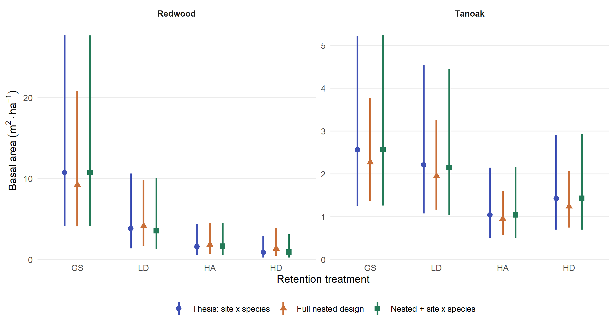
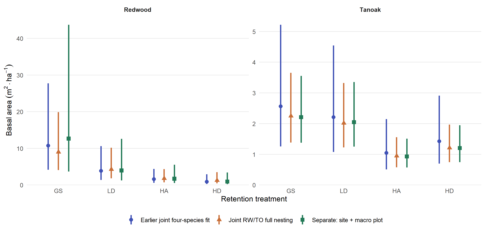



<span id="rd02-record"></span>

How does regeneration basal area differ among the retained-overstory treatments,
and how sensitive is that pattern to the way we represent species and sampling
groups? We'll work from the historical display through joint and separate-species
comparisons to the current publication figure. The current analysis models
redwood, tanoak, Douglas-fir, and other species separately with
`ba_ha ~ treat + (1 | site/treat)`, using zero-inflated Gamma responses and
category-specific zero and dispersion intercepts. The choice follows the
biological interpretation of separate species responses and variances.
There are four sites, 16 macro plots, and 64 vegetation-plot observations
per category; no plot-level random effect is included.

## Running this task

Render normally to review saved results. Add `-P recompute:true` to refresh
calculations from saved models, or `-P refit:true` to refit every comparison and
selected species model. Files are overwritten directly; a failed run may leave
partially updated outputs.

Each calculation is followed immediately by its table or figure in the same cell.
The calculation inside `if (recompute)` runs only when requested; the result display
runs every time, reading the current saved artifact.

## Shared setup

The hidden setup loads the shared F01 helpers and enables automatic chunk
labels before any code is displayed.

```{r}
#| label: rd02-setup
#| include: false

if (!file.exists("outputs/helpers/task-helpers.rds"))
  stop("Saved helpers are missing. Run quarto render task-f01.qmd first.")
invisible(list2env(readRDS("outputs/helpers/task-helpers.rds"), envir = knitr::knit_global()))
enable_chunk_labels()
```

Next we'll choose whether to review,
recompute, or refit. The mode table below identifies which kind of run we're
reading. An ordinary render uses saved results, so reviewing the comparisons
does not require fitting the models again.

```{r}
#| label: rd02-parameters
#| echo: true

recompute <- isTRUE(params$recompute) || isTRUE(params$refit)
data.frame(Mode = if (isTRUE(params$refit)) "Refit and recompute" else if (recompute) "Recompute from saved models" else "Review saved results")
```

## Historical reference display {#rd02-01}

We'll start with the exported thesis reference estimates to establish what the
earlier regeneration display showed. The redwood and tanoak values below provide
a baseline for judging how the revised models affect treatment means and
uncertainty. This step copies saved reference tables; it does not fit a model.

```{r}
#| label: rd02-01
#| echo: true
#| message: false
#| warning: false

if (recompute) {
  publication_root <- normalizePath(getwd(), winslash = "/")
  paths_common <- publication_paths(publication_root)
  suppressPackageStartupMessages({
    library(glmmTMB)
    library(dplyr)
    library(ggplot2)
    library(marginaleffects)
  })
  input <- file.path(paths_common$input, "regeneration-measurements.rds")
  saved <- list(regen_pa = readRDS(input))
  out <- file.path(paths_common$output, "regeneration")
  for (directory in c("figures", "tables", "inference-audit", "manifests"))
    dir.create(file.path(out, directory), recursive = TRUE, showWarnings = FALSE)
  reference_root <- file.path(paths_common$input, "regeneration")
  for (directory in c("tables", "inference-audit")) {
    files <- list.files(file.path(reference_root, directory), full.names = TRUE)
    stopifnot(all(file.copy(files, file.path(out, directory), overwrite = TRUE)))
  }
  estimates <- read.csv(file.path(out, "tables/rd02-basal-area-model-estimates.csv"))
  estimates$treat <- factor(estimates$treat, levels = c("gs", "ld", "ha", "hd"))
  estimates$spp <- factor(estimates$spp, levels = c("rw", "to", "df", "other"))
  variance <- unique(estimates$random_intercept_variance)
  multiplier <- unique(estimates$integration_multiplier)
}

historical_estimates <- read.csv("outputs/regeneration/tables/rd02-basal-area-model-estimates.csv")
publication_table(subset(historical_estimates, spp %in% c("rw", "to"),
             select = c(spp, treat, estimate, lcl, ucl)))
```

Plotting those reference means makes the treatment pattern and interval widths
easier to see before we change the model structure. The figure below uses the
exported estimates and their existing intervals, and remains available for
comparison with the revised displays later on this page.

```{r}
#| label: fig-rd02-historical-reference
#| echo: true
#| message: false
#| warning: false
#| out-width: "100%"
#| fig-cap: "Historical thesis reference: exported redwood and tanoak mean basal area and 95% confidence intervals. No model is fitted in this step."

# fig-rd02-historical-reference
if (recompute) {
  display <- filter(estimates, spp %in% c("rw", "to"))
  pos <- position_dodge(width = .44)
  figure <- ggplot(display, aes(treat, estimate, ymin = lcl, ymax = ucl,
                               color = spp, group = spp)) +
    geom_linerange(linewidth = 1.6, position = pos) +
    geom_point(aes(shape = spp), fill = "black", color = "white", stroke = .6,
               size = 2.8, position = pos) +
    scale_color_manual(values = c(rw = "#3F51B5", to = "#C96F38"),
                       labels = c(rw = "Redwood", to = "Tanoak")) +
    scale_shape_manual(values = c(rw = 21, to = 24),
                       labels = c(rw = "Redwood", to = "Tanoak")) +
    scale_x_discrete(labels = c(gs = "GS", ld = "LD", ha = "HA", hd = "HD")) +
    scale_y_continuous(limits = c(0, NA), breaks = seq(0, 30, 5),
                       expand = expansion(mult = c(0, .06))) +
    labs(x = "Retention treatment", y = expression(Basal~area~(m^2 %.% ha^-1)),
         color = NULL, shape = NULL) +
    theme_minimal(base_size = 12) +
    theme(legend.position = "top", panel.grid.minor = element_blank(),
          panel.grid.major.x = element_blank(), axis.title.y = element_text(margin = margin(r = 10)))
  figure_path <- file.path(out, "figures/rd02-regeneration-basal-area.png")
  ggsave(figure_path, figure, width = 7, height = 4.4, dpi = 320, bg = "white")
  ggsave(sub("png$", "pdf", figure_path), figure, width = 7, height = 4.4)

  provenance <- list(
    task = "RD02", status = "Draft pending scientific and display review",
    generator = "task-rd02.qmd#rd02-01",
    source_object = "exported historical mba reference", model_refitted = FALSE,
    historical_reference = "publication/inputs/thesis/regeneration",
    historical_replay = "analysis/scripts/export-publication-inputs.R using thesis R and renv",
    family = "zero-inflated Gamma (log conditional link; logit zero link)",
    n_species_plot_rows = nrow(saved$regen_pa), n_vegetation_plots = 64L,
    n_macro_plots = 16L, n_sites = 4L,
    random_intercept_variance = variance, integration_multiplier = multiplier,
    site_weights = "equal; no site fixed effects, so integrated expectations coincide across site rows",
    interval = "95% log-scale delta method; full nonrandom parameter covariance including log SD",
    checks = "Historical 16-cell prediction, gradient, and quadrature checks executed by thesis exporter; export checksums can be validated explicitly",
    review = "Retained thesis site:species intercept does not explicitly model macro-plot clustering; manuscript design review remains open. Intervals condition on this model."
  )
  yaml::write_yaml(provenance, file.path(out, "manifests/rd02-figure-provenance.yml"))
  writeLines(capture.output(sessionInfo()), file.path(out, "manifests/rd02-session-info.txt"))
}

knitr::include_graphics("outputs/regeneration/figures/rd02-regeneration-basal-area.png")
```


## Integrated means and uncertainty

To compare models meaningfully, we need their estimates to describe the same
quantity: arithmetic expected basal area, including plots where a species is
absent. We'll define a shared calculation that includes modeled zeros and
integrates over independent Gaussian random intercepts. Its intervals carry the
full parameter covariance, including uncertainty in random-effect variances.
The later estimate tables use this calculation, checked against numerical
predictions, derivatives, and quadrature.

```{r}
#| label: rd02-integrated-means
#| echo: true

integrated_means <- function(m, id, species = NULL) {
  stopifnot(m$fit$convergence == 0, m$sdr$pdHess)
  frame <- model.frame(m)
  if (!"spp" %in% names(frame)) frame$spp <- species
  grid <- distinct(frame, site, treat, spp, .keep_all = TRUE)
  labels <- distinct(grid, treat, spp)
  A <- t(vapply(seq_len(nrow(labels)), function(i) {
    keep <- grid$treat == labels$treat[i] & grid$spp == labels$spp[i]
    as.numeric(keep) / sum(keep)
  }, numeric(nrow(grid))))
  stopifnot(all(rowSums(A > 0) == 4L), family(m)$link == "log",
            length(VarCorr(m)$zi) == 0L,
            all(vapply(VarCorr(m)$cond, function(v) identical(dim(v), c(1L, 1L)), logical(1))))
  X <- model.matrix(delete.response(terms(formula(m, fixed.only = TRUE))), grid)
  Z <- model.matrix(formula(m, component = "zi", fixed.only = TRUE), grid)
  b <- m$fit$par
  ib <- which(names(b) == "beta")
  iz <- which(names(b) == "betazi")
  it <- which(names(b) == "theta")
  stopifnot(identical(colnames(X), names(fixef(m)$cond)),
            identical(colnames(Z), names(fixef(m)$zi)),
            length(it) == length(VarCorr(m)$cond),
            isTRUE(all.equal(unname(b), unname(m$sdr$par.fixed))))
  variance <- sum(exp(2 * b[it]))
  pzero <- plogis(drop(Z %*% b[iz]))
  mu <- exp(drop(X %*% b[ib]) + variance / 2) * (1 - pzero)
  D <- matrix(0, nrow(grid), length(b))
  D[, ib] <- mu * X
  D[, iz] <- -mu * pzero * Z
  D[, it] <- outer(mu, exp(2 * b[it]))
  G <- A %*% D
  estimate <- drop(A %*% mu)
  se <- sqrt(diag(G %*% m$sdr$cov.fixed %*% t(G)))
  functional <- function(b) drop(A %*% (
    exp(drop(X %*% b[ib]) + sum(exp(2 * b[it])) / 2) *
      (1 - plogis(drop(Z %*% b[iz])))))
  numeric_G <- numDeriv::jacobian(functional, unname(b))
  quadrature <- integrate(function(z) exp(sqrt(variance) * z) * dnorm(z), -12, 12)$value
  stopifnot(max(abs(G - numeric_G) / pmax(1, abs(G))) < 1e-5,
            max(abs(mu / exp(variance / 2) - predict(m, grid, type = "response", re.form = NA))) < 1e-7,
            abs(quadrature - exp(variance / 2)) < 1e-8,
            all(is.finite(se)), all(se > 0),
            abs(sum(vapply(VarCorr(m)$cond, function(v) v[1, 1], numeric(1))) - variance) < 1e-9)
  mutate(labels, model_id = id, estimate = estimate, se = se,
    lcl = estimate * exp(-qnorm(.975) * se / estimate),
    ucl = estimate * exp(qnorm(.975) * se / estimate),
    total_random_variance = variance, integration_multiplier = exp(variance / 2))
}
```

## Joint random-effect comparison {#rd02-02}

The historical model represents site-by-species variation, but the field design
also groups observations within macro plots and vegetation plots. We'll compare
three joint models to see how representing that clustering changes model support
and estimated variation. All use the same 256 rows, so their fit statistics are
comparable; the tables below show fit quality, variance components, and residual
checks. Recompute reads saved fits, while refit runs the optimizers.

```{r}
#| label: rd02-02
#| echo: true
#| message: false
#| warning: false

if (recompute) {
  publication_root <- normalizePath(getwd(), winslash = "/")
  paths_common <- publication_paths(publication_root)
  suppressPackageStartupMessages({
    library(glmmTMB)
    library(dplyr)
    library(ggplot2)
    library(DHARMa)
  })
  input <- file.path(paths_common$input, "regeneration-measurements.rds")
  saved <- list(regen_pa = readRDS(input))
  saved_reference <- readRDS(file.path(paths_common$input, "regeneration/saved-model-reference.rds"))
  d <- as.data.frame(saved$regen_pa)
  d$site <- factor(d$site)
  d$plot <- factor(d$plot)
  stopifnot(nrow(d) == 256L, !anyNA(d),
            nrow(distinct(d, site, treat, plot)) == 64L,
            all(count(d, site, treat, plot)$n == 4L),
            all(count(d, site, treat, spp)$n == 4L),
            isTRUE(all.equal(d$ba_ha, saved_reference$response)))
  out <- file.path(paths_common$output, "regeneration/random-effects-comparison")
  for (directory in c("models", "diagnostics", "tables", "figures", "manifests")) {
    dir.create(file.path(out, directory), recursive = TRUE, showWarnings = FALSE)
  }
  formulas <- list(
    thesis_site_species = ba_ha ~ treat * spp + (1 | site:spp),
    full_nested = ba_ha ~ treat * spp + (1 | site/treat/plot),
    nested_plus_site_species = ba_ha ~ treat * spp + (1 | site/treat/plot) + (1 | site:spp)
  )
  models <- list()
  records <- list()
  variance_records <- list()
  diagnostic_records <- list()
  seed <- 20261030L
  simulations <- 1000L

  test_record <- function(sim, id, scope) {
    tests <- list(uniformity = DHARMa::testUniformity,
                  dispersion = DHARMa::testDispersion,
                  outliers = DHARMa::testOutliers,
                  zero_inflation = DHARMa::testZeroInflation)
    bind_rows(lapply(names(tests), function(name) {
      result <- tests[[name]](sim, plot = FALSE)
      data.frame(model_id = id, scope = scope, test = name,
                 statistic = unname(result$statistic)[1], p_value = result$p.value)
    }))
  }

  for (id in names(formulas)) {
    message(if (isTRUE(params$refit)) "Fitting " else "Reading saved fit ", id)
    fit_warnings <- character()
    fit <- if (isTRUE(params$refit)) {
  withCallingHandlers(
      glmmTMB(formulas[[id]], data = d, family = ziGamma(link = "log"),
              ziformula = ~spp, dispformula = ~spp,
              control = glmmTMBControl(optCtrl = list(iter.max = 10000, eval.max = 10000))),
      warning = function(w) {
        fit_warnings <<- c(fit_warnings, conditionMessage(w))
        invokeRestart("muffleWarning")
      }
    )
    } else {
      read_saved_model(file.path(out, "models", paste0(id, ".rds")), "RD02")
    }
    if (!isTRUE(params$refit)) {
      saved_register <- read.csv(file.path(out, "tables/rd02-model-comparison.csv"))
      fit_warnings <- stats::na.omit(saved_register$warnings[saved_register$model_id == id])
    }
    models[[id]] <- fit
    if (isTRUE(params$refit)) saveRDS(fit, file.path(out, "models", paste0(id, ".rds")))
    vc <- VarCorr(fit)$cond
    variance_records[[id]] <- bind_rows(lapply(names(vc), function(group) {
      data.frame(model_id = id, group = group,
        n_groups = length(unique(model.frame(fit)[["site"]])),
        variance = vc[[group]][1, 1], sd = sqrt(vc[[group]][1, 1]))
    }))
    # Count actual unique design groups, rather than the reused plot/corner codes.
    variance_records[[id]]$n_groups <- vapply(variance_records[[id]]$group, function(g) {
      vars <- strsplit(g, ":", fixed = TRUE)[[1]]
      nrow(unique(d[vars]))
    }, integer(1))
    ll <- logLik(fit)
    records[[id]] <- data.frame(
      model_id = id, formula = paste(deparse(formulas[[id]]), collapse = " "),
      n = nobs(fit), k = attr(ll, "df"), log_likelihood = as.numeric(ll),
      AIC = AIC(fit), BIC = BIC(fit), convergence = fit$fit$convergence,
      pd_hessian = fit$sdr$pdHess,
      max_abs_gradient = max(abs(fit$sdr$gradient.fixed)),
      min_random_sd = min(variance_records[[id]]$sd),
      near_boundary_sd_lt_1e_3 = any(variance_records[[id]]$sd < 1e-3),
      warnings = paste(unique(fit_warnings), collapse = " | ")
    )
    # glmmTMB's simulation in this installed version draws new random effects.
    # Explicitly record the version and use the same seed and n for all models.
    sim <- publication_simulate_residuals(fit, n = simulations, seed = seed, refit = FALSE, plot = FALSE)
    saveRDS(sim, file.path(out, "models", paste0(id, "-dharma.rds")))
    diagnostic_records[[id]] <- test_record(sim, id, "species_plot_rows")
    # Recalculate residuals on aggregated responses to inspect each design level.
    groups <- list(site = d$site, macro_plot = interaction(d$site, d$treat, drop = TRUE),
                   vegetation_plot = interaction(d$site, d$treat, d$plot, drop = TRUE))
    for (scope in names(groups)) {
      grouped <- recalculateResiduals(sim, group = groups[[scope]], seed = seed)
      diagnostic_records[[id]] <- bind_rows(diagnostic_records[[id]], test_record(grouped, id, scope))
    }
    png(file.path(out, "diagnostics", paste0(id, "-dharma.png")),
        width = 1800, height = 1000, res = 160)
    plot(sim)
    dev.off()
    png(file.path(out, "diagnostics", paste0(id, "-by-species-treatment.png")),
        width = 1800, height = 1000, res = 160)
    old_par <- par(mfrow = c(1, 2))
    plotResiduals(sim, form = d$spp)
    plotResiduals(sim, form = d$treat)
    par(old_par)
    dev.off()
  }
  comparison <- bind_rows(records) |>
    mutate(delta_AIC = AIC - min(AIC[convergence == 0 & pd_hessian], na.rm = TRUE))
  variance_table <- bind_rows(variance_records)
  diagnostics <- bind_rows(diagnostic_records)
  write.csv(comparison, file.path(out, "tables/rd02-model-comparison.csv"), row.names = FALSE)
  write.csv(variance_table, file.path(out, "tables/rd02-random-effect-variances.csv"), row.names = FALSE)
  write.csv(diagnostics, file.path(out, "tables/rd02-dharma-tests.csv"), row.names = FALSE)
}

htmltools::tagList(
  publication_table(read.csv("outputs/regeneration/random-effects-comparison/tables/rd02-model-comparison.csv")),
  publication_table(read.csv("outputs/regeneration/random-effects-comparison/tables/rd02-random-effect-variances.csv")),
  publication_table(read.csv("outputs/regeneration/random-effects-comparison/tables/rd02-dharma-tests.csv"))
)
```

A variance estimate near zero could reflect little detectable variation at that
level or difficulty locating the optimum. We'll check the design-model fits
with BFGS, starting random-effect SDs at 0.3. The table reports whether the
objective agrees within 1e-4, helping us assess whether the boundary estimates
depend on the fitting route.

```{r}
#| label: rd02-02-optimizer
#| echo: true
#| message: false
#| warning: false

if (recompute) {
  # Boundary components warrant an optimizer/start sensitivity check. Start each
  # random SD at 0.3 rather than inheriting the near-zero nlminb estimates.
  optimizer_checks <- bind_rows(lapply(c("full_nested", "nested_plus_site_species"), function(id) {
    message("Checking BFGS optimizer/start sensitivity: ", id)
    warnings <- character()
    check <- if (isTRUE(params$refit)) {
  withCallingHandlers(update(models[[id]],
      start = list(theta = rep(log(.3), sum(names(models[[id]]$fit$par) == "theta"))),
      control = glmmTMBControl(optimizer = optim, optArgs = list(method = "BFGS"),
                              optCtrl = list(maxit = 10000, reltol = 1e-10))),
      warning = function(w) {
        warnings <<- c(warnings, conditionMessage(w))
        invokeRestart("muffleWarning")
      })
    } else {
      read_saved_model(file.path(out, "models", paste0(id, "-bfgs.rds")), "RD02")
    }
    if (isTRUE(params$refit)) saveRDS(check, file.path(out, "models", paste0(id, "-bfgs.rds")))
    difference <- check$fit$objective - models[[id]]$fit$objective
    stopifnot(check$fit$convergence == 0, abs(difference) < 1e-4)
    data.frame(model_id = id, optimizer = "BFGS; initial random SDs 0.3",
      convergence = check$fit$convergence, pd_hessian = check$sdr$pdHess,
      objective_difference_from_nlminb = difference,
      warnings = paste(unique(warnings), collapse = " | "))
  }))
  write.csv(optimizer_checks, file.path(out, "tables/rd02-optimizer-sensitivity.csv"), row.names = FALSE)
}

publication_table(read.csv("outputs/regeneration/random-effects-comparison/tables/rd02-optimizer-sensitivity.csv"))
```

The historical model's residual check flagged the tails, so we'll examine
whether that signal persists with 10,000 simulations and another seed. The
repeated tests and flagged rows below show how sensitive the finding is to
simulation. We retain every observation while investigating the flag.

```{r}
#| label: rd02-02-tail-check
#| echo: true
#| message: false
#| warning: false

if (recompute) {
  # Inspect the baseline tail flag without removing observations or changing the
  # fit. More simulations and a second seed check Monte Carlo sensitivity.
  tail_check <- publication_simulate_residuals(models$thesis_site_species, n = 10000,
                                  seed = seed + 1L, refit = FALSE, plot = FALSE)
  tail_tests <- test_record(tail_check, "thesis_site_species", "species_plot_rows_10000_simulations")
  write.csv(tail_tests, file.path(out, "tables/rd02-baseline-tail-sensitivity.csv"), row.names = FALSE)
  tail_rows <- bind_rows(lapply(c(1000L, 10000L), function(n) {
    residuals <- if (n == 1000L) readRDS(file.path(out, "models/thesis_site_species-dharma.rds"))$scaledResiduals else
      tail_check$scaledResiduals
    d |>
      mutate(row_id = seq_len(nrow(d)), n_simulations = n, dharma_residual = residuals) |>
      filter(dharma_residual < 1 / (n + 1) | dharma_residual > 1 - 1 / (n + 1))
  }))
  write.csv(tail_rows, file.path(out, "tables/rd02-baseline-tail-observations.csv"), row.names = FALSE)
}

htmltools::tagList(
  publication_table(read.csv("outputs/regeneration/random-effects-comparison/tables/rd02-baseline-tail-sensitivity.csv")),
  publication_table(read.csv("outputs/regeneration/random-effects-comparison/tables/rd02-baseline-tail-observations.csv"))
)
```

Do the alternative clustering assumptions change the treatment means enough to
matter for the regeneration story? We'll calculate integrated means and
full-covariance intervals for each converged joint model. The tables show the
estimates and their changes from the historical structure, with common zero and
dispersion specifications so the comparison focuses on random-effect structure.

```{r}
#| label: rd02-02-integrated-estimates
#| echo: true
#| message: false
#| warning: false

if (recompute) {
  # Integrate each candidate over ALL of its independent conditional random
  # intercepts. Zero and dispersion specifications are identical across models.
  eligible <- comparison$model_id[comparison$convergence == 0 & comparison$pd_hessian]
  estimates <- bind_rows(lapply(eligible, function(id) integrated_means(models[[id]], id)))
  baseline <- filter(estimates, model_id == "thesis_site_species") |>
    select(treat, spp, baseline_mean = estimate, baseline_lcl = lcl, baseline_ucl = ucl)
  estimates <- left_join(estimates, baseline, by = c("treat", "spp")) |>
    mutate(mean_percent_change = 100 * (estimate / baseline_mean - 1),
           ci_width_ratio = (ucl - lcl) / (baseline_ucl - baseline_lcl))
  write.csv(estimates, file.path(out, "tables/rd02-integrated-model-comparison.csv"), row.names = FALSE)
}

publication_table(read.csv("outputs/regeneration/random-effects-comparison/tables/rd02-integrated-model-comparison.csv"))
```

We'll put the redwood and tanoak estimates side by side to see which treatment
patterns persist across the joint models and where uncertainty changes. The
figure helps assess the practical consequences of the covariance choice;
the fit and residual evidence above still informs that choice.

```{r}
#| label: fig-rd02-joint-models
#| echo: true
#| message: false
#| warning: false
#| out-width: "100%"
#| fig-cap: "Joint covariance structures on the same 256 rows: integrated arithmetic mean basal area including zeros and 95% confidence intervals. Species panels have different vertical scales."

# fig-rd02-joint-models
if (recompute) {
  model_labels <- c(thesis_site_species = "Thesis: site x species",
                    full_nested = "Full nested design",
                    nested_plus_site_species = "Nested + site x species")
  display <- estimates |>
    filter(spp %in% c("rw", "to")) |>
    mutate(model_id = factor(model_id, levels = names(formulas)),
           spp = factor(spp, levels = c("rw", "to")))
  position <- position_dodge(width = .58)
  figure <- ggplot(display, aes(treat, estimate, ymin = lcl, ymax = ucl,
                               color = model_id, shape = model_id, group = model_id)) +
    geom_linerange(linewidth = 1, position = position) +
    geom_point(size = 2.4, position = position) +
    facet_wrap(~spp, nrow = 1, scales = "free_y",
               labeller = as_labeller(c(rw = "Redwood", to = "Tanoak"))) +
    scale_color_manual(values = c("#3F51B5", "#C96F38", "#237A57"), labels = model_labels) +
    scale_shape_manual(values = c(16, 17, 15), labels = model_labels) +
    scale_x_discrete(labels = toupper) +
    scale_y_continuous(limits = c(0, NA), expand = expansion(mult = c(0, .06))) +
    labs(x = "Retention treatment", y = expression(Basal~area~(m^2 %.% ha^-1)),
         color = NULL, shape = NULL) +
    theme_minimal(base_size = 11) +
    theme(legend.position = "bottom", panel.grid.minor = element_blank(),
          panel.grid.major.x = element_blank(), strip.text = element_text(face = "bold"))
  figure_file <- file.path(out, "figures/rd02-random-effects-comparison.png")
  ggsave(figure_file, figure, width = 9, height = 4.8, dpi = 300, bg = "white")
  ggsave(sub("png$", "pdf", figure_file), figure, width = 9, height = 4.8)
  provenance <- list(
    task = "RD02 random-effects comparison", source = "publication/inputs/thesis/regeneration-measurements.rds",
    data = "same 256 species-plot rows; 4 sites, 16 treatment macro plots, 64 vegetation plots",
    candidate_formulas = lapply(formulas, function(f) paste(deparse(f), collapse = " ")),
    fixed_components = "ziGamma(log); conditional treat*spp; zero ~spp; dispersion ~spp",
    fit = "maximum likelihood; nlminb; iter.max=eval.max=10000",
    diagnostics = list(seed = seed, simulations = simulations, refit = FALSE,
                       random_effect_simulation = "unconditional glmmTMB simulate default in installed version",
                       baseline_tail_sensitivity = "10000 simulations; seed 20261031"),
    optimizer_sensitivity = "BFGS from random SDs 0.3, objective checked within 1e-4 of nlminb",
    means = "exact integration over all conditional Gaussian random intercepts, including zeros",
    intervals = "95% log-scale delta method with full parameter covariance",
    tests = "AIC comparison; primary covariance structures are not nested in one another, so no ordinary LRT",
    selection = "comparison only; original lead figure and model not replaced"
  )
  yaml::write_yaml(provenance, file.path(out, "manifests/rd02-comparison-provenance.yml"))
  writeLines(capture.output(sessionInfo()), file.path(out, "manifests/rd02-comparison-session-info.txt"))
}


```


## Separate-species comparison {#rd02-03}

Redwood and tanoak may differ in their site and macro-plot variation as well as
their mean responses. We'll explore separate models that give each species its
own variance components, then compare them with joint alternatives fitted to
the same 128 redwood/tanoak rows. The fit, variance, and diagnostic tables below
show what those assumptions imply for the two focal species.

```{r}
#| label: rd02-03
#| echo: true
#| message: false
#| warning: false

if (recompute) {
  publication_root <- normalizePath(getwd(), winslash = "/")
  paths_common <- publication_paths(publication_root)
  suppressPackageStartupMessages({
    library(glmmTMB)
    library(DHARMa)
    library(dplyr)
    library(ggplot2)
  })
  input <- file.path(paths_common$input, "regeneration-measurements.rds")
  saved <- list(regen_pa = readRDS(input))
  d <- droplevels(subset(as.data.frame(saved$regen_pa), spp %in% c("rw", "to")))
  d$site <- factor(d$site)
  d$plot <- factor(d$plot)
  stopifnot(nrow(d) == 128L, !anyNA(d),
            nrow(distinct(d, site, treat, plot)) == 64L,
            all(count(d, site, treat, plot)$n == 2L))
  out <- file.path(paths_common$output, "regeneration/separate-species-comparison")
  for (directory in c("models", "tables", "diagnostics", "figures", "manifests")) {
    dir.create(file.path(out, directory), recursive = TRUE, showWarnings = FALSE)
  }
  spec <- list(
    rw_site_macro = list(species = "rw", formula = ba_ha ~ treat + (1 | site/treat)),
    to_site_macro = list(species = "to", formula = ba_ha ~ treat + (1 | site/treat)),
    joint_site_species_rwto = list(species = NULL, formula = ba_ha ~ treat*spp + (1 | site:spp)),
    joint_full_nested_rwto = list(species = NULL, formula = ba_ha ~ treat*spp + (1 | site/treat/plot)),
    joint_combined_rwto = list(species = NULL, formula = ba_ha ~ treat*spp + (1 | site/treat/plot) + (1 | site:spp))
  )
  models <- list()
  fit_records <- variance_records <- diagnostic_records <- list()
  seed <- 20261030L
  for (id in names(spec)) {
    item <- spec[[id]]
    model_data <- if (is.null(item$species)) d else droplevels(d[d$spp == item$species, ])
    if (!is.null(item$species)) {
      stopifnot(nrow(model_data) == 64L, all(count(model_data, site, treat, plot)$n == 1L))
    }
    message(if (isTRUE(params$refit)) "Fitting " else "Reading saved fit ", id)
    warnings <- character()
    m <- if (isTRUE(params$refit)) {
  withCallingHandlers(
      glmmTMB(item$formula, data = model_data, family = ziGamma(link = "log"),
              ziformula = if (is.null(item$species)) ~spp else ~1,
              dispformula = if (is.null(item$species)) ~spp else ~1,
              control = glmmTMBControl(optCtrl = list(iter.max = 10000, eval.max = 10000))),
      warning = function(w) {
        warnings <<- c(warnings, conditionMessage(w))
        invokeRestart("muffleWarning")
      })
    } else {
      read_saved_model(file.path(out, "models", paste0(id, ".rds")), "RD02")
    }
    if (!isTRUE(params$refit)) {
      saved_register <- read.csv(file.path(out, "tables/rd02-species-fit-register.csv"))
      warnings <- stats::na.omit(saved_register$warnings[saved_register$model_id == id])
    }
    models[[id]] <- m
    if (!is.null(item$species)) {
      stopifnot(setequal(names(VarCorr(m)$cond), c("site", "treat:site")),
                !"plot" %in% names(model.frame(m)))
    }
    if (isTRUE(params$refit)) saveRDS(m, file.path(out, "models", paste0(id, ".rds")))
    vc <- VarCorr(m)$cond
    variance_records[[id]] <- bind_rows(lapply(names(vc), function(g) {
      variables <- strsplit(g, ":", fixed = TRUE)[[1]]
      data.frame(model_id = id, group = g, n_groups = nrow(unique(model_data[variables])),
                 variance = vc[[g]][1, 1], sd = sqrt(vc[[g]][1, 1]))
    }))
    ll <- logLik(m)
    fit_records[[id]] <- data.frame(
      model_id = id, dataset = if (is.null(item$species)) "RW+TO" else toupper(item$species),
      n = nobs(m), n_zero = sum(model_data$ba_ha == 0), k = attr(ll, "df"),
      log_likelihood = as.numeric(ll), AIC = AIC(m), convergence = m$fit$convergence,
      pd_hessian = m$sdr$pdHess, max_abs_gradient = max(abs(m$sdr$gradient.fixed)),
      warnings = paste(unique(warnings), collapse = " | "))
    sim <- publication_simulate_residuals(m, n = 1000, seed = seed, refit = FALSE, plot = FALSE)
    tests <- list(uniformity = testUniformity, dispersion = testDispersion,
                  outliers = testOutliers, zero_inflation = testZeroInflation)
    diagnostic_records[[id]] <- bind_rows(lapply(names(tests), function(test) {
      result <- tests[[test]](sim, plot = FALSE)
      data.frame(model_id = id, test = test, statistic = unname(result$statistic)[1],
                 p_value = result$p.value)
    }))
    png(file.path(out, "diagnostics", paste0(id, "-dharma.png")),
        width = 1800, height = 1000, res = 160)
    plot(sim)
    dev.off()
    png(file.path(out, "diagnostics", paste0(id, "-by-treatment.png")),
        width = 1200, height = 1000, res = 160)
    plotResiduals(sim, form = model_data$treat)
    dev.off()
  }
  fit_table <- bind_rows(fit_records)
  variances <- bind_rows(variance_records)
  diagnostics <- bind_rows(diagnostic_records)
  stopifnot(all(fit_table$convergence == 0), all(fit_table$pd_hessian))
  write.csv(fit_table, file.path(out, "tables/rd02-species-fit-register.csv"), row.names = FALSE)
  write.csv(variances, file.path(out, "tables/rd02-species-variance-components.csv"), row.names = FALSE)
  write.csv(diagnostics, file.path(out, "tables/rd02-species-dharma-tests.csv"), row.names = FALSE)
}

htmltools::tagList(
  publication_table(read.csv("outputs/regeneration/separate-species-comparison/tables/rd02-species-fit-register.csv")),
  publication_table(read.csv("outputs/regeneration/separate-species-comparison/tables/rd02-species-variance-components.csv")),
  publication_table(read.csv("outputs/regeneration/separate-species-comparison/tables/rd02-species-dharma-tests.csv"))
)
```

To assess relative support for separate versus joint fits, we need likelihoods
for the same observations. We'll add the two independent species log likelihoods
and parameter counts to represent the separate pair in the AIC table below.
That pair can be compared with the joint 128-row fits; individual-species AICs
and the earlier 256-row AICs answer different comparisons.

```{r}
#| label: rd02-03-paired-aic
#| echo: true
#| message: false
#| warning: false

if (recompute) {
  # A pair of independent species models has a product likelihood on these same
  # 128 rows; sum log likelihoods AND parameter counts. Do not compare the 64-row
  # individual AICs, or this paired AIC, against the earlier 256-row model AICs.
  separate <- filter(fit_table, dataset != "RW+TO")
  stopifnot(nrow(separate) == 2L, all(separate$k == 8L))
  joint <- filter(fit_table, dataset == "RW+TO")
  comparison <- bind_rows(
    transmute(joint, model_id, n, k, log_likelihood, AIC),
    data.frame(model_id = "separate_site_macro_pair", n = sum(separate$n),
      k = sum(separate$k), log_likelihood = sum(separate$log_likelihood), AIC = sum(separate$AIC))
  ) |>
    mutate(delta_AIC = AIC - min(AIC))
  stopifnot(all(comparison$n == 128L),
            max(abs(comparison$AIC - (-2 * comparison$log_likelihood + 2 * comparison$k))) < 1e-8)
  write.csv(comparison, file.path(out, "tables/rd02-rwto-aic-comparison.csv"), row.names = FALSE)
}

publication_table(read.csv("outputs/regeneration/separate-species-comparison/tables/rd02-rwto-aic-comparison.csv"))
```

Before interpreting the separate-species estimates, we'll check whether a second
optimizer reaches the same objective from random-effect SDs of 0.3. Agreement
and convergence in the table below help us judge the numerical stability of
these fits, especially where a variance component approaches zero.

```{r}
#| label: rd02-03-optimizer
#| echo: true
#| message: false
#| warning: false

if (recompute) {
  # Check the requested fits against a different optimizer and initial SDs.
  optimizer_checks <- bind_rows(lapply(c("rw_site_macro", "to_site_macro"), function(id) {
    model_data <- droplevels(d[d$spp == spec[[id]]$species, ])
    m <- models[[id]]
    warnings <- character()
    check <- if (isTRUE(params$refit)) {
  withCallingHandlers(glmmTMB(spec[[id]]$formula, data = model_data,
      family = ziGamma(link = "log"), ziformula = ~1, dispformula = ~1,
      start = list(theta = rep(log(.3), 2)),
      control = glmmTMBControl(optimizer = optim, optArgs = list(method = "BFGS"),
                              optCtrl = list(maxit = 10000, reltol = 1e-10))),
      warning = function(w) {
        warnings <<- c(warnings, conditionMessage(w))
        invokeRestart("muffleWarning")
      })
    } else {
      read_saved_model(file.path(out, "models", paste0(id, "-bfgs.rds")), "RD02")
    }
    difference <- check$fit$objective - m$fit$objective
    if (isTRUE(params$refit)) saveRDS(check, file.path(out, "models", paste0(id, "-bfgs.rds")))
    stopifnot(check$fit$convergence == 0, abs(difference) < 1e-4)
    data.frame(model_id = id, convergence = check$fit$convergence, pd_hessian = check$sdr$pdHess,
      objective_difference_from_nlminb = difference, warnings = paste(unique(warnings), collapse = " | "))
  }))
  write.csv(optimizer_checks, file.path(out, "tables/rd02-species-optimizer-checks.csv"), row.names = FALSE)
}

publication_table(read.csv("outputs/regeneration/separate-species-comparison/tables/rd02-species-optimizer-checks.csv"))
```

We'll now translate the eligible redwood/tanoak fits into the same integrated
mean basal-area estimand. The estimate table gives treatment means and
full-covariance intervals, allowing us to assess whether separating species
changes the biological pattern or mainly its uncertainty.

```{r}
#| label: rd02-03-integrated-estimates
#| echo: true
#| message: false
#| warning: false

if (recompute) {
  estimates <- bind_rows(lapply(names(models), function(id) {
    integrated_means(models[[id]], id, spec[[id]]$species)
  }))
  write.csv(estimates, file.path(out, "tables/rd02-species-integrated-estimates.csv"), row.names = FALSE)
}

publication_table(read.csv("outputs/regeneration/separate-species-comparison/tables/rd02-species-integrated-estimates.csv"))
```

The focused figure brings those estimates together with the historical
four-species reference. We'll look for treatment patterns that persist and for
intervals that depend strongly on the model structure. The reference is useful
context, while formal AIC comparisons remain restricted to the same fitting data.

```{r}
#| label: fig-rd02-separate-species-comparison
#| echo: true
#| message: false
#| warning: false
#| out-width: "100%"
#| fig-cap: "Focused species-model sensitivity: the earlier joint four-species fit, joint RW/TO full nesting, and separate species fits with site and macro-plot random intercepts. Points are random-effect-integrated means including zeros; ranges are approximate 95% confidence intervals. Vertical scales differ between species."

# fig-rd02-separate-species-comparison
if (recompute) {
  lead <- read.csv(file.path(paths_common$output, "regeneration/tables/rd02-basal-area-model-estimates.csv")) |>
    filter(spp %in% c("rw", "to")) |>
    transmute(treat, spp, model_id = "joint_four_species_reference", estimate, se, lcl, ucl,
              total_random_variance = random_intercept_variance, integration_multiplier)
  display <- bind_rows(lead, estimates) |>
    filter(model_id %in% c("joint_four_species_reference", "joint_full_nested_rwto", "rw_site_macro", "to_site_macro")) |>
    mutate(comparison = ifelse(model_id %in% c("rw_site_macro", "to_site_macro"), "Separate: site + macro plot",
                               ifelse(model_id == "joint_full_nested_rwto", "Joint RW/TO full nesting", "Earlier joint four-species fit")),
           comparison = factor(comparison, levels = c("Earlier joint four-species fit", "Joint RW/TO full nesting", "Separate: site + macro plot")),
           treat = factor(treat, levels = c("gs", "ld", "ha", "hd")),
           spp = factor(spp, levels = c("rw", "to")))
  position <- position_dodge(width = .58)
  figure <- ggplot(display, aes(treat, estimate, ymin = lcl, ymax = ucl,
                               color = comparison, shape = comparison, group = comparison)) +
    geom_linerange(linewidth = 1, position = position) +
    geom_point(size = 2.4, position = position) +
    facet_wrap(~spp, nrow = 1, scales = "free_y",
               labeller = as_labeller(c(rw = "Redwood", to = "Tanoak"))) +
    scale_color_manual(values = c("#3F51B5", "#C96F38", "#237A57")) +
    scale_shape_manual(values = c(16, 17, 15)) +
    scale_x_discrete(labels = toupper) +
    scale_y_continuous(limits = c(0, NA), expand = expansion(mult = c(0, .06))) +
    labs(x = "Retention treatment", y = expression(Basal~area~(m^2 %.% ha^-1)), color = NULL, shape = NULL) +
    theme_minimal(base_size = 11) +
    theme(legend.position = "bottom", panel.grid.minor = element_blank(),
          panel.grid.major.x = element_blank(), strip.text = element_text(face = "bold"))
  ggsave(file.path(out, "figures/rd02-separate-species-comparison.png"), figure,
         width = 10, height = 4.8, dpi = 300, bg = "white")
  ggsave(file.path(out, "figures/rd02-separate-species-comparison.pdf"), figure, width = 10, height = 4.8)
  provenance <- list(
    task = "RD02 separate species with site and macro-plot random effects",
    data = "64 RW and 64 TO observations; 4 sites, 16 macro plots, 64 vegetation plots per species",
    species_formula = "ba_ha ~ treat + (1 | site/treat); ziGamma(log), zero ~1, dispersion ~1",
    candidate_formulas = lapply(spec, function(item) paste(deparse(item$formula), collapse = " ")),
    joint_comparisons = "all refitted on the SAME 128 RW/TO rows; no AIC comparison with earlier 256-row fits",
    paired_likelihood = "sum species log likelihoods and parameter counts; assumes independence between species",
    diagnostics = "1000 unconditional DHARMa simulations, seed 20261030, plus treatment plots",
    optimizer_sensitivity = "BFGS from all random SDs 0.3; objective agreement checked within 1e-4",
    prediction_checks = "all 32 new model/treatment/species means: predict, numerical gradients, quadrature",
    intervals = "95% log-scale delta method including all conditional random SD uncertainty; approximate near boundary",
    review = "plot-level RE omitted as requested; 4 site and 16 nested macro-plot groups per species",
    selection = "comparison only; writes separate comparison outputs"
  )
  yaml::write_yaml(provenance, file.path(out, "manifests/rd02-species-comparison-provenance.yml"))
  writeLines(capture.output(sessionInfo()), file.path(out, "manifests/rd02-species-comparison-session-info.txt"))
}


```


## Selected four-species models {#rd02-05}

The current publication approach treats each species category as a distinct
biological response, with its own site and macro-plot variation. We'll apply
that choice to all four categories, including Douglas-fir and other species so
the supporting estimates remain complete. The tables below record fit quality,
variance components, residual diagnostics, and optimizer agreement for each model.

```{r}
#| label: rd02-05
#| echo: true
#| message: false
#| warning: false

if (recompute) {
  publication_root <- normalizePath(getwd(), winslash = "/")
  paths_common <- publication_paths(publication_root)
  suppressPackageStartupMessages({library(glmmTMB); library(DHARMa); library(dplyr); library(ggplot2)})
  input <- file.path(paths_common$input, "regeneration-measurements.rds")
  saved <- list(regen_pa = readRDS(input))
  d <- as.data.frame(saved$regen_pa)
  d$site <- factor(d$site)
  d$plot <- factor(d$plot)
  species_order <- c("rw", "to", "df", "other")
  species_labels <- c(rw = "Redwood", to = "Tanoak", df = "Douglas-fir", other = "Other species")
  stopifnot(nrow(d) == 256L, !anyNA(d), setequal(unique(d$spp), species_order))
  out <- file.path(paths_common$output, "regeneration/selected-species-models")
  for (directory in c("models", "tables", "diagnostics", "figures", "manifests")) {
    dir.create(file.path(out, directory), recursive = TRUE, showWarnings = FALSE)
  }
  models <- list()
  fit_records <- variance_records <- diagnostic_records <- optimizer_records <- list()
  seed <- 20261030L
  for (sp in species_order) {
    message(if (isTRUE(params$refit)) "Fitting species category: " else "Reading saved species fit: ", sp)
    data_sp <- droplevels(d[d$spp == sp, ])
    stopifnot(nrow(data_sp) == 64L, n_distinct(data_sp$site) == 4L,
              nrow(distinct(data_sp, site, treat)) == 16L,
              all(count(data_sp, site, treat, plot)$n == 1L))
    warnings <- character()
    m <- if (isTRUE(params$refit)) {
  withCallingHandlers(glmmTMB(
      ba_ha ~ treat + (1 | site/treat), data = data_sp,
      family = ziGamma(link = "log"), ziformula = ~1, dispformula = ~1,
      control = glmmTMBControl(optCtrl = list(iter.max = 10000, eval.max = 10000))),
      warning = function(w) { warnings <<- c(warnings, conditionMessage(w)); invokeRestart("muffleWarning") })
    } else {
      read_saved_model(file.path(out, "models", paste0(sp, "_site_macro.rds")), "RD02")
    }
    stopifnot(m$fit$convergence == 0, m$sdr$pdHess,
              setequal(names(VarCorr(m)$cond), c("site", "treat:site")),
              !"plot" %in% names(model.frame(m)))
    if (!isTRUE(params$refit)) {
      saved_register <- read.csv(file.path(out, "tables/rd02-selected-species-fit-register.csv"))
      warnings <- stats::na.omit(saved_register$warnings[saved_register$spp == sp])
    }
    models[[sp]] <- m
    if (isTRUE(params$refit)) saveRDS(m, file.path(out, "models", paste0(sp, "_site_macro.rds")))
    ll <- logLik(m)
    fit_records[[sp]] <- data.frame(spp = sp, species = species_labels[sp], model_id = paste0(sp, "_site_macro"),
      n = nobs(m), n_zero = sum(data_sp$ba_ha == 0), k = attr(ll, "df"),
      log_likelihood = as.numeric(ll), AIC = AIC(m), convergence = m$fit$convergence,
      pd_hessian = m$sdr$pdHess, max_abs_gradient = max(abs(m$sdr$gradient.fixed)),
      warnings = paste(unique(warnings), collapse = " | "), row.names = NULL)
    variance_records[[sp]] <- bind_rows(lapply(names(VarCorr(m)$cond), function(g) {
      value <- VarCorr(m)$cond[[g]][1, 1]
      data.frame(spp = sp, group = g, n_groups = nrow(unique(data_sp[strsplit(g, ":", fixed = TRUE)[[1]]])),
                 variance = value, sd = sqrt(value))
    }))
    sim <- publication_simulate_residuals(m, n = 1000, seed = seed, refit = FALSE, plot = FALSE)
    tests <- list(uniformity = testUniformity, dispersion = testDispersion,
                  outliers = testOutliers, zero_inflation = testZeroInflation)
    diagnostic_records[[sp]] <- bind_rows(lapply(names(tests), function(test) {
      result <- tests[[test]](sim, plot = FALSE)
      data.frame(spp = sp, test = test, statistic = unname(result$statistic)[1], p_value = result$p.value)
    }))
    png(file.path(out, "diagnostics", paste0(sp, "-dharma.png")), width = 1800, height = 1000, res = 160)
    plot(sim)
    dev.off()
    png(file.path(out, "diagnostics", paste0(sp, "-by-treatment.png")), width = 1200, height = 1000, res = 160)
    plotResiduals(sim, form = data_sp$treat)
    dev.off()
    if (isTRUE(params$refit)) {
    check_warnings <- character()
    alternative <- withCallingHandlers(glmmTMB(
      ba_ha ~ treat + (1 | site/treat), data = data_sp,
      family = ziGamma(link = "log"), ziformula = ~1, dispformula = ~1,
      start = list(theta = rep(log(.3), 2)),
      control = glmmTMBControl(optimizer = optim, optArgs = list(method = "BFGS"),
                              optCtrl = list(maxit = 10000, reltol = 1e-10))),
      warning = function(w) { check_warnings <<- c(check_warnings, conditionMessage(w)); invokeRestart("muffleWarning") })
    saveRDS(alternative, file.path(out, "models", paste0(sp, "_site_macro-bfgs.rds")))
    objective_difference <- alternative$fit$objective - m$fit$objective
    stopifnot(alternative$fit$convergence == 0, abs(objective_difference) < 1e-4)
    optimizer_records[[sp]] <- data.frame(spp = sp, convergence = alternative$fit$convergence,
      pd_hessian = alternative$sdr$pdHess, objective_difference_from_nlminb = objective_difference,
      warnings = paste(unique(check_warnings), collapse = " | "))
    } else {
      saved_checks <- read.csv(file.path(out, "tables/rd02-selected-species-optimizer-checks.csv"))
      optimizer_records[[sp]] <- saved_checks[saved_checks$spp == sp, ]
    }
  }
  fit_table <- bind_rows(fit_records)
  variances <- bind_rows(variance_records)
  diagnostics <- bind_rows(diagnostic_records)
  optimizer_checks <- bind_rows(optimizer_records)
  stopifnot(all(fit_table$k == 8L), nrow(variances) == 8L, nrow(diagnostics) == 16L)

  write.csv(fit_table, file.path(out, "tables/rd02-selected-species-fit-register.csv"), row.names = FALSE)
  write.csv(variances, file.path(out, "tables/rd02-selected-species-variances.csv"), row.names = FALSE)
  write.csv(diagnostics, file.path(out, "tables/rd02-selected-species-diagnostics.csv"), row.names = FALSE)
  write.csv(optimizer_checks, file.path(out, "tables/rd02-selected-species-optimizer-checks.csv"), row.names = FALSE)
}

htmltools::tagList(
  publication_table(read.csv("outputs/regeneration/selected-species-models/tables/rd02-selected-species-fit-register.csv")),
  publication_table(read.csv("outputs/regeneration/selected-species-models/tables/rd02-selected-species-variances.csv")),
  publication_table(read.csv("outputs/regeneration/selected-species-models/tables/rd02-selected-species-diagnostics.csv")),
  publication_table(read.csv("outputs/regeneration/selected-species-models/tables/rd02-selected-species-optimizer-checks.csv"))
)
```

What basal area does each selected model imply for each overstory treatment?
We'll calculate all 16 means, including absence probabilities and integrating
site and macro-plot variation. The table below gives the four-category results
and their intervals; prediction, gradient, and quadrature checks accompany the
calculation before we use it in the manuscript.

```{r}
#| label: rd02-05-integrated-estimates
#| echo: true
#| message: false
#| warning: false

if (recompute) {
  estimates <- bind_rows(lapply(species_order, function(sp) {
    integrated_means(models[[sp]], paste0(sp, "_site_macro"), sp)
  })) |>
    mutate(spp = factor(spp, levels = species_order),
           treat = factor(treat, levels = c("gs", "ld", "ha", "hd")),
           species = unname(species_labels[as.character(spp)]), unit = "m2 ha-1",
           estimand = "species-specific arithmetic expected basal area including zeros, integrated over site and macro-plot random effects",
           interval_method = "95% log-scale delta method using full parameter covariance") |>
    arrange(spp, treat)
  stopifnot(nrow(estimates) == 16L, !anyDuplicated(estimates[c("spp", "treat")]),
            all(estimates$lcl > 0), all(estimates$lcl <= estimates$estimate), all(estimates$ucl >= estimates$estimate))
  write.csv(estimates, file.path(out, "tables/rd02-selected-species-estimates.csv"), row.names = FALSE)
  write.csv(optimizer_checks, file.path(out, "tables/rd02-selected-species-optimizer-checks.csv"), row.names = FALSE)
}

publication_table(read.csv("outputs/regeneration/selected-species-models/tables/rd02-selected-species-estimates.csv"))
```

Readers may want the full species comparison even though the main figure
focuses on redwood and tanoak. We'll arrange the same 16 means and intervals
into a compact supplement table, with species in rows and treatments in columns.
This changes their presentation without recalculating the estimates.

```{r}
#| label: tbl-rd02-selected-species-estimates
#| echo: true
#| tbl-cap: "Regeneration basal area 10 years after harvest for all four species categories. Entries are arithmetic mean (lower, upper 95% confidence limits), in m^2^ ha^-1^. Each category was modeled separately using zero-inflated Gamma responses, treatment as a fixed effect, and site and macro-plot-within-site random intercepts. Means include modeled zeros and integrate over both random-effect distributions. Intervals use the full-parameter log-scale delta method and describe uncertainty in means. Each model uses 64 vegetation plots across four sites and 16 macro plots. GS = group selection; LD = low-density dispersed retention; HA = high-density aggregated retention; HD = high-density dispersed retention."

# tbl-rd02-selected-species-estimates
rd02_selected_values <- read.csv(
  "outputs/regeneration/selected-species-models/tables/rd02-selected-species-estimates.csv",
  stringsAsFactors = FALSE
)
stopifnot(nrow(rd02_selected_values) == 16L,
          !anyDuplicated(rd02_selected_values[c("spp", "treat")]),
          all(is.finite(as.matrix(rd02_selected_values[c("estimate", "lcl", "ucl")]))))
rd02_category_labels <- c(rw = "Redwood", to = "Tanoak", df = "Douglas-fir", other = "Other species")
rd02_selected_table <- data.frame(Species = unname(rd02_category_labels))
for (trt in c("gs", "ld", "ha", "hd")) {
  values <- rd02_selected_values[rd02_selected_values$treat == trt, ]
  values <- values[match(names(rd02_category_labels), values$spp), ]
  stopifnot(!anyNA(values$estimate))
  rd02_selected_table[[toupper(trt)]] <- sprintf(
    "%s (%s, %s)", publication_number(values$estimate),
    publication_number(values$lcl), publication_number(values$ucl)
  )
}
write.csv(rd02_selected_table,
  "outputs/regeneration/selected-species-models/tables/rd02-selected-species-display.csv",
  row.names = FALSE)
publication_table(rd02_selected_table)
```

For the main figure, we'll give redwood and tanoak separate panels so their
treatment patterns and uncertainty remain legible at their different basal-area
scales. The figure below uses the selected species models and the estimates
just reviewed. It shows uncertainty in mean basal area; interval overlap alone
does not establish a pairwise treatment difference.

```{r}
#| label: fig-rd02-regeneration-basal-area
#| echo: true
#| message: false
#| warning: false
#| out-width: "100%"
#| fig-cap: "Regeneration basal area 10 years after harvest by retained-overstory treatment. Points are arithmetic expected basal area, including modeled zeros and integrated over fitted site and nested macro-plot random intercepts; colored ranges are 95% confidence intervals for the means from the full-parameter log-scale delta method. Blue ranges with circles denote redwood and orange ranges with triangles denote tanoak. Each species is modeled separately using zero-inflated Gamma responses with treatment as a fixed effect and four site and 16 nested macro-plot random intercepts, using 64 vegetation-plot observations per species. GS = group selection; LD = low-density dispersed retention; HA = high-density aggregated retention; HD = high-density dispersed retention. Species panels use different vertical scales. Intervals describe uncertainty in means, not new-plot variation or pairwise significance tests."

# fig-rd02-regeneration-basal-area
if (recompute) {
  figure <- ggplot(filter(estimates, spp %in% c("rw", "to")),
    aes(treat, estimate, ymin = lcl, ymax = ucl, color = spp, group = spp)) +
    geom_linerange(linewidth = 1.6, position = position_dodge(width = .44)) +
    geom_point(aes(shape = spp), fill = "black", color = "white", stroke = .6, size = 2.8,
               position = position_dodge(width = .44)) +
    facet_wrap(~spp, nrow = 1, scales = "free_y",
               labeller = as_labeller(c(rw = "Redwood", to = "Tanoak"))) +
    scale_color_manual(values = c(rw = "#3F51B5", to = "#C96F38"), labels = c(rw = "Redwood", to = "Tanoak")) +
    scale_shape_manual(values = c(rw = 21, to = 24), labels = c(rw = "Redwood", to = "Tanoak")) +
    scale_x_discrete(labels = toupper) +
    scale_y_continuous(limits = c(0, NA), expand = expansion(mult = c(0, .06))) +
    labs(x = "Retention treatment", y = expression(Basal~area~(m^2 %.% ha^-1)), color = NULL, shape = NULL) +
    theme_minimal(base_size = 12) +
    theme(legend.position = "top", panel.grid.minor = element_blank(), panel.grid.major.x = element_blank(),
          strip.text = element_text(face = "bold"))
  figure_name <- "rd02-selected-species-basal-area"
  ggsave(file.path(out, "figures", paste0(figure_name, ".png")), figure, width = 7, height = 4.4, dpi = 320, bg = "white")
  ggsave(file.path(out, "figures", paste0(figure_name, ".pdf")), figure, width = 7, height = 4.4)
  provenance <- list(
    task = "RD02 selected species-category models", selected_structure = "four independent species-category models",
    selection_basis = "User selected biological interpretability and conventional species-specific analysis; not minimum AIC",
    categories = unname(species_labels), formula = "ba_ha ~ treat + (1 | site/treat)",
    family = "zero-inflated Gamma; conditional log link; zero ~1; dispersion ~1",
    design = "64 vegetation-plot observations per category; 4 site and 16 nested macro-plot intercept groups; no plot-level RE",
    target = "arithmetic expected basal area including zeros and analytically integrating site and macro-plot intercepts",
    intervals = "95% log-scale delta method; full parameter covariance including both random SDs",
    checks = "16 mean cells: predict, numerical gradients, quadrature; BFGS optimizer checks; RW/TO sensitivity agreement",
    diagnostics = "1000 unconditional DHARMa simulations per category; seed 20261030; residual plots by treatment",
    artifacts = "RW/TO figure in Results; four-category estimate table in supplement",
    figure_layout = "two species panels with different vertical scales to retain interval legibility",
    status = "model structure selected; updated displays and diagnostics available for review"
  )
  yaml::write_yaml(provenance, file.path(out, "manifests/rd02-selected-species-provenance.yml"))
  writeLines(capture.output(sessionInfo()), file.path(out, "manifests/rd02-selected-species-session-info.txt"))
}

knitr::include_graphics("outputs/regeneration/selected-species-models/figures/rd02-selected-species-basal-area.png")
```

The RW/TO display is in the [Results body](draft-results.qmd#rd02-regeneration-display-draft);
all 16 means and intervals are in the [supplement](draft-supplement.qmd#tbl-rd02-selected-species-estimates).


## Assemble the sensitivity display {#rd02-04}

We've considered several model structures in separate steps. We'll now bring
their saved results together to see how much the regeneration interpretation
depends on those choices. This first cell assembles fit statistics, preserving
the fitting-data scope so AIC differences are calculated within comparable groups.

```{r}
#| label: tbl-rd02-random-effects-fit
#| echo: true
#| message: false
#| warning: false
#| tbl-cap: "Sensitivity-model fit. Delta AIC is calculated within each dataset. Separate-species rows combine independent category likelihoods and parameter counts: 32 parameters for four categories, 16 for RW/TO. The selected primary analysis is marked. All component fits converged with positive-definite Hessians."

# tbl-rd02-random-effects-fit
if (recompute) {
  publication_root <- normalizePath(getwd(), winslash = "/")
  paths_common <- publication_paths(publication_root)
  suppressPackageStartupMessages({library(dplyr); library(ggplot2)})
  root <- file.path(paths_common$output, "regeneration")
  joint_dir <- file.path(root, "random-effects-comparison/tables")
  species_dir <- file.path(root, "separate-species-comparison/tables")
  selected_dir <- file.path(root, "selected-species-models/tables")
  inputs <- c(
    fit4 = file.path(joint_dir, "rd02-model-comparison.csv"),
    var4 = file.path(joint_dir, "rd02-random-effect-variances.csv"),
    diag4 = file.path(joint_dir, "rd02-dharma-tests.csv"),
    mean4 = file.path(joint_dir, "rd02-integrated-model-comparison.csv"),
    component2 = file.path(species_dir, "rd02-species-fit-register.csv"),
    fit2 = file.path(species_dir, "rd02-rwto-aic-comparison.csv"),
    var2 = file.path(species_dir, "rd02-species-variance-components.csv"),
    diag2 = file.path(species_dir, "rd02-species-dharma-tests.csv"),
    mean2 = file.path(species_dir, "rd02-species-integrated-estimates.csv"),
    selected_fit = file.path(selected_dir, "rd02-selected-species-fit-register.csv"),
    selected_var = file.path(selected_dir, "rd02-selected-species-variances.csv"),
    selected_diag = file.path(selected_dir, "rd02-selected-species-diagnostics.csv"),
    selected_mean = file.path(selected_dir, "rd02-selected-species-estimates.csv")
  )
  stopifnot(all(file.exists(inputs)))
  read_input <- function(key) read.csv(inputs[[key]], stringsAsFactors = FALSE)
  fit4 <- read_input("fit4")
  component2 <- read_input("component2")
  fit2 <- read_input("fit2")
  selected_components <- read_input("selected_fit")
  meta <- data.frame(
    model_id = c("thesis_site_species", "full_nested", "nested_plus_site_species",
                 "joint_site_species_rwto", "joint_full_nested_rwto", "joint_combined_rwto",
                 "separate_site_macro_pair", "selected_separate_four_species"),
    fit_scope = c(rep("Four-species fits", 3), rep("RW/TO fits", 4), "Four-species fits"),
    model_label = c("Site x species", "Full nesting", "Nested + site x species",
                    "Site x species", "Full nesting", "Nested + site x species", "Separate: site + macro plot",
                    "Separate: site + macro plot")
  )
  annotate <- function(x) {
    x$component_model_id <- x$model_id
    x$model_id[x$model_id %in% c("rw_site_macro", "to_site_macro")] <- "separate_site_macro_pair"
    stopifnot(all(x$model_id %in% meta$model_id))
    left_join(x, meta, by = "model_id")
  }
  annotate_selected <- function(x) {
    x$component_model_id <- if ("model_id" %in% names(x)) x$model_id else paste0(x$spp, "_site_macro")
    x$model_id <- "selected_separate_four_species"
    left_join(x, meta, by = "model_id")
  }
  pair_components <- component2[component2$model_id %in% c("rw_site_macro", "to_site_macro"), ]
  fit2$convergence <- vapply(fit2$model_id, function(id) {
    rows <- if (id == "separate_site_macro_pair") pair_components else component2[component2$model_id == id, ]
    as.integer(any(rows$convergence != 0))
  }, integer(1))
  fit2$pd_hessian <- vapply(fit2$model_id, function(id) {
    rows <- if (id == "separate_site_macro_pair") pair_components else component2[component2$model_id == id, ]
    all(rows$pd_hessian)
  }, logical(1))
  fit <- bind_rows(
    select(fit4, model_id, n, k, log_likelihood, AIC, convergence, pd_hessian),
    select(fit2, model_id, n, k, log_likelihood, AIC, convergence, pd_hessian),
    data.frame(model_id = "selected_separate_four_species", n = sum(selected_components$n),
      k = sum(selected_components$k), log_likelihood = sum(selected_components$log_likelihood),
      AIC = sum(selected_components$AIC), convergence = as.integer(any(selected_components$convergence != 0)),
      pd_hessian = all(selected_components$pd_hessian))
  ) |>
    left_join(meta, by = "model_id") |>
    mutate(BIC = -2 * log_likelihood + log(n) * k,
           selected_primary = model_id == "selected_separate_four_species") |>
    group_by(fit_scope) |>
    mutate(delta_AIC_within_scope = AIC - min(AIC)) |>
    ungroup() |>
    arrange(match(model_id, c("thesis_site_species", "full_nested", "nested_plus_site_species",
                             "selected_separate_four_species", "joint_site_species_rwto",
                             "joint_full_nested_rwto", "joint_combined_rwto", "separate_site_macro_pair")))
  out <- file.path(root, "overall-sensitivity")
  for (directory in c("tables", "figures", "manifests")) {
    dir.create(file.path(out, directory), recursive = TRUE, showWarnings = FALSE)
  }
  write.csv(fit, file.path(out, "tables/rd02-overall-model-comparison.csv"), row.names = FALSE)
}

rd02_cmp_fit <- read.csv("outputs/regeneration/overall-sensitivity/tables/rd02-overall-model-comparison.csv")
rd02_scope_label <- c(`Four-species fits` = "4 species (256)", `RW/TO fits` = "RW/TO (128)")
rd02_fit_table <- data.frame(
  Data = unname(rd02_scope_label[rd02_cmp_fit$fit_scope]),
  Model = ifelse(rd02_cmp_fit$selected_primary,
                 paste0(rd02_cmp_fit$model_label, " (selected)"), rd02_cmp_fit$model_label),
  Parameters = rd02_cmp_fit$k,
  AIC = rd02_cmp_fit$AIC,
  `Delta AIC` = rd02_cmp_fit$delta_AIC_within_scope,
  check.names = FALSE
)

publication_table(rd02_fit_table)
```

Next we'll collect variance components, diagnostics, and means from those same
fits. Together, these tables help us relate a change in interval width or mean
to the underlying variance and residual evidence. Each estimate and interval
endpoint is checked against its source, and individual model identities remain
visible where separate species fits share one display label.

```{r}
#| label: rd02-04-assemble-estimates
#| echo: true
#| message: false
#| warning: false

if (recompute) {
  variances <- bind_rows(annotate(read_input("var4")), annotate(read_input("var2")),
                        annotate_selected(read_input("selected_var"))) |>
    mutate(species_context = case_when(component_model_id == "rw_site_macro" ~ "Redwood",
                                       component_model_id == "to_site_macro" ~ "Tanoak",
                                       component_model_id == "df_site_macro" ~ "Douglas-fir",
                                       component_model_id == "other_site_macro" ~ "Other species",
                                       TRUE ~ "Shared variance"))
  diagnostics <- bind_rows(
    annotate(filter(read_input("diag4"), scope == "species_plot_rows")),
    annotate(mutate(read_input("diag2"), scope = "species_plot_rows")),
    annotate_selected(mutate(read_input("selected_diag"), scope = "species_plot_rows"))
  ) |>
    mutate(species_context = case_when(component_model_id == "rw_site_macro" ~ "Redwood",
                                       component_model_id == "to_site_macro" ~ "Tanoak",
                                       component_model_id == "df_site_macro" ~ "Douglas-fir",
                                       component_model_id == "other_site_macro" ~ "Other species",
                                       fit_scope == "Four-species fits" ~ "All four species",
                                       TRUE ~ "RW + TO"))
  mean_columns <- c("treat", "spp", "model_id", "estimate", "se", "lcl", "ucl",
                    "total_random_variance", "integration_multiplier")
  means <- bind_rows(annotate(select(read_input("mean4"), all_of(mean_columns))),
                     annotate(select(read_input("mean2"), all_of(mean_columns))),
                     annotate_selected(select(read_input("selected_mean"), all_of(mean_columns))))
  stopifnot(
    nrow(fit) == 8L, all(fit$convergence == 0), all(fit$pd_hessian),
    all(fit$n[fit$fit_scope == "Four-species fits"] == 256L),
    all(fit$n[fit$fit_scope == "RW/TO fits"] == 128L),
    max(abs(fit$AIC - (-2 * fit$log_likelihood + 2 * fit$k))) < 1e-8,
    max(abs(fit$BIC[match(fit4$model_id, fit$model_id)] - fit4$BIC)) < 1e-8,
    nrow(variances) == 28L, nrow(diagnostics) == 48L, nrow(means) == 96L,
    !anyDuplicated(means[, c("model_id", "spp", "treat")]),
    all(is.finite(means$estimate)), all(is.finite(means$se)),
    all(means$lcl <= means$estimate), all(means$ucl >= means$estimate)
  )
  # Verify that assembly preserves each source's numeric values exactly.
  for (key in c("mean4", "mean2", "selected_mean")) {
    source_means <- read_input(key)
    assembled <- if (key == "selected_mean") filter(means, model_id == "selected_separate_four_species") else
      if (key == "mean4") filter(means, fit_scope == "Four-species fits", model_id != "selected_separate_four_species") else
        filter(means, fit_scope == "RW/TO fits")
    index <- match(paste(source_means$model_id, source_means$spp, source_means$treat),
                   paste(assembled$component_model_id, assembled$spp, assembled$treat))
    stopifnot(!anyNA(index), identical(source_means$estimate, assembled$estimate[index]),
              identical(source_means$lcl, assembled$lcl[index]), identical(source_means$ucl, assembled$ucl[index]))
  }
  tables <- list("rd02-overall-model-comparison.csv" = fit,
                 "rd02-overall-variance-components.csv" = variances,
                 "rd02-overall-dharma-tests.csv" = diagnostics,
                 "rd02-overall-integrated-estimates.csv" = means)
  for (filename in names(tables)) write.csv(tables[[filename]], file.path(out, "tables", filename), row.names = FALSE)
}

htmltools::tagList(
  publication_table(read.csv("outputs/regeneration/overall-sensitivity/tables/rd02-overall-variance-components.csv")),
  publication_table(read.csv("outputs/regeneration/overall-sensitivity/tables/rd02-overall-dharma-tests.csv")),
  publication_table(read.csv("outputs/regeneration/overall-sensitivity/tables/rd02-overall-integrated-estimates.csv"))
)
```

The combined figure lets us scan for redwood and tanoak treatment patterns that
are stable across the alternatives and estimates that deserve closer review.
We'll keep the 256-row and 128-row fitting datasets in separate rows to show
where the data scope changes as well as the model structure. The selected
species estimates appear alongside the relevant comparisons.

```{r}
#| label: fig-rd02-random-effects-comparison
#| echo: true
#| message: false
#| warning: false
#| out-width: "100%"
#| fig-cap: "Overall basal-area sensitivity. Top panels show joint fits and the selected separate models for all four categories; bottom panels show RW/TO joint fits and separate species models with site and macro-plot random intercepts. Points are arithmetic means including modeled zeros and integrated over fitted random effects; ranges are approximate 95% confidence intervals from the full-covariance log-scale delta method. Vertical scales differ between panels."

# fig-rd02-random-effects-comparison
if (recompute) {
  display <- filter(means, spp %in% c("rw", "to")) |>
    mutate(fit_scope = factor(fit_scope, levels = c("Four-species fits", "RW/TO fits")),
           model_label = factor(model_label, levels = unique(meta$model_label)),
           spp = factor(spp, levels = c("rw", "to")),
           treat = factor(treat, levels = c("gs", "ld", "ha", "hd")))
  stopifnot(nrow(display) == 64L,
            all(count(display, fit_scope, model_label, spp)$n == 4L))
  position <- position_dodge(width = .66)
  figure <- ggplot(display, aes(treat, estimate, ymin = lcl, ymax = ucl,
                               color = model_label, shape = model_label, group = model_label)) +
    geom_linerange(linewidth = 1, position = position) +
    geom_point(size = 2.3, position = position) +
    facet_wrap(vars(fit_scope, spp), ncol = 2, scales = "free_y",
               labeller = labeller(spp = c(rw = "Redwood", to = "Tanoak"))) +
    scale_color_manual(values = c("#3F51B5", "#C96F38", "#237A57", "#8B4678")) +
    scale_shape_manual(values = c(16, 17, 15, 18)) +
    scale_x_discrete(labels = toupper) +
    scale_y_continuous(limits = c(0, NA), expand = expansion(mult = c(0, .06))) +
    labs(x = "Retention treatment", y = expression(Basal~area~(m^2 %.% ha^-1)), color = NULL, shape = NULL) +
    guides(color = guide_legend(nrow = 2, byrow = TRUE), shape = guide_legend(nrow = 2, byrow = TRUE)) +
    theme_minimal(base_size = 11) +
    theme(legend.position = "bottom", panel.grid.minor = element_blank(),
          panel.grid.major.x = element_blank(), strip.text = element_text(face = "bold"),
          panel.spacing = grid::unit(1.2, "lines"))
  ggsave(file.path(out, "figures/rd02-overall-sensitivity.png"), figure,
         width = 10, height = 8.5, dpi = 300, bg = "white")
  ggsave(file.path(out, "figures/rd02-overall-sensitivity.pdf"), figure, width = 10, height = 8.5)
  yaml::write_yaml(list(
    task = "RD02 overall sensitivity displays and tables", models_refitted = FALSE,
    inputs = "Current comparison and selected-model tables from this task",
    configurations = 8L, estimate_rows = 96L, focal_figure_points = 64L,
    selected_primary = "selected_separate_four_species: user-selected species-specific site/macro-plot models",
    AIC = "Delta AIC calculated separately within the 256-row and 128-row data scopes",
    BIC = "-2 log likelihood + log(n) times parameter count; n=128 for the combined separate pair",
    separate_pair = "RW and TO components share a display label; component_model_id preserves their separate fits",
    estimates = "Original estimates and interval limits copied exactly; no inference recalculated",
    figure = "Two species columns; fitting-data scopes in rows; panel-specific vertical scales"
  ), file.path(out, "manifests/rd02-overall-provenance.yml"))
  message("Assembled eight configurations, 96 unchanged mean/interval cells, and 64 focal figure points.")
}

knitr::include_graphics("outputs/regeneration/overall-sensitivity/figures/rd02-overall-sensitivity.png")
```

The interpretation below should stay tied to these results as the analysis
develops. We'll read AICs and mean intervals directly from the assembled tables
and format them for the prose. The printed examples show the values being
inserted; this step adds no new inference.

```{r}
#| label: rd02-comparison-values
#| echo: true

rd02_cmp_dir <- "outputs/regeneration/overall-sensitivity"
rd02_cmp_fit <- read.csv(file.path(rd02_cmp_dir, "tables/rd02-overall-model-comparison.csv"))
rd02_cmp_means <- read.csv(file.path(rd02_cmp_dir, "tables/rd02-overall-integrated-estimates.csv"))
rd02_scope_label <- c(`Four-species fits` = "4 species (256)", `RW/TO fits` = "RW/TO (128)")
rd02_aic <- function(id) {
  value <- rd02_cmp_fit$AIC[rd02_cmp_fit$model_id == id]
  stopifnot(length(value) == 1L)
  sprintf("%.2f", value)
}
rd02_mean_ci <- function(id, species, treatment) {
  value <- subset(rd02_cmp_means, model_id == id & spp == species & treat == treatment)
  stopifnot(nrow(value) == 1L)
  sprintf("%s (%s, %s)", publication_number(value$estimate),
          publication_number(value$lcl), publication_number(value$ucl))
}

cat("Separate RW/TO pair AIC:", rd02_aic("separate_site_macro_pair"),
    "\nRedwood GS mean (95% CI):", rd02_mean_ci("separate_site_macro_pair", "rw", "gs"), "\n")
```






## Publication execution {#publication-execution}

Regeneration calculations use publication R 4.6.2 and `publication/renv.lock`.
Committed thesis exports supply the data and historical references. Prediction,
gradient, integration, optimizer, and diagnostic checks accompany the calculations above.

<details>
<summary>Selected-model source and diagnostics</summary>

The publication-only pipeline fits four separate categories from the saved
regeneration data. All 16 means pass prediction, gradient, and integration
checks; the RW/TO estimates reproduce the separate-species sensitivity fits.
Thesis files and earlier joint-model artifacts remain unchanged.

[Estimates](repo-files/publication/outputs/regeneration/selected-species-models/tables/rd02-selected-species-estimates.csv),
[fit register](repo-files/publication/outputs/regeneration/selected-species-models/tables/rd02-selected-species-fit-register.csv),
[diagnostics](repo-files/publication/outputs/regeneration/selected-species-models/tables/rd02-selected-species-diagnostics.csv),
[variance components](repo-files/publication/outputs/regeneration/selected-species-models/tables/rd02-selected-species-variances.csv),
[optimizer checks](repo-files/publication/outputs/regeneration/selected-species-models/tables/rd02-selected-species-optimizer-checks.csv),
[generator](task-rd02.qmd#rd02-05),
[provenance](repo-files/publication/outputs/regeneration/selected-species-models/manifests/rd02-selected-species-provenance.yml), and
[figure PDF](repo-files/publication/outputs/regeneration/selected-species-models/figures/rd02-selected-species-basal-area.pdf).

</details>

<details>
<summary>Analytical specifications and historical checks</summary>

### Selected analysis and manuscript outputs

The selected manuscript analysis fits all four species categories separately:
`ba_ha ~ treat + (1 | site/treat)`, `ziGamma(log)`, zero `~1`, dispersion `~1`.
The [selected-model calculation](#rd02-05) produces these outputs. Each category
has 64 observations, four site groups, and 16 nested macro-plot groups.
The plot-level random effect is omitted. Selection follows the user's
biological modeling decision rather than the minimum-AIC alternative.

Current outputs are under `outputs/regeneration/selected-species-models/`:
16 integrated means and full-covariance intervals, four fitted models, fit and
variance registers, DHARMa plots/tests, optimizer checks, and provenance. All
four models are checked against BFGS; all 16 means are verified using model
predictions, numerical gradients, and quadrature. RW/TO means reproduce the same-species comparison. This task reads committed thesis exports and writes only publication outputs.

### Historical joint-model reference

The [historical reference calculation](#rd02-01) reads exported historical estimates and audit
tables, then generates the reference display.
The original `mba` replay, prediction, gradient, and quadrature checks execute
in `analysis/scripts/export-publication-inputs.R` under thesis R and renv.
Publication never loads `analysis/regen_visualize.rda`. The selected model is `m5` from
`analysis/analysis/regen_visualize.qmd`: zero-inflated Gamma, conditional log
link, `ba_ha ~ treat * spp + (1 | site:spp)`, zero and dispersion formulas
`~spp`. All four species classes remain in the fit. Only redwood and tanoak
enter the main display. This is basal area per hectare, not stem density.

For species g and treatment t, the integrated expectation is
`(1 - p_zero[g]) * exp(X[t,g] beta + sigma_site:spp^2 / 2)`.
There are no random effects in the zero component. Gamma dispersion needs no
lognormal residual correction. Four site rows receive equal weights, but the
integrated expectations coincide because site is not a fixed predictor.
This is the same arithmetic-response estimand used for RD04, audited here
for the regeneration model's distinct structure.

The full `sdr$cov.fixed` covariance propagates uncertainty in conditional and
zero coefficients and the log random-effect SD, including cross-covariances.
Means use positive 95% log-scale delta-method intervals. Model-selection,
measurement/aggregation, and model-structure uncertainty are not included.
The retained site-by-species intercept does not explicitly model macro-plot
clustering, unlike the fuel hierarchy. That design question remains open for
scientific review; this script does not silently replace the thesis model.

Outputs in `publication/outputs/regeneration/`:

- `figures/rd02-regeneration-basal-area.png` and `.pdf`: shared-scale historical display.
- `tables/rd02-basal-area-model-estimates.csv`: all 16 species/treatment means.
- `tables/rd02-observed-basal-area-summary.csv`: observed counts, zeros, and means.
- `inference-audit/`: four-site grid and zero-effect/integrated comparison.
- `manifests/`: model specification, review status, and session information.

The thesis export operation checks all 16 historical cells against `predict()` and `marginaleffects` for the
zero-effect reference, and against `marginaleffects::hypotheses()` for integrated
means and SEs. Independent numerical gradients and numerical quadrature verify
the analytic derivatives and integration factor. Export integrity can be checked explicitly with the input checker. No significance arrows, inherited p-values, or claims
based on CI overlap are generated. Refitted bootstrap intervals remain possible
later modeling work.

### Full nested design comparison

The [joint comparison](#rd02-02) fits three models on the same 256 saved species/vegetation-plot rows:

- Thesis: `ba_ha ~ treat * spp + (1 | site:spp)`.
- Full design: `ba_ha ~ treat * spp + (1 | site/treat/plot)`.
- Sensitivity: full design plus `(1 | site:spp)`.

The full design expands to site, site:treatment (macro plot), and
site:treatment:plot (vegetation plot) intercepts: 4, 16, and 64 groups.
Plot/corner codes are reused and are not treated as globally unique IDs.
All candidates use zero-inflated Gamma with conditional log link, the same
`treat*spp` fixed effects, and `~spp` zero and dispersion formulas. No random
effects are added to the zero model. The sensitivity candidate distinguishes
adding design clustering from removing species-specific site variation.

Outputs are in `outputs/regeneration/random-effects-comparison/`:
ML fit/AIC/BIC/convergence records, variance components, row/grouped DHARMa
tests and plots, integrated means and full-covariance delta-method intervals,
optimizer and residual-tail sensitivity checks, and a model-comparison figure.
The two primary covariance structures are not nested in one another; the
comparison does not report an ordinary likelihood-ratio test. Lower AIC alone
does not settle the scientific adequacy of a covariance structure.

The comparison checks refitted thesis likelihood against the saved fit,
prediction matrices against `predict()`, and all integrated-mean gradients
against numerical derivatives. It checks design-candidate optima using BFGS
from initial random SDs of 0.3, alongside the main nlminb fits. Near-zero
variance components are recorded rather than silently dropped. Their
delta-method intervals are approximate near the boundary; no refitted
bootstrap intervals are claimed.

DHARMa uses 1,000 unconditional simulations per model (seed 20261030), with
recalculated residuals at site, macro-plot, and vegetation-plot levels. These
checks are exploratory, not proof of independence; four sites provide little
power at the site level. The baseline tail flag is checked again with 10,000
simulations and a different seed; flagged rows from both runs are retained.
All observations remain in the fits.

The committed thesis exports are read-only inputs. Fitted models and simulations remain local RDS artifacts. The comparison is
recorded in `publication/sections/rd02-random-effects-review.qmd`, included
in the RD02 workflow card. It does not automatically replace the lead model.

### Separate RW and TO models with site and macro-plot effects

`03-compare-rd02-separate-species.R` gives each focal species
`ba_ha ~ treat + (1 | site/treat)`, with `ziGamma(log)`, zero `~1`, and
dispersion `~1`. There are 64 observations, 4 sites, 16 macro plots, and 64
vegetation plots per species. Each fit estimates its own variance components.
Within one species, site-by-species is simply site. The plot-level random
intercept is omitted; each species has one observation per vegetation plot.

For a valid AIC comparison, all three joint alternatives are refitted on the
same 128 RW/TO rows. The separate pair's log likelihoods and parameter counts
are summed under species independence. Neither individual-species AICs nor
the paired AIC are compared with the earlier 256-row, four-species AICs.
Cross-species covariance is not estimated by the independent fits.

Outputs are in `outputs/regeneration/separate-species-comparison/`:
fit and variance registers, same-data AIC comparison, 1,000-simulation DHARMa
checks and treatment plots, full-covariance integrated means and intervals,
BFGS/start sensitivity checks, provenance, session, and a comparison figure.
All 32 mean cells are checked using `predict()`, numerical gradients, and
quadrature. Original inputs and lead figure/estimates are checksum protected.
The workflow includes `publication/sections/rd02-separate-species-review.qmd`.
The script does not replace the lead model or generate significance arrows.

### Overall sensitivity figures and tables

`04-assemble-rd02-sensitivity.R` reads their generated CSVs without refitting models or recalculating
inference. The overall collection includes the three four-species joint fits,
three RW/TO joint refits, the separate site/macro-plot RW/TO pair, and the
selected four-category separate models.

`outputs/regeneration/overall-sensitivity/` contains a four-panel
figure (fitting-data scopes in rows, species in columns), an eight-configuration
fit table, all 28 variance-component rows, 48 row-level diagnostic tests, and
96 complete mean/interval cells (64 focal-species cells in the figure).
The separate species share a figure label; `component_model_id` preserves
their individual fits. AIC differences are calculated within each data scope,
never across the 256-row and 128-row groups.

The assembler checks that every source estimate and interval limit is copied
exactly, all configuration/treatment/species cells are present once, AIC
matches its log likelihood and parameter count.
The overall and focused species figures remain in the workflow with one fit
comparison table. Full estimates, variance components, and diagnostics are
downloads; duplicate rendered tables are omitted. Review prose summarizes
treatment patterns, notable variance/interval differences, and diagnostic trends.

</details>


