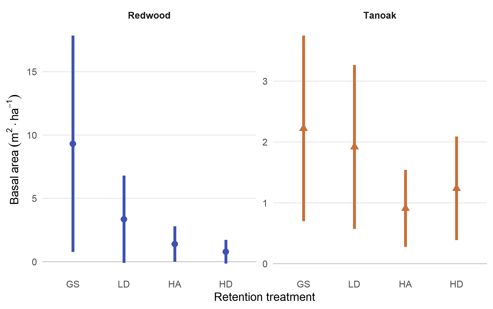
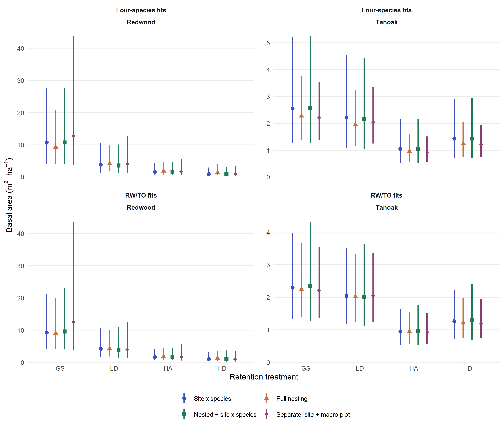
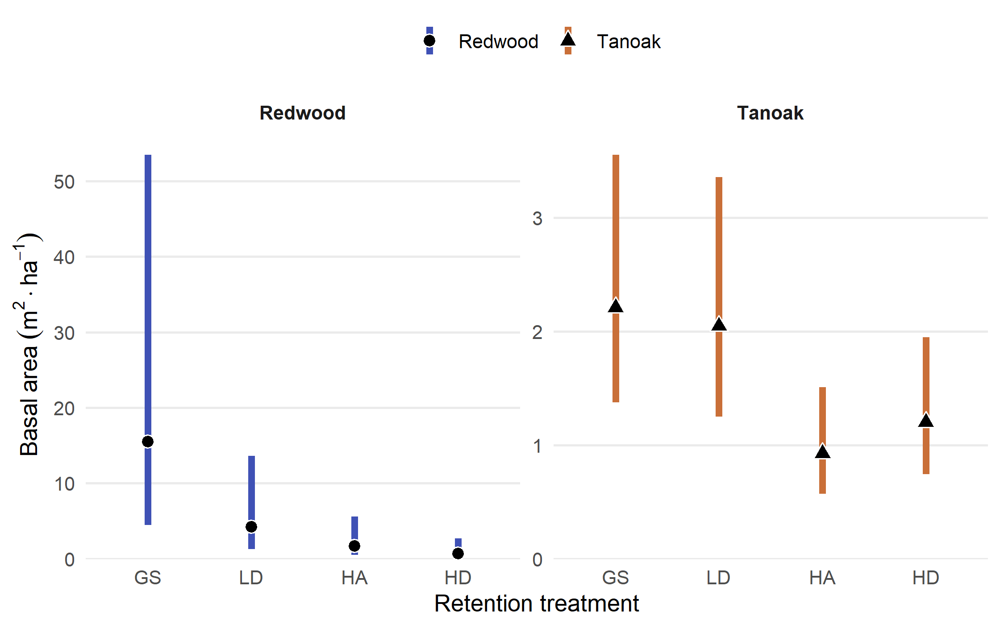



<span id="rd02-record"></span>

## Question and goals

How does regeneration basal area differ among retained-overstory treatments ten
years after harvest, and how much does that answer depend on how we represent
species and sampling groups? We'll review the thesis results, make the current
statistical choices explicit, and examine existing sensitivity evidence before
presenting the publication estimates.

The products are a redwood/tanoak (RW/TO) Results figure and a four-category
supplement table, including Douglas-fir and other species. Basal area is measured
in m² ha⁻¹; this task does not analyze stem counts. Following the model comparison,
we retain the four separate species models as the final selection. The RW/TO
Results figure and four-category supplement table are accepted for downstream
publication drafting. We now extend RD02 with an exploratory sensitivity analysis
of site and treatment differences in zero probability. The accepted models remain
the baseline pending review of that evidence.

## Setup and execution

The F01 bundle supplies shared readers and display functions; RD02-specific
analysis stays here. An ordinary render reviews saved evidence.
`-P recompute:true` refreshes calculations from saved models; `-P refit:true`
also refits them. `-P refit_diagonal:true` fits only the two diagonal candidates
and recomputes the comparisons from the other saved fits. Missing models are
prerequisites, not permission to refit. `-P refit_zero:true` fits only the six
new zero-process alternatives and refreshes their sensitivity results; it reads
the accepted species models without refitting them.
`-P recompute_zero:true` refreshes just this sensitivity from its saved fits.

```{r}
#| label: rd02-setup
#| include: false

if (!file.exists("outputs/helpers/task-helpers.rds"))
  stop("Saved helpers are missing. Run quarto render task-f01.qmd first.")
invisible(list2env(readRDS("outputs/helpers/task-helpers.rds"), envir = knitr::knit_global()))
enable_chunk_labels()
suppressPackageStartupMessages({
  library(glmmTMB); library(dplyr); library(ggplot2); library(DHARMa)
})
```

We'll use one set of data, paths, and labels. The 256 rows represent four
categories on 64 vegetation plots, nested in 16 treatment macro plots at four
sites. Recomputing overwrites current outputs directly, so a failed run requires
completing the affected sequence before treating its outputs as current.

```{r}
#| label: rd02-parameters
#| echo: true
#| message: false
#| warning: false

recompute <- isTRUE(params$recompute) || isTRUE(params$refit) || isTRUE(params$refit_diagonal)
publication_root <- normalizePath(getwd(), winslash = "/")
paths_common <- publication_paths(publication_root)
regeneration_root <- file.path(paths_common$output, "regeneration")
joint_root <- file.path(regeneration_root, "random-effects-comparison")
species_root <- file.path(regeneration_root, "separate-species-comparison")
selected_root <- file.path(regeneration_root, "selected-species-models")
zero_root <- file.path(regeneration_root, "zero-process-sensitivity")
zero_recompute <- recompute || isTRUE(params$refit_zero) || isTRUE(params$recompute_zero)
species_order <- c("rw", "to", "df", "other")
species_labels <- c(rw = "Redwood", to = "Tanoak", df = "Douglas-fir", other = "Other species")
seed <- 20261030L
simulations <- 1000L
if (recompute) {
  d <- as.data.frame(readRDS(file.path(paths_common$input, "regeneration-measurements.rds")))
  d$site <- factor(d$site)
  d$plot <- factor(d$plot)
  saved_reference <- readRDS(file.path(paths_common$input, "regeneration/saved-model-reference.rds"))
}
data.frame(Mode = if (isTRUE(params$refit)) "Refit and recompute" else
  if (isTRUE(params$refit_diagonal)) "Fit diagonal candidates and recompute" else
  if (recompute) "Recompute from saved models" else "Review saved results")
```

## Thesis results {#rd02-01}

The thesis selected `ba_ha ~ treat * spp + (1 | site:spp)`, with a log-link
Gamma positive component and species-specific zero and dispersion components.
Its Results wrapper predicted with `type = "response"` and `re.form = NA`:
zeros are included, but random effects are set to zero. That is different from
integrating over their distributions, despite the prediction documentation's
use of the term population-level.

The figure redraws the actual thesis means and response-scale asymptotic 95%
intervals, recovered from the saved thesis `regen_all` emmeans objects under
R 4.3.2. The exporter verifies all 16 cells against the saved-model zero-effect
reference and verifies `estimate ± qnorm(.975) × SE`. We show RW/TO without
the thesis significance arrows. Negative lower limits are retained: they reflect
the original normal approximation, not a claim that basal area can be negative.
The publication estimates use an integrated target and positive intervals.

We'll copy the committed historical evidence without loading thesis models in
the publication environment, then draw its focal-species figure.

```{r}
#| label: fig-rd02-historical-reference
#| echo: true
#| message: false
#| warning: false
#| fig-cap: "Thesis RW/TO basal-area means and original asymptotic 95% intervals, with random effects set to zero. Negative lower limits are retained. Species panels have different vertical scales; historical significance arrows are omitted."
#| out-width: "100%"

if (recompute) {
  out <- regeneration_root
  purrr::walk(c("figures", "tables", "inference-audit", "manifests"), function(directory)
    dir.create(file.path(out, directory), recursive = TRUE, showWarnings = FALSE))
  reference_root <- file.path(paths_common$input, "regeneration")
  purrr::walk(c("tables", "inference-audit"), function(directory) {
    files <- list.files(file.path(reference_root, directory), full.names = TRUE)
    stopifnot(all(file.copy(files, file.path(out, directory), overwrite = TRUE)))
  })
  display <- read.csv(file.path(out, "tables/rd02-thesis-results.csv")) |>
    filter(spp %in% c("rw", "to")) |>
    mutate(treat = factor(treat, levels = c("gs", "ld", "ha", "hd")),
           spp = factor(spp, levels = c("rw", "to")))
  stopifnot(nrow(display) == 8L, any(display$lcl < 0))
  figure <- ggplot(display, aes(treat, estimate, ymin = lcl, ymax = ucl, color = spp, shape = spp)) +
    geom_hline(yintercept = 0, color = "grey75", linewidth = .4) +
    geom_linerange(linewidth = 1.4) + geom_point(size = 2.8) +
    facet_wrap(~spp, nrow = 1, scales = "free_y", labeller = as_labeller(species_labels)) +
    scale_color_manual(values = c(rw = "#3F51B5", to = "#C96F38"), labels = species_labels) +
    scale_shape_manual(values = c(rw = 16, to = 17), labels = species_labels) +
    scale_x_discrete(labels = toupper) +
    labs(x = "Retention treatment", y = expression(Basal~area~(m^2 %.% ha^-1)), color = NULL, shape = NULL) +
    theme_minimal(base_size = 12) +
    theme(legend.position = "none", panel.grid.minor = element_blank(),
          panel.grid.major.x = element_blank(), strip.text = element_text(face = "bold"))
  figure_path <- file.path(out, "figures/rd02-regeneration-basal-area.png")
  ggsave(figure_path, figure, width = 7, height = 4.4, dpi = 320, bg = "white")
  ggsave(sub("png$", "pdf", figure_path), figure, width = 7, height = 4.4)
  yaml::write_yaml(list(
    task = "RD02 historical thesis results", generator = "task-rd02.qmd#fig-rd02-historical-reference",
    source = "rd02-thesis-results.csv; thesis results_appendix_deps.rda regen_all",
    model_id = "thesis_mba_m5", model_refitted = FALSE,
    target = "expected basal area including zeros; random effects set to zero",
    interval = "original response-scale asymptotic normal 95% intervals; negative limits retained",
    distinction = "rd02-basal-area-model-estimates.csv contains retrospective integrated historical-model means, not thesis figure values",
    checks = "16 emmeans cells match zero-effect predictions/SEs and estimate +/- qnorm(.975)*SE in thesis exporter"
  ), file.path(out, "manifests/rd02-figure-provenance.yml"))
  writeLines(capture.output(sessionInfo()), file.path(out, "manifests/rd02-session-info.txt"))
}

```

The thesis display suggests larger redwood basal area under GS, with substantial
uncertainty. It establishes a historical reference, not a new pairwise test or a
resolution of the clustering question.

<details id="rd02-historical-details">
<summary>Historical estimates and calculation details</summary>

We'll show all four thesis categories alongside the retrospective integrated
means from the same historical fit. That extra column is not the thesis target
plotted above.

```{r}
#| label: rd02-historical-values
#| echo: true
#| message: false
#| warning: false

thesis_values <- read.csv("outputs/regeneration/tables/rd02-thesis-results.csv")
historical_integrated <- read.csv("outputs/regeneration/tables/rd02-basal-area-model-estimates.csv")
historical_review <- left_join(
  select(thesis_values, spp, treat, thesis_mean = estimate, thesis_se = se, thesis_lcl = lcl, thesis_ucl = ucl),
  select(historical_integrated, spp, treat, retrospectively_integrated_mean = estimate), by = c("spp", "treat"))
publication_table(historical_review, digits = 4L)
```

[Actual thesis values](repo-files/publication/outputs/regeneration/tables/rd02-thesis-results.csv)
and the [historical estimand audit](repo-files/publication/outputs/regeneration/inference-audit/rd02-estimand-comparison.csv)
record this distinction. Reproduction uses the thesis exporter, not publication refitting.

</details>

### Observed sampling context

Before interpreting models, we'll inspect observed arithmetic means and zero
counts. Each species/treatment cell contains 16 vegetation plots across four
sites: subsamples within macro plots, not 16 independent treatment replicates.
Zero frequencies help us assess the assumption of a treatment-invariant zero process.

```{r}
#| label: rd02-observed-context
#| echo: true
#| message: false
#| warning: false

publication_table(read.csv("outputs/regeneration/tables/rd02-observed-basal-area-summary.csv"), digits = 4L)
```

## Current decisions and statistical framework {#rd02-inference-review}

We retain four separate species-category models:
`ba_ha ~ treat + (1 | site/treat)`, `ziGamma(log)`, zero `~1`, dispersion `~1`.
Each species has 64 observations, four site groups, and 16 nested macro plots.
Separate fitting allows species-specific variances as well as treatment means.
It does not estimate cross-species covariance; uncertainty for species contrasts
or sums cannot simply assume that covariance has been established.

Each species has one observation per vegetation plot. We omit a vegetation-plot
intercept rather than adding an observation-level variance component alongside
Gamma dispersion. We retain macro-plot intercepts to represent treatment-level
clustering, even when estimated near zero. This design choice does not establish
precise estimation of those variances or evidence that they differ from zero.

### Zero process, prediction target, and uncertainty

The family represents a point mass at zero plus a positive Gamma response: a
hurdle-Gamma interpretation. The intercept-only zero component assumes constant
absence probability across treatments within each species. Observed differences
in zeros are a relevant limitation, not a reason to silently change the model
here. Gamma dispersion is also constant within each species. See the
[family documentation](https://glmmtmb.github.io/glmmTMB/reference/nbinom2.html).

For species $g$ and treatment $t$, the reported mean is

$$
M_{tg}=(1-p_{0g})\exp\{x_{tg}^{\mathsf T}\beta_g+
(\sigma^2_{\mathrm{site},g}+\sigma^2_{\mathrm{macro},g})/2\}.
$$

We integrate over all independent Gaussian random intercepts, including modeled
zeros. Gamma dispersion needs no lognormal residual correction. Averaging four
equally weighted site rows has no numerical effect because site is not a fixed
predictor. Generalization to comparable forest conditions still assumes
exchangeable random effects; four sites provide limited information about their
distribution.

`type = "response"` includes modeled zeros; `re.form = NA` sets random effects
to zero, while `re.form = NULL` conditions on fitted effects. Averaging zero-effect
predictions does not perform this integration. See the
[prediction documentation](https://glmmtmb.github.io/glmmTMB/reference/predict.glmmTMB.html).
The integration factor is constant across treatments within each model, preserving
its treatment ratios and rankings. Species-specific factors can change
cross-species rankings.

Uncertainty uses the full covariance of conditional and zero coefficients and
log random-effect SDs, including cross-covariances. For gradient $G$ and
covariance $V$, the mean variance is $GVG^{\mathsf T}$. Positive 95% log-scale
delta intervals describe uncertainty in means, not new observations. They exclude
model-selection, measurement/aggregation, and model-structure uncertainty.
Boundary variances and four-site estimation limit the asymptotic approximation;
refitted bootstrap assessment has not been done.

We'll define the integrated calculation with its prediction, numerical-gradient,
and quadrature checks. A site random intercept in the zero component requires
numerical integration of its logistic-normal probability. We assume the zero
and positive-component random effects are independent, as specified by these
models, and include zero-process variance uncertainty in the full gradient.
For diagonal species effects, each row receives only its
species' site and macro-plot variances. These establish implementation agreement,
not scientific adequacy or interval coverage.

```{r}
#| label: rd02-integrated-means
#| echo: true
#| message: false
#| warning: false

integrated_means <- function(m, id, species = NULL) {
  stopifnot(m$fit$convergence == 0, m$sdr$pdHess)
  frame <- model.frame(m)
  if (!"spp" %in% names(frame)) frame$spp <- species
  grid <- distinct(frame, site, treat, spp, .keep_all = TRUE)
  labels <- distinct(grid, treat, spp)
  # A averages four valid site rows per treatment/species cell. Multiplying
  # the full gradient by A retains covariance between their predictions.
  A <- do.call(rbind, purrr::map(seq_len(nrow(labels)), function(i) {
    keep <- grid$treat == labels$treat[i] & grid$spp == labels$spp[i]
    as.numeric(keep) / sum(keep)
  }))
  vc <- VarCorr(m)$cond
  structure <- m$modelInfo$reStruc$condReStruc
  stopifnot(all(rowSums(A > 0) == 4L), family(m)$link == "log",
            length(vc) == length(structure))
  stopifnot(family(m)$family == "Gamma", is.null(model.offset(frame)),
            length(VarCorr(m)$disp) == 0L)
  # Support the task's independent intercepts and diagonal species indicators.
  # Do not silently treat an unstructured covariance as independent variances.
  random_design <- purrr::map2(vc, structure, function(v, block) {
    if (identical(colnames(v), "(Intercept)")) {
      stopifnot(identical(dim(v), c(1L, 1L)), block$blockNumTheta == 1L)
      return(matrix(1, nrow(grid), 1L))
    }
    species_design <- model.matrix(~0 + spp, grid)
    stopifnot(block$blockName == "diag", block$blockNumTheta == ncol(v),
              identical(colnames(v), colnames(species_design)),
              all(v[row(v) != col(v)] == 0))
    species_design
  })
  W <- do.call(cbind, lapply(random_design, function(z) z^2))
  X <- model.matrix(delete.response(terms(formula(m, fixed.only = TRUE))), grid)
  Z <- model.matrix(formula(m, component = "zi", fixed.only = TRUE), grid)
  # Use the full nonrandom parameter vector: theta/thetazi are log(SD).
  # Gamma dispersion has zero derivative for this mean, but stays in V.
  b <- m$fit$par
  ib <- which(names(b) == "beta")
  iz <- which(names(b) == "betazi")
  it <- which(names(b) == "theta")
  itz <- which(names(b) == "thetazi")
  zi_vc <- VarCorr(m)$zi
  stopifnot(length(itz) <= 1L, length(zi_vc) == length(itz))
  if (length(itz)) stopifnot(identical(names(zi_vc), "site"),
                            identical(colnames(zi_vc[[1]]), "(Intercept)"))
  stopifnot(identical(colnames(X), names(fixef(m)$cond)),
            identical(colnames(Z), names(fixef(m)$zi)),
            length(it) == ncol(W),
            isTRUE(all.equal(unname(b), unname(m$sdr$par.fixed))))
  # Independent variances add for each observation's random-effect design.
  # There is no additional lognormal residual correction for Gamma responses.
  variance <- drop(W %*% exp(2 * b[it]))
  # The logistic-normal expectation has no lognormal correction. Integrate
  # over a standard normal and differentiate the same probability functional.
  zero_moments <- function(eta, log_sd = numeric()) {
    if (!length(log_sd)) {
      p <- plogis(eta)
      return(cbind(p = p, d_eta = p * (1 - p), d_logsd = 0))
    }
    s <- exp(log_sd)
    t(vapply(eta, function(a) c(
      p = integrate(function(z) plogis(a + s*z) * dnorm(z), -Inf, Inf,
                    rel.tol = 1e-10)$value,
      d_eta = integrate(function(z) { p <- plogis(a + s*z); p*(1-p)*dnorm(z) },
                        -Inf, Inf, rel.tol = 1e-10)$value,
      d_logsd = integrate(function(z) { p <- plogis(a + s*z); p*(1-p)*s*z*dnorm(z) },
                          -Inf, Inf, rel.tol = 1e-10)$value), numeric(3)))
  }
  zm <- zero_moments(drop(Z %*% b[iz]), b[itz])
  pzero <- zm[, "p"]
  mu <- exp(drop(X %*% b[ib]) + variance / 2) * (1 - pzero)
  # Derivatives include zero coefficients and every conditional/zero log(SD). The full
  # covariance retains their cross-covariances with conditional coefficients.
  D <- matrix(0, nrow(grid), length(b))
  D[, ib] <- mu * X
  D[, iz] <- -mu * zm[, "d_eta"] / (1 - pzero) * Z
  D[, it] <- mu * sweep(W, 2L, exp(2 * b[it]), "*")
  if (length(itz)) D[, itz] <- -mu * zm[, "d_logsd"] / (1 - pzero)
  G <- A %*% D
  estimate <- drop(A %*% mu)
  se <- sqrt(diag(G %*% m$sdr$cov.fixed %*% t(G)))
  functional <- function(b) drop(A %*% (
    exp(drop(X %*% b[ib]) + drop(W %*% exp(2 * b[it])) / 2) *
      (1 - zero_moments(drop(Z %*% b[iz]), b[itz])[, "p"])))
  numeric_G <- numDeriv::jacobian(functional, unname(b))
  variance_values <- unique(variance)
  quadrature <- vapply(variance_values, function(v)
    integrate(function(z) exp(sqrt(v) * z) * dnorm(z), -12, 12)$value, numeric(1))
  vc_variance <- Reduce(`+`, purrr::map2(random_design, vc,
    function(z, v) rowSums((z %*% v) * z)))
  # In the locked glmmTMB version re.form=NA zeros conditional effects but
  # retains fitted zero-process effects. NA site levels zero both components.
  zero_effect_grid <- grid
  if (length(itz)) zero_effect_grid$site <- NA
  stopifnot(max(abs(G - numeric_G) / pmax(1, abs(G))) < 1e-5,
            max(abs((1 - plogis(drop(Z %*% b[iz]))) * exp(drop(X %*% b[ib])) -
                      predict(m, zero_effect_grid, type = "response", re.form = NA))) < 1e-7,
            max(abs(quadrature - exp(variance_values / 2))) < 1e-8,
            all(is.finite(se)), all(se > 0),
            max(abs(vc_variance - variance)) < 1e-9,
            all(vapply(seq_len(nrow(labels)), function(i)
              length(unique(variance[A[i, ] > 0])) == 1L, logical(1))))
  # se is on the response scale; se/estimate is its log-scale delta SE.
  # Exponentiation produces positive intervals for the mean, not new plots.
  mutate(labels, model_id = id, estimate = estimate, se = se,
    lcl = estimate * exp(-qnorm(.975) * se / estimate),
    ucl = estimate * exp(qnorm(.975) * se / estimate),
    marginal_zero_probability = drop(A %*% pzero),
    total_random_variance = drop(A %*% variance),
    integration_multiplier = drop(A %*% exp(variance / 2)))
}
```

We'll extract diagnostic and variance evidence consistently across candidates.
The local formatter keeps AIC differences, near-zero SDs, and p-values readable
without altering shared publication display functions.

```{r}
#| label: rd02-review-helpers
#| echo: true
#| message: false
#| warning: false

rd02_tests <- function(sim, id, scope) {
  tests <- list(uniformity = DHARMa::testUniformity, dispersion = DHARMa::testDispersion,
                outliers = DHARMa::testOutliers, zero_inflation = DHARMa::testZeroInflation)
  purrr::imap(tests, function(test, name) {
    result <- test(sim, plot = FALSE)
    data.frame(model_id = id, scope = scope, test = name,
               statistic = unname(result$statistic)[1], p_value = result$p.value)
  }) |> purrr::list_rbind()
}
rd02_variances <- function(m, id) {
  purrr::imap(VarCorr(m)$cond, function(v, group) {
    # Count unique nested combinations: plot codes alone are reused.
    variables <- strsplit(group, ":", fixed = TRUE)[[1]]
    data.frame(model_id = id, group = group,
               n_groups = nrow(unique(model.frame(m)[variables])),
               coefficient = colnames(v), variance = diag(v), sd = sqrt(diag(v)))
  }) |> purrr::list_rbind()
}
rd02_review_table <- function(x) {
  for (name in names(x)) {
    if (!is.numeric(x[[name]]) || is.integer(x[[name]])) next
    if (grepl("difference", name)) {
      x[[name]] <- formatC(x[[name]], format = "g", digits = 4)
    } else if (grepl("AIC|log_likelihood", name, ignore.case = TRUE)) {
      x[[name]] <- sprintf("%.2f", x[[name]])
    } else if (name == "p_value") {
      x[[name]] <- format.pval(x[[name]], digits = 5, eps = 1e-5)
    } else if (grepl("sd|variance|gradient|objective_difference", name)) {
      x[[name]] <- formatC(x[[name]], format = "g", digits = 4)
    } else {
      x[[name]] <- publication_number(x[[name]], digits = 4L)
    }
  }
  publication_table(x, digits = NULL)
}
```

## Candidate models {#rd02-candidates}

We compare the thesis site-by-species structure, full site/macro/vegetation
nesting, nesting plus site-by-species variation, and separate species models
with site and macro-plot intercepts. The original joint models share random-effect
variances; the added diagonal models estimate site and macro-plot variances for
each species. Joint conditional effects remain `treat*spp`, with species-specific
zero and dispersion intercepts.

The four joint structures are fitted both to all four categories (256 rows)
and to RW/TO only (128 rows). The separate configuration uses the product of
species likelihoods on the corresponding dataset. Summing log likelihoods and
parameter counts assumes species independence; it provides a candidate
likelihood, not evidence of independence. Individual 64-row AICs and AICs from
different scopes must not be ranked together. The primary covariance structures
are not nested, so we do not report an ordinary likelihood-ratio test.

### Why add species-specific diagonal variances? {#rd02-diagonal-rationale}

Does a common site variance hide biologically relevant differences in how species
respond to the study's contrasting sites? We expect both redwood and tanoak to
benefit from light, with a stronger regeneration growth response in redwood.
North- and south-facing slopes provide a reason to consider different magnitudes
of among-site variation. This is a scientific motivation for the candidate, not
evidence that aspect or light caused the fitted differences: neither enters this
model as a measured predictor.

The term `(1 | site:spp)` gives each site-species combination its own deviation,
but draws all deviations from one common-variance distribution. In contrast,
`diag(0 + spp | site)` estimates one variance for each species and fixes their
cross-species correlations to zero. We use the no-intercept species indicators;
`diag(spp | site)` instead constrains independent intercept and contrast
coefficients, which imposes reference-dependent species variances and covariance.
See the [glmmTMB covariance documentation](https://glmmtmb.github.io/glmmTMB/articles/covstruct.html).

We pair the species-specific site effects with
`diag(0 + spp | site:treat)`. Macro plots received the treatments, and their four
vegetation plots are subsamples. Retaining these terms preserves that clustering
level even when its estimated variance approaches zero; it does not guarantee
well-calibrated uncertainty. We omit a vegetation-plot term: each species has one
observation per vegetation plot, and the existing joint plot-intercept estimates
are near zero. A shared plot intercept could represent cross-species dependence,
but would impose a common proportional plot effect that this candidate does not
attempt to estimate.

The resulting diagonal model has the same species-specific mean, zero,
dispersion, and site/macro variance parameters as the separate fits. Its likelihood
factorizes by species, so agreement with their summed likelihood is expected;
joint fitting does not add replication or test biological independence. Four sites
still weakly inform each site variance. The expectation of positive responses in
both species could also imply positive cross-species site covariance, which this
diagonal structure does not estimate. This comparison examines unequal variance
without claiming to identify that covariance or the light-response mechanism.

### Authoritative species models {#rd02-05}

We'll fit or read the four selected species models once and collect their
variance, residual, and optimizer evidence. RW/TO comparisons reuse this
collection. Model specifications, observations, controls, and simulation settings
are unchanged. BFGS uses the existing SD start of 0.3 and objective-agreement
tolerance of 1e-4. The consolidated review below displays the evidence once.

```{r}
#| label: rd02-05
#| echo: true
#| message: false
#| warning: false

if (recompute) {
  stopifnot(nrow(d) == 256L, !anyNA(d), setequal(unique(d$spp), species_order))
  out <- selected_root
  for (directory in c("models", "tables", "diagnostics", "figures", "manifests")) {
    dir.create(file.path(out, directory), recursive = TRUE, showWarnings = FALSE)
  }
  models <- list()
  fit_records <- variance_records <- diagnostic_records <- optimizer_records <- list()
  for (sp in species_order) {
    message(if (isTRUE(params$refit)) "Fitting species category: " else "Reading saved species fit: ", sp)
    data_sp <- droplevels(d[d$spp == sp, ])
    stopifnot(nrow(data_sp) == 64L, n_distinct(data_sp$site) == 4L,
              nrow(distinct(data_sp, site, treat)) == 16L,
              all(count(data_sp, site, treat, plot)$n == 1L))
    warnings <- character()
    m <- if (isTRUE(params$refit)) {
  withCallingHandlers(glmmTMB(
      ba_ha ~ treat + (1 | site/treat), data = data_sp,
      family = ziGamma(link = "log"), ziformula = ~1, dispformula = ~1,
      control = glmmTMBControl(optCtrl = list(iter.max = 10000, eval.max = 10000))),
      warning = function(w) { warnings <<- c(warnings, conditionMessage(w)); invokeRestart("muffleWarning") })
    } else {
      read_saved_model(file.path(out, "models", paste0(sp, "_site_macro.rds")), "RD02")
    }
    stopifnot(m$fit$convergence == 0, m$sdr$pdHess,
              setequal(names(VarCorr(m)$cond), c("site", "treat:site")),
              !"plot" %in% names(model.frame(m)))
    if (!isTRUE(params$refit)) {
      saved_register <- read.csv(file.path(out, "tables/rd02-selected-species-fit-register.csv"))
      warnings <- stats::na.omit(saved_register$warnings[saved_register$spp == sp])
    }
    models[[sp]] <- m
    if (isTRUE(params$refit)) saveRDS(m, file.path(out, "models", paste0(sp, "_site_macro.rds")))
    ll <- logLik(m)
    fit_records[[sp]] <- data.frame(spp = sp, species = species_labels[sp], model_id = paste0(sp, "_site_macro"),
      n = nobs(m), n_zero = sum(data_sp$ba_ha == 0), k = attr(ll, "df"),
      log_likelihood = as.numeric(ll), AIC = AIC(m), convergence = m$fit$convergence,
      pd_hessian = m$sdr$pdHess, max_abs_gradient = max(abs(m$sdr$gradient.fixed)),
      warnings = paste(unique(warnings), collapse = " | "), row.names = NULL)
    variance_records[[sp]] <- rd02_variances(m, paste0(sp, "_site_macro")) |>
      mutate(spp = sp) |> select(spp, group, n_groups, variance, sd)
    sim <- publication_simulate_residuals(m, n = 1000, seed = seed, refit = FALSE, plot = FALSE)
    diagnostic_records[[sp]] <- rd02_tests(sim, paste0(sp, "_site_macro"), "species_plot_rows") |>
      mutate(spp = sp) |> select(spp, test, statistic, p_value)
    png(file.path(out, "diagnostics", paste0(sp, "-dharma.png")), width = 1800, height = 1000, res = 160)
    plot(sim)
    dev.off()
    png(file.path(out, "diagnostics", paste0(sp, "-by-treatment.png")), width = 1200, height = 1000, res = 160)
    plotResiduals(sim, form = data_sp$treat)
    dev.off()
    if (isTRUE(params$refit)) {
    check_warnings <- character()
    alternative <- withCallingHandlers(glmmTMB(
      ba_ha ~ treat + (1 | site/treat), data = data_sp,
      family = ziGamma(link = "log"), ziformula = ~1, dispformula = ~1,
      start = list(theta = rep(log(.3), 2)),
      control = glmmTMBControl(optimizer = optim, optArgs = list(method = "BFGS"),
                              optCtrl = list(maxit = 10000, reltol = 1e-10))),
      warning = function(w) { check_warnings <<- c(check_warnings, conditionMessage(w)); invokeRestart("muffleWarning") })
    saveRDS(alternative, file.path(out, "models", paste0(sp, "_site_macro-bfgs.rds")))
    objective_difference <- alternative$fit$objective - m$fit$objective
    stopifnot(alternative$fit$convergence == 0, abs(objective_difference) < 1e-4)
    optimizer_records[[sp]] <- data.frame(spp = sp, convergence = alternative$fit$convergence,
      pd_hessian = alternative$sdr$pdHess, objective_difference_from_nlminb = objective_difference,
      warnings = paste(unique(check_warnings), collapse = " | "))
    } else {
      alternative <- read_saved_model(file.path(out, "models", paste0(sp, "_site_macro-bfgs.rds")), "RD02")
      stopifnot(alternative$fit$convergence == 0,
                abs(alternative$fit$objective - m$fit$objective) < 1e-4)
      saved_checks <- read.csv(file.path(out, "tables/rd02-selected-species-optimizer-checks.csv"))
      optimizer_records[[sp]] <- saved_checks[saved_checks$spp == sp, ]
    }
  }
  fit_table <- bind_rows(fit_records)
  variances <- bind_rows(variance_records)
  diagnostics <- bind_rows(diagnostic_records)
  optimizer_checks <- bind_rows(optimizer_records)
  stopifnot(all(fit_table$k == 8L), nrow(variances) == 8L, nrow(diagnostics) == 16L)

  write.csv(fit_table, file.path(out, "tables/rd02-selected-species-fit-register.csv"), row.names = FALSE)
  write.csv(variances, file.path(out, "tables/rd02-selected-species-variances.csv"), row.names = FALSE)
  write.csv(diagnostics, file.path(out, "tables/rd02-selected-species-diagnostics.csv"), row.names = FALSE)
  write.csv(optimizer_checks, file.path(out, "tables/rd02-selected-species-optimizer-checks.csv"), row.names = FALSE)
  selected_models <- models
}
```

We'll calculate all 16 integrated means with the existing prediction,
derivative, quadrature, and cell-completeness checks. This full-precision source
supplies both the publication figure and supplement table.

```{r}
#| label: rd02-05-integrated-estimates
#| echo: true
#| message: false
#| warning: false

if (recompute) {
  out <- selected_root
  models <- selected_models
  estimates <- purrr::map(species_order, function(sp) {
    integrated_means(models[[sp]], paste0(sp, "_site_macro"), sp)
  }) |> purrr::list_rbind() |>
    mutate(spp = factor(spp, levels = species_order),
           treat = factor(treat, levels = c("gs", "ld", "ha", "hd")),
           species = unname(species_labels[as.character(spp)]), unit = "m2 ha-1",
           estimand = "species-specific arithmetic expected basal area including zeros, integrated over site and macro-plot random effects",
           interval_method = "95% log-scale delta method using full parameter covariance") |>
    arrange(spp, treat)
  stopifnot(nrow(estimates) == 16L, !anyDuplicated(estimates[c("spp", "treat")]),
            all(estimates$lcl > 0), all(estimates$lcl <= estimates$estimate), all(estimates$ucl >= estimates$estimate))
  write.csv(estimates, file.path(out, "tables/rd02-selected-species-estimates.csv"), row.names = FALSE)
  write.csv(optimizer_checks, file.path(out, "tables/rd02-selected-species-optimizer-checks.csv"), row.names = FALSE)
}
```

### Joint four-category alternatives {#rd02-02}

We'll keep the same 256 rows in each joint comparison and verify the thesis
structure's likelihood against its saved reference. Unconditional DHARMa
simulations assess the fitted hierarchy; grouped residuals inspect site,
macro-plot, and vegetation-plot patterns. Their evidence is collected for the
consolidated review rather than repeated in separate figures. We show the new
diagonal fit's numerical record here before comparing its scientific implications.

```{r}
#| label: rd02-02
#| echo: true
#| message: false
#| warning: false

if (recompute) {
  stopifnot(nrow(d) == 256L, !anyNA(d),
            nrow(distinct(d, site, treat, plot)) == 64L,
            all(count(d, site, treat, plot)$n == 4L),
            all(count(d, site, treat, spp)$n == 4L),
            isTRUE(all.equal(d$ba_ha, saved_reference$response)))
  out <- joint_root
  for (directory in c("models", "diagnostics", "tables", "figures", "manifests")) {
    dir.create(file.path(out, directory), recursive = TRUE, showWarnings = FALSE)
  }
  formulas <- list(
    thesis_site_species = ba_ha ~ treat * spp + (1 | site:spp),
    full_nested = ba_ha ~ treat * spp + (1 | site/treat/plot),
    nested_plus_site_species = ba_ha ~ treat * spp + (1 | site/treat/plot) + (1 | site:spp),
    diagonal_site_macro = ba_ha ~ treat * spp + diag(0 + spp | site) + diag(0 + spp | site:treat)
  )
  models <- list()
  records <- list()
  variance_records <- list()
  diagnostic_records <- list()

  for (id in names(formulas)) {
    fit_requested <- isTRUE(params$refit) ||
      (isTRUE(params$refit_diagonal) && id == "diagonal_site_macro")
    message(if (fit_requested) "Fitting " else "Reading saved fit ", id)
    fit_warnings <- character()
    fit <- if (fit_requested) {
  withCallingHandlers(
      glmmTMB(formulas[[id]], data = d, family = ziGamma(link = "log"),
              ziformula = ~spp, dispformula = ~spp,
              control = glmmTMBControl(optCtrl = list(iter.max = 10000, eval.max = 10000))),
      warning = function(w) {
        fit_warnings <<- c(fit_warnings, conditionMessage(w))
        invokeRestart("muffleWarning")
      }
    )
    } else {
      read_saved_model(file.path(out, "models", paste0(id, ".rds")), "RD02")
    }
    if (!fit_requested) {
      saved_register <- read.csv(file.path(out, "tables/rd02-model-comparison.csv"))
      fit_warnings <- stats::na.omit(saved_register$warnings[saved_register$model_id == id])
    }
    models[[id]] <- fit
    if (fit_requested) saveRDS(fit, file.path(out, "models", paste0(id, ".rds")))
    vc <- VarCorr(fit)$cond
    variance_records[[id]] <- rd02_variances(fit, id)
    ll <- logLik(fit)
    records[[id]] <- data.frame(
      model_id = id, formula = paste(deparse(formulas[[id]]), collapse = " "),
      n = nobs(fit), k = attr(ll, "df"), log_likelihood = as.numeric(ll),
      AIC = AIC(fit), BIC = BIC(fit), convergence = fit$fit$convergence,
      pd_hessian = fit$sdr$pdHess,
      max_abs_gradient = max(abs(fit$sdr$gradient.fixed)),
      min_random_sd = min(variance_records[[id]]$sd),
      near_boundary_sd_lt_1e_3 = any(variance_records[[id]]$sd < 1e-3),
      warnings = paste(unique(fit_warnings), collapse = " | ")
    )
    # F01 explicitly requests unconditional random-effect simulation.
    # Explicitly record the version and use the same seed and n for all models.
    sim <- publication_simulate_residuals(fit, n = simulations, seed = seed, refit = FALSE, plot = FALSE)
    saveRDS(sim, file.path(out, "models", paste0(id, "-dharma.rds")))
    diagnostic_records[[id]] <- rd02_tests(sim, id, "species_plot_rows")
    # Recalculate residuals on aggregated responses to inspect each design level.
    groups <- list(site = d$site, macro_plot = interaction(d$site, d$treat, drop = TRUE),
                   vegetation_plot = interaction(d$site, d$treat, d$plot, drop = TRUE))
    for (scope in names(groups)) {
      grouped <- recalculateResiduals(sim, group = groups[[scope]], seed = seed)
      diagnostic_records[[id]] <- bind_rows(diagnostic_records[[id]], rd02_tests(grouped, id, scope))
    }
    png(file.path(out, "diagnostics", paste0(id, "-dharma.png")),
        width = 1800, height = 1000, res = 160)
    plot(sim)
    dev.off()
    png(file.path(out, "diagnostics", paste0(id, "-by-species-treatment.png")),
        width = 1800, height = 1000, res = 160)
    old_par <- par(mfrow = c(1, 2))
    plotResiduals(sim, form = d$spp)
    plotResiduals(sim, form = d$treat)
    par(old_par)
    dev.off()
  }
  stopifnot(abs(as.numeric(logLik(models$thesis_site_species)) - saved_reference$logLik) < 1e-4)
  comparison <- bind_rows(records) |>
    mutate(delta_AIC = AIC - min(AIC[convergence == 0 & pd_hessian], na.rm = TRUE))
  variance_table <- bind_rows(variance_records)
  diagnostics <- bind_rows(diagnostic_records)
  write.csv(comparison, file.path(out, "tables/rd02-model-comparison.csv"), row.names = FALSE)
  write.csv(variance_table, file.path(out, "tables/rd02-random-effect-variances.csv"), row.names = FALSE)
  write.csv(diagnostics, file.path(out, "tables/rd02-dharma-tests.csv"), row.names = FALSE)
}
rd02_review_table(read.csv(file.path(joint_root, "tables/rd02-model-comparison.csv")) |>
  filter(model_id == "diagonal_site_macro"))
```

Near-zero variances warrant checking the fitting route. We'll read the saved
BFGS/start checks, or refit them only in refit mode, preserving the original
objective-agreement tolerance.

```{r}
#| label: rd02-02-optimizer
#| echo: true
#| message: false
#| warning: false

if (recompute) {
  # Boundary components warrant an optimizer/start sensitivity check. Start each
  # random SD at 0.3 rather than inheriting the near-zero nlminb estimates.
  optimizer_checks <- purrr::map(c("full_nested", "nested_plus_site_species", "diagonal_site_macro"), function(id) {
    message("Checking BFGS optimizer/start sensitivity: ", id)
    fit_requested <- isTRUE(params$refit) ||
      (isTRUE(params$refit_diagonal) && id == "diagonal_site_macro")
    warnings <- character()
    check <- if (fit_requested) {
  withCallingHandlers(update(models[[id]],
      start = list(theta = rep(log(.3), sum(names(models[[id]]$fit$par) == "theta"))),
      control = glmmTMBControl(optimizer = optim, optArgs = list(method = "BFGS"),
                              optCtrl = list(maxit = 10000, reltol = 1e-10))),
      warning = function(w) {
        warnings <<- c(warnings, conditionMessage(w))
        invokeRestart("muffleWarning")
      })
    } else {
      read_saved_model(file.path(out, "models", paste0(id, "-bfgs.rds")), "RD02")
    }
    if (!fit_requested) {
      saved_checks <- read.csv(file.path(out, "tables/rd02-optimizer-sensitivity.csv"))
      warnings <- stats::na.omit(saved_checks$warnings[saved_checks$model_id == id])
    }
    if (fit_requested) saveRDS(check, file.path(out, "models", paste0(id, "-bfgs.rds")))
    difference <- check$fit$objective - models[[id]]$fit$objective
    stopifnot(check$fit$convergence == 0, abs(difference) < 1e-4)
    data.frame(model_id = id, optimizer = "BFGS; initial random SDs 0.3",
      convergence = check$fit$convergence, pd_hessian = check$sdr$pdHess,
      objective_difference_from_nlminb = difference,
      warnings = paste(unique(warnings), collapse = " | "))
  }) |> purrr::list_rbind()
  write.csv(optimizer_checks, file.path(out, "tables/rd02-optimizer-sensitivity.csv"), row.names = FALSE)
}
```

The historical joint fit has a residual-tail flag. We'll repeat the existing
10,000-simulation check with seed 20261031 and retain flagged observations from
both counts. The later review shows the sensitivity; no observation is removed.

```{r}
#| label: rd02-02-tail-check
#| echo: true
#| message: false
#| warning: false

if (recompute) {
  # Inspect the baseline tail flag without removing observations or changing the
  # fit. More simulations and a second seed check Monte Carlo sensitivity.
  tail_check <- publication_simulate_residuals(models$thesis_site_species, n = 10000,
                                  seed = seed + 1L, refit = FALSE, plot = FALSE)
  tail_tests <- rd02_tests(tail_check, "thesis_site_species", "species_plot_rows_10000_simulations")
  write.csv(tail_tests, file.path(out, "tables/rd02-baseline-tail-sensitivity.csv"), row.names = FALSE)
  tail_rows <- purrr::map(c(1000L, 10000L), function(n) {
    residuals <- if (n == 1000L) readRDS(file.path(out, "models/thesis_site_species-dharma.rds"))$scaledResiduals else
      tail_check$scaledResiduals
    d |>
      mutate(row_id = seq_len(nrow(d)), n_simulations = n, dharma_residual = residuals) |>
      filter(dharma_residual < 1 / (n + 1) | dharma_residual > 1 - 1 / (n + 1))
  }) |> purrr::list_rbind()
  write.csv(tail_rows, file.path(out, "tables/rd02-baseline-tail-observations.csv"), row.names = FALSE)
}
```

We'll express eligible joint fits using the same integrated estimand as the
selected models. Their mean and interval changes then reflect model structure,
rather than comparing different prediction targets.

```{r}
#| label: rd02-02-integrated-estimates
#| echo: true
#| message: false
#| warning: false

if (recompute) {
  # Integrate each candidate over ALL of its independent conditional random
  # intercepts. Zero and dispersion specifications are identical across models.
  eligible <- comparison$model_id[comparison$convergence == 0 & comparison$pd_hessian]
  estimates <- purrr::map(eligible, function(id) integrated_means(models[[id]], id)) |> purrr::list_rbind()
  baseline <- filter(estimates, model_id == "thesis_site_species") |>
    select(treat, spp, baseline_mean = estimate, baseline_lcl = lcl, baseline_ucl = ucl)
  estimates <- left_join(estimates, baseline, by = c("treat", "spp")) |>
    mutate(mean_percent_change = 100 * (estimate / baseline_mean - 1),
           ci_width_ratio = (ucl - lcl) / (baseline_ucl - baseline_lcl))
  write.csv(estimates, file.path(out, "tables/rd02-integrated-model-comparison.csv"), row.names = FALSE)
  provenance <- list(
    task = "RD02 random-effects comparison", source = "publication/inputs/thesis/regeneration-measurements.rds",
    data = "same 256 species-plot rows; 4 sites, 16 treatment macro plots, 64 vegetation plots",
    candidate_formulas = purrr::map(formulas, function(f) paste(deparse(f), collapse = " ")),
    fixed_components = "ziGamma(log); conditional treat*spp; zero ~spp; dispersion ~spp",
    fit = "maximum likelihood; nlminb; iter.max=eval.max=10000",
    diagnostics = list(seed = seed, simulations = simulations, refit = FALSE,
                       random_effect_simulation = "explicit unconditional simulation via F01 helper",
                       baseline_tail_sensitivity = "10000 simulations; seed 20261031"),
    optimizer_sensitivity = "BFGS from random SDs 0.3, objective checked within 1e-4 of nlminb",
    means = "exact integration over all conditional Gaussian random intercepts, including zeros",
    intervals = "95% log-scale delta method with full parameter covariance",
    tests = "AIC comparison; primary covariance structures are not nested in one another, so no ordinary LRT",
    selection = "sensitivity evidence; separate species models remain selected"
  )
  yaml::write_yaml(provenance, file.path(out, "manifests/rd02-comparison-provenance.yml"))
  writeLines(capture.output(sessionInfo()), file.path(out, "manifests/rd02-comparison-session-info.txt"))
}
```

### Joint RW/TO alternatives {#rd02-03}

We'll fit or read the four joint structures on the same 128 RW/TO rows.
Separate-species evidence comes directly from the authoritative selected fits,
including diagnostics and optimizer records. This retains the focused same-data
comparison while removing duplicate separate-model computation. The new diagonal
fit's numerical record is displayed immediately below.

```{r}
#| label: rd02-03
#| echo: true
#| message: false
#| warning: false

if (recompute) {
  d <- droplevels(subset(d, spp %in% c("rw", "to")))
  stopifnot(nrow(d) == 128L, !anyNA(d),
            nrow(distinct(d, site, treat, plot)) == 64L,
            all(count(d, site, treat, plot)$n == 2L))
  out <- species_root
  for (directory in c("models", "tables", "diagnostics", "figures", "manifests")) {
    dir.create(file.path(out, directory), recursive = TRUE, showWarnings = FALSE)
  }
  spec <- list(
    joint_site_species_rwto = list(formula = ba_ha ~ treat*spp + (1 | site:spp)),
    joint_full_nested_rwto = list(formula = ba_ha ~ treat*spp + (1 | site/treat/plot)),
    joint_combined_rwto = list(formula = ba_ha ~ treat*spp + (1 | site/treat/plot) + (1 | site:spp)),
    joint_diagonal_site_macro_rwto = list(formula = ba_ha ~ treat*spp +
      diag(0 + spp | site) + diag(0 + spp | site:treat))
  )
  models <- list()
  fit_records <- variance_records <- diagnostic_records <- optimizer_records <- list()
  for (id in names(spec)) {
    item <- spec[[id]]
    model_data <- d
    fit_requested <- isTRUE(params$refit) ||
      (isTRUE(params$refit_diagonal) && id == "joint_diagonal_site_macro_rwto")
    message(if (fit_requested) "Fitting " else "Reading saved fit ", id)
    warnings <- character()
    m <- if (fit_requested) {
  withCallingHandlers(
      glmmTMB(item$formula, data = model_data, family = ziGamma(link = "log"),
              ziformula = ~spp, dispformula = ~spp,
              control = glmmTMBControl(optCtrl = list(iter.max = 10000, eval.max = 10000))),
      warning = function(w) {
        warnings <<- c(warnings, conditionMessage(w))
        invokeRestart("muffleWarning")
      })
    } else {
      read_saved_model(file.path(out, "models", paste0(id, ".rds")), "RD02")
    }
    if (!fit_requested) {
      saved_register <- read.csv(file.path(out, "tables/rd02-species-fit-register.csv"))
      warnings <- stats::na.omit(saved_register$warnings[saved_register$model_id == id])
    }
    models[[id]] <- m
    if (fit_requested) saveRDS(m, file.path(out, "models", paste0(id, ".rds")))
    vc <- VarCorr(m)$cond
    variance_records[[id]] <- rd02_variances(m, id)
    ll <- logLik(m)
    fit_records[[id]] <- data.frame(
      model_id = id, dataset = "RW+TO",
      n = nobs(m), n_zero = sum(model_data$ba_ha == 0), k = attr(ll, "df"),
      log_likelihood = as.numeric(ll), AIC = AIC(m), convergence = m$fit$convergence,
      pd_hessian = m$sdr$pdHess, max_abs_gradient = max(abs(m$sdr$gradient.fixed)),
      warnings = paste(unique(warnings), collapse = " | "))
    sim <- publication_simulate_residuals(m, n = 1000, seed = seed, refit = FALSE, plot = FALSE)
    diagnostic_records[[id]] <- rd02_tests(sim, id, "species_plot_rows") |> select(-scope)
    png(file.path(out, "diagnostics", paste0(id, "-dharma.png")),
        width = 1800, height = 1000, res = 160)
    plot(sim)
    dev.off()
    png(file.path(out, "diagnostics", paste0(id, "-by-treatment.png")),
        width = 1200, height = 1000, res = 160)
    plotResiduals(sim, form = model_data$treat)
    dev.off()
    if (id == "joint_diagonal_site_macro_rwto") {
      check_warnings <- character()
      check <- if (fit_requested) {
        withCallingHandlers(update(m,
          start = list(theta = rep(log(.3), sum(names(m$fit$par) == "theta"))),
          control = glmmTMBControl(optimizer = optim, optArgs = list(method = "BFGS"),
            optCtrl = list(maxit = 10000, reltol = 1e-10))),
          warning = function(w) {
            check_warnings <<- c(check_warnings, conditionMessage(w))
            invokeRestart("muffleWarning")
          })
      } else read_saved_model(file.path(out, "models", paste0(id, "-bfgs.rds")), "RD02")
      if (!fit_requested) {
        saved_checks <- read.csv(file.path(out, "tables/rd02-species-optimizer-checks.csv"))
        check_warnings <- stats::na.omit(saved_checks$warnings[saved_checks$model_id == id])
      }
      if (fit_requested) saveRDS(check, file.path(out, "models", paste0(id, "-bfgs.rds")))
      difference <- check$fit$objective - m$fit$objective
      stopifnot(check$fit$convergence == 0, abs(difference) < 1e-4)
      optimizer_records[[id]] <- data.frame(model_id = id, convergence = check$fit$convergence,
        pd_hessian = check$sdr$pdHess, objective_difference_from_nlminb = difference,
        warnings = paste(unique(check_warnings), collapse = " | "))
    }
  }
  # Reuse authoritative RW/TO fit, variance, diagnostic, and optimizer records.
  primary_var <- read.csv(file.path(selected_root, "tables/rd02-selected-species-variances.csv"))
  primary_diag <- read.csv(file.path(selected_root, "tables/rd02-selected-species-diagnostics.csv"))
  # Only joint fits live in this directory. The separate configuration reads
  # its authoritative register below, so it needs no duplicate saved models.
  fit_table <- bind_rows(fit_records)
  variances <- bind_rows(primary_var |> filter(spp %in% c("rw", "to")) |>
    mutate(model_id = paste0(spp, "_site_macro")) |> select(-spp), bind_rows(variance_records))
  diagnostics <- bind_rows(primary_diag |> filter(spp %in% c("rw", "to")) |>
    mutate(model_id = paste0(spp, "_site_macro")) |> select(-spp), bind_rows(diagnostic_records))
  stopifnot(all(fit_table$convergence == 0), all(fit_table$pd_hessian))
  write.csv(fit_table, file.path(out, "tables/rd02-species-fit-register.csv"), row.names = FALSE)
  write.csv(variances, file.path(out, "tables/rd02-species-variance-components.csv"), row.names = FALSE)
  write.csv(diagnostics, file.path(out, "tables/rd02-species-dharma-tests.csv"), row.names = FALSE)
  primary_opt <- read.csv(file.path(selected_root, "tables/rd02-selected-species-optimizer-checks.csv")) |>
    filter(spp %in% c("rw", "to")) |> mutate(model_id = paste0(spp, "_site_macro")) |> select(-spp)
  write.csv(bind_rows(primary_opt, bind_rows(optimizer_records)),
    file.path(out, "tables/rd02-species-optimizer-checks.csv"), row.names = FALSE)
}
rd02_review_table(read.csv(file.path(species_root, "tables/rd02-species-fit-register.csv")) |>
  filter(model_id == "joint_diagonal_site_macro_rwto"))
```

We'll sum the selected RW/TO log likelihoods and parameter counts. The identity
$AIC=-2\ell+2k$ is checked on all five 128-row alternatives.

```{r}
#| label: rd02-03-paired-aic
#| echo: true
#| message: false
#| warning: false

if (recompute) {
  # A pair of independent species models has a product likelihood on these same
  # 128 rows; sum log likelihoods AND parameter counts. Do not compare the 64-row
  # individual AICs, or this paired AIC, against the earlier 256-row model AICs.
  separate <- read.csv(file.path(selected_root, "tables/rd02-selected-species-fit-register.csv")) |>
    filter(spp %in% c("rw", "to"))
  stopifnot(nrow(separate) == 2L, all(separate$k == 8L))
  joint <- filter(fit_table, dataset == "RW+TO")
  comparison <- bind_rows(
    transmute(joint, model_id, n, k, log_likelihood, AIC),
    data.frame(model_id = "separate_site_macro_pair", n = sum(separate$n),
      k = sum(separate$k), log_likelihood = sum(separate$log_likelihood), AIC = sum(separate$AIC))
  ) |>
    mutate(delta_AIC = AIC - min(AIC))
  stopifnot(all(comparison$n == 128L),
            max(abs(comparison$AIC - (-2 * comparison$log_likelihood + 2 * comparison$k))) < 1e-8)
  write.csv(comparison, file.path(out, "tables/rd02-rwto-aic-comparison.csv"), row.names = FALSE)
}
```

We'll calculate joint RW/TO integrated means and reuse the eight selected
RW/TO estimates exactly. The collection retains 40 comparison cells; reuse is
not described as independent numerical validation.

```{r}
#| label: rd02-03-integrated-estimates
#| echo: true
#| message: false
#| warning: false

if (recompute) {
  estimates <- purrr::map(names(models), function(id) {
    integrated_means(models[[id]], id)
  }) |> purrr::list_rbind()
  primary_means <- read.csv(file.path(selected_root, "tables/rd02-selected-species-estimates.csv")) |>
    filter(spp %in% c("rw", "to")) |>
    select(treat, spp, model_id, estimate, se, lcl, ucl, total_random_variance, integration_multiplier)
  estimates <- bind_rows(primary_means, estimates)
  stopifnot(nrow(estimates) == 40L)
  write.csv(estimates, file.path(out, "tables/rd02-species-integrated-estimates.csv"), row.names = FALSE)
  provenance <- list(
    task = "RD02 separate species with site and macro-plot random effects",
    data = "64 RW and 64 TO observations; 4 sites, 16 macro plots, 64 vegetation plots per species",
    species_formula = "ba_ha ~ treat + (1 | site/treat); ziGamma(log), zero ~1, dispersion ~1",
    candidate_formulas = purrr::map(spec, function(item) paste(deparse(item$formula), collapse = " ")),
    joint_comparisons = "all refitted on the SAME 128 RW/TO rows; no AIC comparison with earlier 256-row fits",
    paired_likelihood = "sum species log likelihoods and parameter counts; assumes independence between species",
    diagnostics = "1000 unconditional DHARMa simulations, seed 20261030, plus treatment plots",
    optimizer_sensitivity = "BFGS from all random SDs 0.3; objective agreement checked within 1e-4",
    prediction_checks = "32 joint means checked here; 8 RW/TO means reused from the 16 checked selected means",
    intervals = "95% log-scale delta method including all conditional random SD uncertainty; approximate near boundary",
    review = "plot-level RE omitted as requested; 4 site and 16 nested macro-plot groups per species",
    selection = "joint sensitivity fits plus authoritative selected RW/TO fits; no duplicate separate fitting"
  )
  yaml::write_yaml(provenance, file.path(out, "manifests/rd02-species-comparison-provenance.yml"))
  writeLines(capture.output(sessionInfo()), file.path(out, "manifests/rd02-species-comparison-session-info.txt"))
}
```

## Consolidated sensitivity review {#rd02-04}

We'll assemble the ten-configuration fit record with separate AIC scopes.
BIC remains downloadable; the review focuses on log likelihood, parameter count,
AIC, and within-scope differences. Supporting tables are folded beneath the
figure so the treatment patterns remain easy to inspect.

```{r}
#| label: rd02-04-assemble-fit
#| echo: true
#| message: false
#| warning: false

if (recompute) {
  joint_dir <- file.path(regeneration_root, "random-effects-comparison/tables")
  species_dir <- file.path(regeneration_root, "separate-species-comparison/tables")
  selected_dir <- file.path(regeneration_root, "selected-species-models/tables")
  inputs <- c(
    fit4 = file.path(joint_dir, "rd02-model-comparison.csv"),
    var4 = file.path(joint_dir, "rd02-random-effect-variances.csv"),
    diag4 = file.path(joint_dir, "rd02-dharma-tests.csv"),
    mean4 = file.path(joint_dir, "rd02-integrated-model-comparison.csv"),
    component2 = file.path(species_dir, "rd02-species-fit-register.csv"),
    fit2 = file.path(species_dir, "rd02-rwto-aic-comparison.csv"),
    var2 = file.path(species_dir, "rd02-species-variance-components.csv"),
    diag2 = file.path(species_dir, "rd02-species-dharma-tests.csv"),
    mean2 = file.path(species_dir, "rd02-species-integrated-estimates.csv"),
    selected_fit = file.path(selected_dir, "rd02-selected-species-fit-register.csv"),
    selected_var = file.path(selected_dir, "rd02-selected-species-variances.csv"),
    selected_diag = file.path(selected_dir, "rd02-selected-species-diagnostics.csv"),
    selected_mean = file.path(selected_dir, "rd02-selected-species-estimates.csv")
  )
  stopifnot(all(file.exists(inputs)))
  read_input <- function(key) read.csv(inputs[[key]], stringsAsFactors = FALSE)
  fit4 <- read_input("fit4")
  component2 <- read_input("component2")
  fit2 <- read_input("fit2")
  selected_components <- read_input("selected_fit")
  meta <- data.frame(
    model_id = c("thesis_site_species", "full_nested", "nested_plus_site_species", "diagonal_site_macro",
                 "joint_site_species_rwto", "joint_full_nested_rwto", "joint_combined_rwto", "joint_diagonal_site_macro_rwto",
                 "separate_site_macro_pair", "selected_separate_four_species"),
    fit_scope = c(rep("Four-species fits", 4), rep("RW/TO fits", 5), "Four-species fits"),
    model_label = c("Site x species", "Full nesting", "Nested + site x species", "Diagonal: site + macro plot",
                    "Site x species", "Full nesting", "Nested + site x species", "Diagonal: site + macro plot", "Separate: site + macro plot",
                    "Separate: site + macro plot")
  )
  annotate <- function(x) {
    x$component_model_id <- x$model_id
    x$model_id[x$model_id %in% c("rw_site_macro", "to_site_macro")] <- "separate_site_macro_pair"
    stopifnot(all(x$model_id %in% meta$model_id))
    left_join(x, meta, by = "model_id")
  }
  annotate_selected <- function(x) {
    x$component_model_id <- if ("model_id" %in% names(x)) x$model_id else paste0(x$spp, "_site_macro")
    x$model_id <- "selected_separate_four_species"
    left_join(x, meta, by = "model_id")
  }
  pair_components <- selected_components[selected_components$spp %in% c("rw", "to"), ]
  fit2$convergence <- purrr::map_int(fit2$model_id, function(id) {
    rows <- if (id == "separate_site_macro_pair") pair_components else component2[component2$model_id == id, ]
    as.integer(any(rows$convergence != 0))
  })
  fit2$pd_hessian <- purrr::map_lgl(fit2$model_id, function(id) {
    rows <- if (id == "separate_site_macro_pair") pair_components else component2[component2$model_id == id, ]
    all(rows$pd_hessian)
  })
  fit <- bind_rows(
    select(fit4, model_id, n, k, log_likelihood, AIC, convergence, pd_hessian),
    select(fit2, model_id, n, k, log_likelihood, AIC, convergence, pd_hessian),
    data.frame(model_id = "selected_separate_four_species", n = sum(selected_components$n),
      k = sum(selected_components$k), log_likelihood = sum(selected_components$log_likelihood),
      AIC = sum(selected_components$AIC), convergence = as.integer(any(selected_components$convergence != 0)),
      pd_hessian = all(selected_components$pd_hessian))
  ) |>
    left_join(meta, by = "model_id") |>
    mutate(BIC = -2 * log_likelihood + log(n) * k,
           selected_primary = model_id == "selected_separate_four_species") |>
    group_by(fit_scope) |>
    mutate(delta_AIC_within_scope = AIC - min(AIC)) |>
    ungroup() |>
    arrange(match(model_id, c("thesis_site_species", "full_nested", "nested_plus_site_species", "diagonal_site_macro",
                             "selected_separate_four_species", "joint_site_species_rwto",
                             "joint_full_nested_rwto", "joint_combined_rwto", "joint_diagonal_site_macro_rwto", "separate_site_macro_pair")))
  out <- file.path(regeneration_root, "overall-sensitivity")
  for (directory in c("tables", "figures", "manifests")) {
    dir.create(file.path(out, directory), recursive = TRUE, showWarnings = FALSE)
  }
  write.csv(fit, file.path(out, "tables/rd02-overall-model-comparison.csv"), row.names = FALSE)
}
```

We'll assemble means, variances, and row-level diagnostics, retaining component
model identities. Existing completeness and exact source-to-assembly checks
protect all 120 mean/interval cells. Grouped residual checks remain in their
joint source rather than being mislabeled as row tests.

```{r}
#| label: rd02-04-assemble-estimates
#| echo: true
#| message: false
#| warning: false

if (recompute) {
  variances <- bind_rows(annotate(read_input("var4")), annotate(read_input("var2")),
                        annotate_selected(read_input("selected_var"))) |>
    mutate(species_context = case_when(component_model_id == "rw_site_macro" ~ "Redwood",
                                       component_model_id == "to_site_macro" ~ "Tanoak",
                                       component_model_id == "df_site_macro" ~ "Douglas-fir",
                                       component_model_id == "other_site_macro" ~ "Other species",
                                       !is.na(coefficient) & startsWith(coefficient, "spp") ~
                                         unname(species_labels[sub("^spp", "", coefficient)]),
                                       TRUE ~ "Shared variance"))
  diagnostics <- bind_rows(
    annotate(filter(read_input("diag4"), scope == "species_plot_rows")),
    annotate(mutate(read_input("diag2"), scope = "species_plot_rows")),
    annotate_selected(mutate(read_input("selected_diag"), scope = "species_plot_rows"))
  ) |>
    mutate(species_context = case_when(component_model_id == "rw_site_macro" ~ "Redwood",
                                       component_model_id == "to_site_macro" ~ "Tanoak",
                                       component_model_id == "df_site_macro" ~ "Douglas-fir",
                                       component_model_id == "other_site_macro" ~ "Other species",
                                       fit_scope == "Four-species fits" ~ "All four species",
                                       TRUE ~ "RW + TO"))
  mean_columns <- c("treat", "spp", "model_id", "estimate", "se", "lcl", "ucl",
                    "total_random_variance", "integration_multiplier")
  means <- bind_rows(annotate(select(read_input("mean4"), all_of(mean_columns))),
                     annotate(select(read_input("mean2"), all_of(mean_columns))),
                     annotate_selected(select(read_input("selected_mean"), all_of(mean_columns))))
  stopifnot(
    nrow(fit) == 10L, all(fit$convergence == 0), all(fit$pd_hessian),
    all(fit$n[fit$fit_scope == "Four-species fits"] == 256L),
    all(fit$n[fit$fit_scope == "RW/TO fits"] == 128L),
    max(abs(fit$AIC - (-2 * fit$log_likelihood + 2 * fit$k))) < 1e-8,
    max(abs(fit$BIC[match(fit4$model_id, fit$model_id)] - fit4$BIC)) < 1e-8,
    nrow(variances) == 40L, nrow(diagnostics) == 56L, nrow(means) == 120L,
    !anyDuplicated(means[, c("model_id", "spp", "treat")]),
    all(is.finite(means$estimate)), all(is.finite(means$se)),
    all(means$lcl <= means$estimate), all(means$ucl >= means$estimate)
  )
  # Verify that assembly preserves each source's numeric values exactly.
  for (key in c("mean4", "mean2", "selected_mean")) {
    source_means <- read_input(key)
    assembled <- if (key == "selected_mean") filter(means, model_id == "selected_separate_four_species") else
      if (key == "mean4") filter(means, fit_scope == "Four-species fits", model_id != "selected_separate_four_species") else
        filter(means, fit_scope == "RW/TO fits")
    index <- match(paste(source_means$model_id, source_means$spp, source_means$treat),
                   paste(assembled$component_model_id, assembled$spp, assembled$treat))
    stopifnot(!anyNA(index), identical(source_means$estimate, assembled$estimate[index]),
              identical(source_means$lcl, assembled$lcl[index]), identical(source_means$ucl, assembled$ucl[index]))
  }
  tables <- list("rd02-overall-model-comparison.csv" = fit,
                 "rd02-overall-variance-components.csv" = variances,
                 "rd02-overall-dharma-tests.csv" = diagnostics,
                 "rd02-overall-integrated-estimates.csv" = means)
  for (filename in names(tables)) write.csv(tables[[filename]], file.path(out, "tables", filename), row.names = FALSE)
}
```

The consolidated figure shows integrated RW/TO means and intervals for every
configuration. Different rows distinguish fitting datasets; species have
separate vertical scales. This reveals practical sensitivity, while numerical
fit evidence below addresses relative model support.

```{r}
#| label: fig-rd02-random-effects-comparison
#| echo: true
#| message: false
#| warning: false
#| fig-cap: "Basal-area sensitivity under five covariance/species configurations. Top panels use 256 four-category rows; bottom panels use 128 RW/TO rows. Diagonal models allow species-specific site and macro-plot variances and fix cross-species correlations to zero. Points integrate all fitted random effects and include zeros; ranges are full-covariance log-scale delta-method 95% intervals for means. Panel-specific vertical scales are used. Diagonal and separate estimates nearly coincide; their horizontal positions are offset for visibility."
#| out-width: "100%"

if (recompute) {
  display <- filter(means, spp %in% c("rw", "to")) |>
    mutate(fit_scope = factor(fit_scope, levels = c("Four-species fits", "RW/TO fits")),
           model_label = factor(model_label, levels = unique(meta$model_label)),
           spp = factor(spp, levels = c("rw", "to")),
           treat = factor(treat, levels = c("gs", "ld", "ha", "hd")))
  stopifnot(nrow(display) == 80L,
            all(count(display, fit_scope, model_label, spp)$n == 4L))
  position <- position_dodge(width = .66)
  figure <- ggplot(display, aes(treat, estimate, ymin = lcl, ymax = ucl,
                               color = model_label, shape = model_label, group = model_label)) +
    geom_linerange(linewidth = 1, position = position) +
    geom_point(size = 2.3, position = position) +
    facet_wrap(vars(fit_scope, spp), ncol = 2, scales = "free_y",
               labeller = labeller(spp = c(rw = "Redwood", to = "Tanoak"))) +
    scale_color_manual(values = c("#3F51B5", "#C96F38", "#237A57", "#007C91", "#8B4678")) +
    scale_shape_manual(values = c(16, 17, 15, 1, 18)) +
    scale_x_discrete(labels = toupper) +
    scale_y_continuous(limits = c(0, NA), expand = expansion(mult = c(0, .06))) +
    labs(x = "Retention treatment", y = expression(Basal~area~(m^2 %.% ha^-1)), color = NULL, shape = NULL) +
    guides(color = guide_legend(nrow = 2, byrow = TRUE), shape = guide_legend(nrow = 2, byrow = TRUE)) +
    theme_minimal(base_size = 11) +
    theme(legend.position = "bottom", panel.grid.minor = element_blank(),
          panel.grid.major.x = element_blank(), strip.text = element_text(face = "bold"),
          panel.spacing = grid::unit(1.2, "lines"))
  ggsave(file.path(out, "figures/rd02-overall-sensitivity.png"), figure,
         width = 10, height = 8.5, dpi = 300, bg = "white")
  ggsave(file.path(out, "figures/rd02-overall-sensitivity.pdf"), figure, width = 10, height = 8.5)
  yaml::write_yaml(list(
    task = "RD02 overall sensitivity displays and tables", models_refitted = FALSE,
    inputs = "Current comparison and selected-model tables from this task",
    configurations = 10L, estimate_rows = 120L, focal_figure_points = 80L,
    selected_primary = "selected_separate_four_species: user-selected species-specific site/macro-plot models",
    AIC = "Delta AIC calculated separately within the 256-row and 128-row data scopes",
    BIC = "-2 log likelihood + log(n) times parameter count; n=128 for the combined separate pair",
    separate_pair = "RW and TO components share a display label; component_model_id preserves their separate fits",
    estimates = "Original estimates and interval limits copied exactly; no inference recalculated",
    figure = "Two species columns; fitting-data scopes in rows; panel-specific vertical scales"
  ), file.path(out, "manifests/rd02-overall-provenance.yml"))
  message("Assembled ten configurations, 120 unchanged mean/interval cells, and 80 focal figure points.")
}


```

<details id="rd02-comparison-details">
<summary>Candidate specifications, fit statistics, and complete comparison estimates</summary>

We'll pair each configuration with its data scope and species assumptions.
Separate likelihoods assume independence; the original joint fits share variance
parameters, while the diagonal joint fits allow species-specific variances.

```{r}
#| label: rd02-candidate-specifications
#| echo: true
#| message: false
#| warning: false

specifications <- read.csv("outputs/regeneration/overall-sensitivity/tables/rd02-overall-model-comparison.csv") |>
  select(model_id, fit_scope, model_label, selected_primary) |>
  mutate(random_structure = case_when(
    grepl("separate", model_id) ~ "Separate species: (1 | site/treat)",
    grepl("diagonal", model_id) ~ "diag(0 + spp | site) + diag(0 + spp | site:treat)",
    grepl("combined|nested_plus", model_id) ~ "(1 | site/treat/plot) + (1 | site:spp)",
    grepl("full_nested", model_id) ~ "(1 | site/treat/plot)",
    TRUE ~ "(1 | site:spp)"),
    zero_and_dispersion = ifelse(grepl("separate", model_id), "~1 per species", "~spp"))
publication_table(specifications)
```

The fit table separates 256-row and 128-row comparisons. The selected
four-category configuration is marked; its RW/TO pair is the focal subset,
not a second independent selection.

```{r}
#| label: tbl-rd02-random-effects-fit
#| echo: true
#| message: false
#| warning: false
#| tbl-cap: "Same-data sensitivity-model fit. Delta AIC is within each dataset. Separate configurations sum component likelihoods and parameter counts, assuming independence. All primary fits converge with positive-definite Hessians; optimizer sensitivity is reviewed separately."

rd02_cmp_fit <- read.csv("outputs/regeneration/overall-sensitivity/tables/rd02-overall-model-comparison.csv")
rd02_fit_table <- rd02_cmp_fit |>
  transmute(Data = fit_scope, Model = ifelse(selected_primary, paste0(model_label, " (selected)"), model_label),
            Parameters = k, log_likelihood, AIC, `Delta AIC` = delta_AIC_within_scope)
rd02_review_table(rd02_fit_table)
```

The complete table retains every category and interval endpoint behind the
sensitivity comparison. We'll display it once rather than repeating its values
across separate reviews.

```{r}
#| label: rd02-complete-comparison-estimates
#| echo: true
#| message: false
#| warning: false

publication_table(read.csv("outputs/regeneration/overall-sensitivity/tables/rd02-overall-integrated-estimates.csv"), digits = 4L)
```

[Fit statistics](repo-files/publication/outputs/regeneration/overall-sensitivity/tables/rd02-overall-model-comparison.csv),
[complete estimates](repo-files/publication/outputs/regeneration/overall-sensitivity/tables/rd02-overall-integrated-estimates.csv),
and [figure PDF](repo-files/publication/outputs/regeneration/overall-sensitivity/figures/rd02-overall-sensitivity.pdf).

</details>

### What changes with model structure? {#rd02-random-effects-review}

Site-by-species has the lowest AIC in both scopes. The selected four-category
configuration has ΔAIC
`r sprintf("%.2f", rd02_cmp_fit$delta_AIC_within_scope[rd02_cmp_fit$model_id == "selected_separate_four_species"])`;
the separate RW/TO pair has ΔAIC
`r sprintf("%.2f", rd02_cmp_fit$delta_AIC_within_scope[rd02_cmp_fit$model_id == "separate_site_macro_pair"])`.
We retain separate models for biological interpretation and species-specific
variances, not because they minimize AIC. Fit evidence qualifies the decision.

Redwood means follow GS > LD > HA > HD; tanoak follows GS > LD > HD > HA across
the configurations. Absolute means and interval widths change, particularly for
redwood GS. The RW/TO ordering within HD changes with shared full nesting.
These are descriptive patterns in estimates, not treatment or species tests.

### What did the diagonal fits add? {#rd02-diagonal-results}

We'll compare each diagonal fit with the corresponding separate-species
configuration on the same rows. Agreement is expected from their factorized
likelihoods; it checks the implementation without providing independent evidence
for species independence or model adequacy. Relative differences retain the
small numerical discrepancies rather than rounding them to apparent identity.

```{r}
#| label: rd02-diagonal-agreement
#| echo: true
#| message: false
#| warning: false

rd02_cmp_means <- read.csv("outputs/regeneration/overall-sensitivity/tables/rd02-overall-integrated-estimates.csv")
diagonal_agreement <- purrr::map2(
  c("diagonal_site_macro", "joint_diagonal_site_macro_rwto"),
  c("selected_separate_four_species", "separate_site_macro_pair"), function(joint_id, separate_id) {
    joint <- filter(rd02_cmp_means, model_id == joint_id)
    separate <- filter(rd02_cmp_means, model_id == separate_id)
    index <- match(paste(joint$spp, joint$treat), paste(separate$spp, separate$treat))
    stopifnot(!anyNA(index), nrow(joint) == nrow(separate))
    separate <- separate[index, ]
    fit_joint <- filter(rd02_cmp_fit, model_id == joint_id)
    fit_separate <- filter(rd02_cmp_fit, model_id == separate_id)
    data.frame(Data = fit_joint$fit_scope, Parameters = fit_joint$k,
      AIC = fit_joint$AIC, delta_AIC = fit_joint$delta_AIC_within_scope,
      log_likelihood_difference = fit_joint$log_likelihood - fit_separate$log_likelihood,
      max_mean_difference_percent = 100 * max(abs(joint$estimate / separate$estimate - 1)),
      max_SE_difference_percent = 100 * max(abs(joint$se / separate$se - 1)))
  }) |> purrr::list_rbind()
stopifnot(max(abs(diagonal_agreement$log_likelihood_difference)) < 1e-4)
rd02_review_table(diagonal_agreement)
```

The diagonal fits have AIC 508.78 for RW/TO and 646.78 for all four categories,
with within-scope differences of 3.64 and 3.92 from the site-by-species leaders.
They reproduce the separate configurations' log likelihoods within 5 × 10⁻⁹;
integrated means differ by less than 0.0002%, and SEs by less than 0.0006%.
The joint parameterization therefore adds no material fit or explanatory power
over separate fitting and leaves the selected publication estimates unchanged.
It confirms that allowing unequal species variances is compatible with a joint
model; joint versus separate syntax is not itself the scientific distinction.

Both scopes recover site variances near 0.522 for redwood and 0.0242 for tanoak.
The four-category fit additionally estimates approximately 1.087 for other species
and effectively zero for Douglas-fir. All diagonal macro-plot SDs are below 0.001.
The redwood/tanoak difference is consistent with the motivating hypothesis of
unequal environmental sensitivity, but four sites cannot identify a light or
aspect mechanism or establish a precise variance ratio. These candidates also
retain treatment-invariant zero probabilities and zero cross-species covariance.
The comparison with the AIC leader changes both variance flexibility and the
presence of macro-plot terms; its AIC difference does not isolate either choice.

### Selected-model variance and numerical evidence {#rd02-separate-species-review}

We'll collect one row per selected species: observations and zeros, site/macro
SDs, integration multiplier, gradient, Hessian, and optimizer agreement. Small
SDs remain visible rather than rounding to zero.

```{r}
#| label: rd02-selected-model-review
#| echo: true
#| message: false
#| warning: false

selected_fit <- read.csv(file.path(selected_root, "tables/rd02-selected-species-fit-register.csv"))
selected_var <- read.csv(file.path(selected_root, "tables/rd02-selected-species-variances.csv"))
selected_opt <- read.csv(file.path(selected_root, "tables/rd02-selected-species-optimizer-checks.csv"))
selected_values <- read.csv(file.path(selected_root, "tables/rd02-selected-species-estimates.csv"))
selected_review <- selected_fit |> select(spp, n, n_zero, convergence, pd_hessian, max_abs_gradient)
for (group in c("site", "treat:site")) {
  v <- filter(selected_var, .data$group == .env$group)
  selected_review[[if (group == "site") "site_sd" else "macro_sd"]] <- v$sd[match(selected_review$spp, v$spp)]
}
selected_review$integration_multiplier <- selected_values$integration_multiplier[match(selected_review$spp, selected_values$spp)]
selected_review$bfgs_pd_hessian <- selected_opt$pd_hessian[match(selected_review$spp, selected_opt$spp)]
selected_review$objective_difference <- selected_opt$objective_difference_from_nlminb[match(selected_review$spp, selected_opt$spp)]
rd02_review_table(selected_review)
```

All selected fits converge with positive-definite Hessians and agree with BFGS
within the existing tolerance. Site SDs differ: redwood is about 0.72, tanoak
0.16, and other species 1.04; Douglas-fir is near zero. Every selected macro-plot
SD is below 0.001. We retain those design terms, but convergence does not resolve
boundary behavior or four-site variance precision. The
[glmmTMB troubleshooting guidance](https://glmmtmb.github.io/glmmTMB/articles/troubleshooting.html)
distinguishes numerical concerns from weakly informed variance parameters.

We'll show the complete comparison variance record once to relate these
species-specific values to shared variances in the joint fits.

```{r}
#| label: rd02-variance-evidence
#| echo: true
#| message: false
#| warning: false

rd02_review_table(read.csv("outputs/regeneration/overall-sensitivity/tables/rd02-overall-variance-components.csv"))
```

### Residual and optimizer sensitivity

F01 explicitly requests unconditional random-effect simulations. DHARMa 0.5.0
otherwise defaults to conditional simulations; approaches differ in what they
assess and their diagnostic power. We preserve the unconditional checks,
1,000 simulations per fit, and seed 20261030. Nonsignificant results do not prove
independence or adequacy, especially at four sites. See the
[DHARMa guidance](https://stat.ethz.ch/CRAN/web/packages/DHARMa/refman/DHARMa.html).

We'll display distinct diagnostic results once. The selected four-category
records already contain RW/TO, so their reused pair is omitted here. Joint
four-category checks retain site, macro-plot, and vegetation-plot scopes;
selected and RW/TO joint checks are row-level.

```{r}
#| label: rd02-diagnostic-evidence
#| echo: true
#| message: false
#| warning: false

diagnostic_review <- bind_rows(
  read.csv(file.path(joint_root, "tables/rd02-dharma-tests.csv")),
  read.csv(file.path(species_root, "tables/rd02-species-dharma-tests.csv")) |>
    filter(!model_id %in% c("rw_site_macro", "to_site_macro")) |> mutate(scope = "species_plot_rows"),
  read.csv(file.path(selected_root, "tables/rd02-selected-species-diagnostics.csv")) |>
    mutate(model_id = paste0(spp, "_site_macro"), scope = "species_plot_rows") |> select(-spp))
stopifnot(!anyDuplicated(diagnostic_review[c("model_id", "scope", "test")]))
rd02_review_table(diagnostic_review)
```

Selected-model row checks show no uniformity, dispersion, outlier, or
zero-frequency flags at the conventional 0.05 reference. Global tests cannot
establish adequacy of the treatment-invariant zero process. Unconditional and
grouped checks also have limited power for remaining dependence. Treatment
residual plots remain available with the saved model diagnostics.

The two diagonal fits likewise have no row-level flags among these four tests;
the four-category fit's grouped checks also have no flags at the 0.05 reference.
Its saved residual-versus-prediction, species, and treatment plots, and the RW/TO
residual and treatment plots, show no flagged pattern. These checks do not resolve
the zero-process assumption, cross-species dependence, or four-site uncertainty.

We'll show the larger historical-model tail check and its flagged observations
together, retaining every observation in the analysis.

```{r}
#| label: rd02-tail-evidence
#| echo: true
#| message: false
#| warning: false

htmltools::tagList(
  rd02_review_table(read.csv(file.path(joint_root, "tables/rd02-baseline-tail-sensitivity.csv"))),
  rd02_review_table(read.csv(file.path(joint_root, "tables/rd02-baseline-tail-observations.csv")))
)
```

The baseline outlier p-value is approximately 0.015 with 1,000 simulations and
0.04991 with 10,000. Different observations are flagged, showing sensitivity to
simulation count and seed; the larger run does not eliminate the flag. We retain
the data and treat this as a limitation of the historical-model evidence.

We'll show the joint design-model optimizer checks alongside the selected-model
evidence above. Agreement concerns the numerical optimum, not scientific
sufficiency of the covariance structure or interval coverage.

```{r}
#| label: rd02-joint-optimizer-evidence
#| echo: true
#| message: false
#| warning: false

rd02_review_table(read.csv(file.path(joint_root, "tables/rd02-optimizer-sensitivity.csv")))
rd02_review_table(read.csv(file.path(species_root, "tables/rd02-species-optimizer-checks.csv")) |>
  filter(model_id == "joint_diagonal_site_macro_rwto"))
```

Both primary diagonal fits converge with positive-definite Hessians and maximum
absolute gradients below 4 × 10⁻⁶. BFGS from random SDs of 0.3 reaches the same
objective within 2 × 10⁻⁸ in both scopes, satisfying the existing 10⁻⁴ tolerance.
The RW/TO BFGS Hessian is positive definite; the four-category BFGS fit reports a
non-positive-definite Hessian at essentially the same objective. Agreement in
objective values therefore does not establish stable curvature for the boundary
components, and the four-category intervals retain that numerical qualification.

## Publication estimates and display

We'll arrange the authoritative 16 integrated means into the species-by-treatment
supplement table. Formatting changes display only; the full-precision source
also supplies the Results figure. These intervals describe means, and interval
overlap does not establish pairwise significance.

```{r}
#| label: tbl-rd02-selected-species-estimates
#| echo: true
#| tbl-cap: "Regeneration basal area 10 years after harvest for all four species categories. Entries are arithmetic mean (lower, upper 95% confidence limits), in m^2^ ha^-1^. Each category was modeled separately using zero-inflated Gamma responses, treatment as a fixed effect, and site and macro-plot-within-site random intercepts. Means include modeled zeros and integrate over both random-effect distributions. Intervals use the full-parameter log-scale delta method and describe uncertainty in means. Each model uses 64 vegetation plots across four sites and 16 macro plots. GS = group selection; LD = low-density dispersed retention; HA = high-density aggregated retention; HD = high-density dispersed retention."

# tbl-rd02-selected-species-estimates
rd02_selected_values <- read.csv(
  "outputs/regeneration/selected-species-models/tables/rd02-selected-species-estimates.csv",
  stringsAsFactors = FALSE
)
stopifnot(nrow(rd02_selected_values) == 16L,
          !anyDuplicated(rd02_selected_values[c("spp", "treat")]),
          all(is.finite(as.matrix(rd02_selected_values[c("estimate", "lcl", "ucl")]))))
rd02_category_labels <- c(rw = "Redwood", to = "Tanoak", df = "Douglas-fir", other = "Other species")
rd02_selected_table <- data.frame(Species = unname(rd02_category_labels))
for (trt in c("gs", "ld", "ha", "hd")) {
  values <- rd02_selected_values[rd02_selected_values$treat == trt, ]
  values <- values[match(names(rd02_category_labels), values$spp), ]
  stopifnot(!anyNA(values$estimate))
  rd02_selected_table[[toupper(trt)]] <- sprintf(
    "%s (%s, %s)", publication_number(values$estimate),
    publication_number(values$lcl), publication_number(values$ucl)
  )
}
write.csv(rd02_selected_table,
  "outputs/regeneration/selected-species-models/tables/rd02-selected-species-display.csv",
  row.names = FALSE)
publication_table(rd02_selected_table)
```

The focal figure gives redwood and tanoak separate vertical scales so patterns
and uncertainty remain legible. It uses the selected estimates, not the thesis
zero-effect target or a separately recomputed RW/TO pair.

```{r}
#| label: fig-rd02-regeneration-basal-area
#| echo: true
#| message: false
#| warning: false
#| fig-cap: "Regeneration basal area 10 years after harvest by retained-overstory treatment. Points are arithmetic expected basal area, including modeled zeros and integrated over fitted site and nested macro-plot random intercepts; colored ranges are 95% confidence intervals for the means from the full-parameter log-scale delta method. Blue ranges with circles denote redwood and orange ranges with triangles denote tanoak. Each species is modeled separately using zero-inflated Gamma responses with treatment as a fixed effect and four site and 16 nested macro-plot random intercepts, using 64 vegetation-plot observations per species. GS = group selection; LD = low-density dispersed retention; HA = high-density aggregated retention; HD = high-density dispersed retention. Species panels use different vertical scales. Intervals describe uncertainty in means, not new-plot variation or pairwise significance tests."
#| out-width: "100%"

# fig-rd02-regeneration-basal-area
out <- selected_root
if (recompute) {
  estimates <- read.csv(file.path(out, "tables/rd02-selected-species-estimates.csv")) |>
    mutate(treat = factor(treat, levels = c("gs", "ld", "ha", "hd")))
  figure <- ggplot(filter(estimates, spp %in% c("rw", "to")),
    aes(treat, estimate, ymin = lcl, ymax = ucl, color = spp, group = spp)) +
    geom_linerange(linewidth = 1.6, position = position_dodge(width = .44)) +
    geom_point(aes(shape = spp), fill = "black", color = "white", stroke = .6, size = 2.8,
               position = position_dodge(width = .44)) +
    facet_wrap(~spp, nrow = 1, scales = "free_y",
               labeller = as_labeller(c(rw = "Redwood", to = "Tanoak"))) +
    scale_color_manual(values = c(rw = "#3F51B5", to = "#C96F38"), labels = c(rw = "Redwood", to = "Tanoak")) +
    scale_shape_manual(values = c(rw = 21, to = 24), labels = c(rw = "Redwood", to = "Tanoak")) +
    scale_x_discrete(labels = toupper) +
    scale_y_continuous(limits = c(0, NA), expand = expansion(mult = c(0, .06))) +
    labs(x = "Retention treatment", y = expression(Basal~area~(m^2 %.% ha^-1)), color = NULL, shape = NULL) +
    theme_minimal(base_size = 12) +
    theme(legend.position = "top", panel.grid.minor = element_blank(), panel.grid.major.x = element_blank(),
          strip.text = element_text(face = "bold"))
  figure_name <- "rd02-selected-species-basal-area"
  ggsave(file.path(out, "figures", paste0(figure_name, ".png")), figure, width = 7, height = 4.4, dpi = 320, bg = "white")
  ggsave(file.path(out, "figures", paste0(figure_name, ".pdf")), figure, width = 7, height = 4.4)
  writeLines(capture.output(sessionInfo()), file.path(out, "manifests/rd02-selected-species-session-info.txt"))
}
# Selection metadata follows the current decision on saved-result renders too.
provenance <- list(
    task = "RD02 selected species-category models", selected_structure = "four independent species-category models",
    selection_basis = "User confirmed four separate species models after joint diagonal sensitivity review; species-specific biological interpretation and variances, not minimum AIC",
    categories = unname(species_labels), formula = "ba_ha ~ treat + (1 | site/treat)",
    family = "zero-inflated Gamma; conditional log link; zero ~1; dispersion ~1",
    design = "64 vegetation-plot observations per category; 4 site and 16 nested macro-plot intercept groups; no plot-level RE",
    target = "arithmetic expected basal area including zeros and analytically integrating site and macro-plot intercepts",
    intervals = "95% log-scale delta method; full parameter covariance including both random SDs",
    checks = "16 mean cells: predict, numerical gradients, quadrature; BFGS optimizer checks; RW/TO comparison reuses these authoritative fits and estimates",
    diagnostics = "1000 unconditional DHARMa simulations per category; seed 20261030; residual plots by treatment",
    artifacts = "RW/TO figure in Results; four-category estimate table in supplement",
    figure_layout = "two species panels with different vertical scales to retain interval legibility",
    status = "Accepted baseline: four separate species models and publication displays; zero-process sensitivity reopened for review"
  )
yaml::write_yaml(provenance, file.path(out, "manifests/rd02-selected-species-provenance.yml"))


```

The RW/TO figure appears in the [Results](draft-results.qmd#rd02-regeneration-display-draft);
all categories appear in the [supplement](draft-supplement.qmd#tbl-rd02-selected-species-estimates).
[Full-precision estimates](repo-files/publication/outputs/regeneration/selected-species-models/tables/rd02-selected-species-estimates.csv)
remain the numerical source for subsequent claims.

## Zero-process sensitivity {#rd02-zero-sensitivity}

Do sites differ in the probability that a vegetation plot has no regeneration
basal area, and does allowing that variation change our treatment comparisons?
The accepted hurdle-Gamma models use one zero probability per species. We'll
compare that baseline with a site random intercept in the zero component for
all four categories, keeping the positive-Gamma model and dispersion unchanged.
For redwood, we'll also examine treatment and treatment-plus-site zero models:
its observed treatment zero counts suggest that occurrence could contribute to
the treatment response. These candidates are exploratory, not replacements for
the accepted publication models. We do not add interactions or correlated
effects between the zero and positive processes.

We'll first locate the observed zeros by site and treatment. Each site contains
16 vegetation plots per category; each site-treatment macro plot contains four.
These counts describe the sample and do not themselves test site differences.

```{r}
#| label: rd02-zero-observed

if (zero_recompute) {
  zero_data <- as.data.frame(readRDS(file.path(paths_common$input, "regeneration-measurements.rds")))
  zero_data$site <- factor(zero_data$site)
  for (directory in c("models", "tables", "figures", "manifests"))
    dir.create(file.path(zero_root, directory), recursive = TRUE, showWarnings = FALSE)
  zero_observed <- bind_rows(lapply(c("site", "treat"), function(group) {
    zero_data |> group_by(spp, across(all_of(group))) |>
      summarise(n = n(), n_zero = sum(ba_ha == 0), .groups = "drop") |>
      rename(level = all_of(group)) |> mutate(group = group)
  })) |> mutate(proportion_zero = n_zero/n)
  write.csv(zero_observed, file.path(zero_root, "tables/rd02-zero-observed.csv"), row.names = FALSE)
}
rd02_review_table(read.csv(file.path(zero_root, "tables/rd02-zero-observed.csv")))
```

We'll fit six alternatives and read the four accepted models as their
baselines. Site variation adds one zero-process SD; redwood treatment adds
three coefficients. We retain the existing optimizer controls, seed, and
10^-4^ objective-agreement tolerance. Boundary and optimizer warnings stay in
the record. AIC comparisons are within each species' same 64 observations;
they do not supply a calibrated boundary-variance significance test. With only
four sites and two tanoak zeros, weak identification is a substantive limitation.

```{r}
#| label: rd02-zero-fit

if (zero_recompute) {
  zero_models <- list()
  zero_fit_rows <- list()
  fit_zero <- isTRUE(params$refit) || isTRUE(params$refit_zero)
  for (sp in species_order) {
    data_sp <- droplevels(subset(zero_data, spp == sp))
    base <- read_saved_model(file.path(selected_root, "models", paste0(sp, "_site_macro.rds")), "RD02")
    specifications <- list(constant = ~1, site = ~1 + (1 | site))
    if (sp == "rw") specifications <- c(specifications,
      list(treatment = ~treat, treatment_site = ~treat + (1 | site)))
    for (structure in names(specifications)) {
      id <- if (structure == "constant") paste0(sp, "_site_macro") else paste0(sp, "_zi_", structure)
      warnings <- check_warnings <- character()
      model_path <- file.path(zero_root, "models", paste0(id, ".rds"))
      check_path <- file.path(zero_root, "models", paste0(id, "-bfgs.rds"))
      capture_warning <- function(w) {
        warnings <<- c(warnings, conditionMessage(w)); invokeRestart("muffleWarning")
      }
      if (structure == "constant") {
        m <- base
        check <- read_saved_model(file.path(selected_root, "models", paste0(sp, "_site_macro-bfgs.rds")), "RD02")
      } else if (fit_zero) {
        message("Fitting zero-process alternative: ", id)
        m <- withCallingHandlers(update(base, data = data_sp,
          ziformula = specifications[[structure]],
          control = glmmTMBControl(optCtrl = list(iter.max = 10000, eval.max = 10000))),
          warning = capture_warning)
        check <- withCallingHandlers(update(m,
          control = glmmTMBControl(optimizer = optim, optArgs = list(method = "BFGS"),
            optCtrl = list(maxit = 10000, reltol = 1e-10))),
          warning = function(w) { check_warnings <<- c(check_warnings, conditionMessage(w)); invokeRestart("muffleWarning") })
        saveRDS(m, model_path)
        saveRDS(check, check_path)
      } else {
        m <- read_saved_model(model_path, "RD02")
        check <- read_saved_model(check_path, "RD02")
        previous <- read.csv(file.path(zero_root, "tables/rd02-zero-model-comparison.csv"))
        warnings <- na.omit(previous$warnings[previous$model_id == id])
        check_warnings <- na.omit(previous$bfgs_warnings[previous$model_id == id])
      }
      difference <- check$fit$objective - m$fit$objective
      stopifnot(nobs(m) == 64L, m$fit$convergence == 0, m$sdr$pdHess,
                check$fit$convergence == 0, abs(difference) < 1e-4,
                max(abs(fixef(m)$cond - fixef(base)$cond)) < 1e-3,
                max(abs(fixef(m)$disp - fixef(base)$disp)) < 1e-3)
      ll <- logLik(m)
      zero_models[[id]] <- m
      zi_vc <- VarCorr(m)$zi
      zero_fit_rows[[id]] <- data.frame(model_id = id, spp = sp, zero_structure = structure,
        zero_formula = paste(deparse(specifications[[structure]]), collapse = " "),
        n = nobs(m), n_zero = sum(data_sp$ba_ha == 0), k = attr(ll, "df"),
        log_likelihood = as.numeric(ll), AIC = AIC(m), convergence = m$fit$convergence,
        pd_hessian = m$sdr$pdHess, max_abs_gradient = max(abs(m$sdr$gradient.fixed)),
        zero_site_sd = if (length(zi_vc)) sqrt(zi_vc$site[1,1]) else 0,
        conditional_site_sd = sqrt(VarCorr(m)$cond$site[1,1]),
        conditional_macro_sd = sqrt(VarCorr(m)$cond[["treat:site"]][1,1]),
        bfgs_pd_hessian = check$sdr$pdHess, objective_difference = difference,
        warnings = paste(unique(warnings), collapse = " | "),
        bfgs_warnings = paste(unique(check_warnings), collapse = " | "))
    }
  }
  zero_fit <- bind_rows(zero_fit_rows) |> group_by(spp) |>
    mutate(delta_AIC = AIC - min(AIC), AIC_change_from_baseline = AIC - AIC[zero_structure == "constant"]) |>
    ungroup()
  stopifnot(nrow(zero_fit) == 10L,
            max(abs(zero_fit$AIC - (-2*zero_fit$log_likelihood + 2*zero_fit$k))) < 1e-8)
  write.csv(zero_fit, file.path(zero_root, "tables/rd02-zero-model-comparison.csv"), row.names = FALSE)
}
zero_fit <- read.csv(file.path(zero_root, "tables/rd02-zero-model-comparison.csv"))
rd02_review_table(zero_fit)
```

The site-only zero model increases AIC by approximately 2 for redwood and
tanoak, whose estimated zero-site SDs are below 0.001. Douglas-fir has zero-site
SD `r sprintf("%.2f", zero_fit$zero_site_sd[zero_fit$model_id == "df_zi_site"])`
and improves AIC by
`r sprintf("%.2f", -zero_fit$AIC_change_from_baseline[zero_fit$model_id == "df_zi_site"])`;
other species has zero-site SD
`r sprintf("%.2f", zero_fit$zero_site_sd[zero_fit$model_id == "other_zi_site"])`
but its extra parameter increases AIC by
`r sprintf("%.2f", zero_fit$AIC_change_from_baseline[zero_fit$model_id == "other_zi_site"])`.
These are modest fit differences, not decisive evidence for selecting different
structures. All ten primary and alternate-optimizer fits have positive-definite
Hessians and satisfy the existing objective-agreement tolerance.

For redwood, treatment-dependent zeros improve AIC by
`r sprintf("%.2f", -zero_fit$AIC_change_from_baseline[zero_fit$model_id == "rw_zi_treatment"])`
relative to the accepted baseline. Adding site variation to that treatment
model changes the log likelihood very little and costs approximately two AIC
units. The exploratory AIC leader is therefore the treatment-zero candidate,
but its advantage over the accepted model is less than one unit.

We'll check zeros at the site and treatment scales, where a global zero-count
test can miss structure. The existing unconditional DHARMa simulation draws new
random effects; its count envelopes describe exchangeable groups rather than
predictions conditioned on a particular fitted site. We also report fitted
site-treatment zero probabilities and approximate intervals conditional on the
estimated site effects. Those intervals are distinct from population-average
uncertainty and can be unreliable near a variance boundary.

```{r}
#| label: rd02-zero-diagnostics

if (zero_recompute) {
  diagnostic_rows <- count_rows <- probability_rows <- list()
  for (id in names(zero_models)) {
    m <- zero_models[[id]]
    frame <- model.frame(m)
    sp <- zero_fit$spp[match(id, zero_fit$model_id)]
    sim <- publication_simulate_residuals(m, n = simulations, seed = seed, refit = FALSE, plot = FALSE)
    diagnostic_rows[[id]] <- rd02_tests(sim, id, "species_plot_rows")
    count_rows[[id]] <- bind_rows(lapply(c("site", "treat"), function(group) {
      bind_rows(lapply(levels(factor(frame[[group]])), function(level) {
        keep <- frame[[group]] == level
        simulated_counts <- colSums(sim$simulatedResponse[keep, , drop = FALSE] == 0)
        data.frame(model_id = id, spp = sp, group = group, level = level,
          n = sum(keep), observed_zeros = sum(frame$ba_ha[keep] == 0),
          simulated_mean = mean(simulated_counts),
          simulated_lower = unname(quantile(simulated_counts, .025)),
          simulated_upper = unname(quantile(simulated_counts, .975)))
      }))
    }))
    grid <- distinct(frame, site, treat, .keep_all = TRUE)
    prediction <- predict(m, newdata = grid, type = "zlink", re.form = NULL, se.fit = TRUE)
    probability_rows[[id]] <- data.frame(model_id = id, spp = sp,
      site = grid$site, treat = grid$treat,
      probability_zero = plogis(prediction$fit),
      lower_probability = plogis(prediction$fit - qnorm(.975)*prediction$se.fit),
      upper_probability = plogis(prediction$fit + qnorm(.975)*prediction$se.fit))
  }
  write.csv(bind_rows(diagnostic_rows), file.path(zero_root, "tables/rd02-zero-diagnostics.csv"), row.names = FALSE)
  write.csv(bind_rows(count_rows), file.path(zero_root, "tables/rd02-zero-count-checks.csv"), row.names = FALSE)
  write.csv(bind_rows(probability_rows), file.path(zero_root, "tables/rd02-zero-site-probabilities.csv"), row.names = FALSE)
}
rd02_review_table(read.csv(file.path(zero_root, "tables/rd02-zero-count-checks.csv")))
rd02_review_table(read.csv(file.path(zero_root, "tables/rd02-zero-diagnostics.csv")))
```

None of the four existing row-level diagnostic tests flags a candidate at the
0.05 reference. The grouped counts reveal a limitation hidden by those global
checks: Camp 6 has one Douglas-fir zero, below the baseline's pointwise 95%
simulation range of 3–10, and five other-species zeros, below its range of 6–13.
Both counts fall inside the corresponding site-varying model envelopes. These
are exploratory, unadjusted pointwise checks, not formal site-effect tests.
Their width and the four-site sample limit their ability to discriminate models;
they do not establish that site- or treatment-independent occurrence is adequate.

The site-only alternative makes the fitted occurrence differences visible
without adding treatment effects. Points and ranges below are fitted zero
probabilities with approximate 95% intervals; crosses are observed proportions.

```{r}
#| label: fig-rd02-zero-sites
#| fig-cap: "Observed zero proportions (crosses) and fitted probabilities with approximate 95% intervals for constant and site-varying zero submodels. Site-model predictions condition on fitted zero-process site effects. Each site has 16 vegetation plots per species category. These are exploratory fits; four sites provide limited information about their variance."

if (zero_recompute) {
  probabilities <- read.csv(file.path(zero_root, "tables/rd02-zero-site-probabilities.csv")) |>
    left_join(select(zero_fit, model_id, zero_structure), by = "model_id") |>
    filter(zero_structure %in% c("constant", "site")) |> distinct(spp, site, zero_structure, .keep_all = TRUE)
  observations <- filter(zero_observed, group == "site") |>
    mutate(site = level, species = factor(unname(species_labels[as.character(spp)]),
      levels = unname(species_labels)))
  probabilities$species <- factor(unname(species_labels[as.character(probabilities$spp)]),
                                  levels = unname(species_labels))
  figure <- ggplot(probabilities, aes(site, probability_zero, color = zero_structure)) +
    geom_pointrange(aes(ymin = lower_probability, ymax = upper_probability),
      position = position_dodge(width = .45)) +
    geom_point(data = observations, aes(site, proportion_zero), inherit.aes = FALSE, shape = 4, size = 2.5) +
    facet_wrap(~species, ncol = 2) + coord_cartesian(ylim = c(0, 1)) +
    labs(x = NULL, y = "Probability of zero basal area", color = "Zero submodel") +
    theme_bw() + theme(axis.text.x = element_text(angle = 25, hjust = 1), legend.position = "bottom")
  ggsave(file.path(zero_root, "figures/rd02-zero-site-probabilities.png"), figure, width = 9, height = 6, dpi = 320)
  ggsave(file.path(zero_root, "figures/rd02-zero-site-probabilities.pdf"), figure, width = 9, height = 6)
}
knitr::include_graphics(file.path(zero_root, "figures/rd02-zero-site-probabilities.png"))
```

The site-varying fits shrink the observed differences toward a common
probability. Redwood and tanoak shrink almost completely; Douglas-fir retains
the clearest fitted site gradient. Other-species occurrence differs between
Camp 6 and the remaining sites, but the fit gain does not offset the AIC penalty.

We'll now propagate the zero-model changes into the publication estimand:
expected basal area including zeros, integrated over independent site and
macro-plot effects. The logistic-normal expectation and its derivatives enter
the full covariance calculation above. The zero and positive processes are
independent in these specifications; a site-only occurrence multiplier is
constant across treatments, so it preserves their mean ratios. Treatment zero
effects can change those ratios. We check the baseline against its accepted
means and SEs and check alternative ratios against the separate positive-Gamma
and occurrence contributions. Intervals remain asymptotic; refitted bootstrap
coverage and formal boundary-variance tests are not assessed here.

```{r}
#| label: rd02-zero-estimates

if (zero_recompute) {
  zero_estimates <- bind_rows(lapply(names(zero_models), function(id) {
    sp <- zero_fit$spp[match(id, zero_fit$model_id)]
    integrated_means(zero_models[[id]], id, species = sp)
  })) |> left_join(select(zero_fit, model_id, zero_structure), by = "model_id")
  accepted <- read.csv(file.path(selected_root, "tables/rd02-selected-species-estimates.csv"))
  baseline <- filter(zero_estimates, zero_structure == "constant")
  index <- match(paste(baseline$spp, baseline$treat), paste(accepted$spp, accepted$treat))
  stopifnot(!anyNA(index), max(abs(baseline$estimate/accepted$estimate[index] - 1)) < 1e-7,
            max(abs(baseline$se/accepted$se[index] - 1)) < 1e-7)
  zero_estimates <- zero_estimates |>
    left_join(transmute(baseline, spp, treat, baseline_mean = estimate, baseline_width = ucl-lcl),
              by = c("spp", "treat")) |>
    mutate(mean_change_percent = 100*(estimate/baseline_mean - 1),
           interval_width_change_percent = 100*((ucl-lcl)/baseline_width - 1)) |>
    group_by(model_id) |> mutate(ratio_to_GS = estimate/estimate[treat == "gs"]) |> ungroup()
  ratio_check <- zero_estimates |> group_by(spp, treat) |>
    summarise(spread = diff(range(ratio_to_GS[zero_structure %in% c("constant", "site")])), .groups = "drop")
  stopifnot(nrow(zero_estimates) == 40L, max(abs(ratio_check$spread)) < 1e-3)
  write.csv(zero_estimates, file.path(zero_root, "tables/rd02-zero-integrated-estimates.csv"), row.names = FALSE)
  yaml::write_yaml(list(task = "RD02 exploratory zero-process sensitivity",
    data = "64 vegetation plots per species category; 4 sites and 16 macro plots",
    conditional_formula = "ba_ha ~ treat + (1 | site/treat)", family = "ziGamma(log); dispersion ~1",
    zero_candidates = c("~1 baseline", "~1 + (1 | site) all four categories",
                        "~treat and ~treat + (1 | site) redwood only"),
    target = "expected basal area including zeros, integrated over independent conditional and zero random effects",
    integration = "analytic conditional lognormal expectation; adaptive logistic-normal integration, relative tolerance 1e-10",
    uncertainty = "full-covariance log-scale delta intervals; includes zero-site log-SD; no model-selection uncertainty",
    limitations = "4 sites; sparse tanoak zeros; independent component random effects; no bootstrap coverage or formal variance test",
    diagnostics = "1000 unconditional DHARMa simulations, seed 20261030; site and treatment zero-count envelopes",
    status = "Exploratory alternatives; accepted publication estimates unchanged"),
    file.path(zero_root, "manifests/rd02-zero-provenance.yml"))
  writeLines(capture.output(sessionInfo()), file.path(zero_root, "manifests/rd02-zero-session-info.txt"))
}
zero_estimates <- read.csv(file.path(zero_root, "tables/rd02-zero-integrated-estimates.csv"))
rd02_review_table(zero_estimates)
```

We'll compare all four species on their own vertical scales, retaining the
accepted constant-zero models alongside the alternatives. Differences in mean
levels, interval widths, and treatment ratios answer separate parts of the
sensitivity question; interval overlap does not constitute a treatment test.

```{r}
#| label: fig-rd02-zero-means
#| fig-cap: "Expected regeneration basal area including modeled zeros under alternative zero submodels. All candidates retain the accepted positive-Gamma specification. Points integrate independent conditional and zero-process random effects; ranges are full-covariance log-scale delta-method 95% intervals for means. Treatment zero effects are explored for redwood only. Species panels use different vertical scales."

if (zero_recompute) {
  figure_data <- zero_estimates |>
    mutate(species = factor(unname(species_labels[as.character(spp)]), levels = unname(species_labels)),
      treat = factor(treat, levels = c("gs", "ld", "ha", "hd"), labels = c("GS", "LD", "HA", "HD")),
      zero_structure = factor(zero_structure, levels = c("constant", "site", "treatment", "treatment_site"),
        labels = c("Constant (accepted)", "Site", "Treatment", "Treatment + site")))
  figure <- ggplot(figure_data, aes(treat, estimate, color = zero_structure, shape = zero_structure)) +
    geom_pointrange(aes(ymin = lcl, ymax = ucl), position = position_dodge(width = .6)) +
    facet_wrap(~species, scales = "free_y", ncol = 2) +
    labs(x = "Retained-overstory treatment", y = expression("Expected basal area ("*m^2*" ha"^-1*")"),
         color = "Zero submodel", shape = "Zero submodel") +
    theme_bw() + theme(legend.position = "bottom")
  ggsave(file.path(zero_root, "figures/rd02-zero-integrated-means.png"), figure, width = 9, height = 7, dpi = 320)
  ggsave(file.path(zero_root, "figures/rd02-zero-integrated-means.pdf"), figure, width = 9, height = 7)
}
knitr::include_graphics(file.path(zero_root, "figures/rd02-zero-integrated-means.png"))
```

Allowing site variation alone leaves redwood and tanoak estimates essentially
unchanged. Douglas-fir means increase by about 0.64%, with interval widths about
8–10% larger; other-species means increase by about 0.09%, with widths about
2% larger. Site-only occurrence variation therefore has little effect on the
current population-average basal-area conclusions, despite visible fitted
site differences for Douglas-fir.

Redwood treatment-dependent occurrence has a larger practical effect: expected
GS basal area rises from
`r sprintf("%.2f", zero_estimates$estimate[zero_estimates$model_id == "rw_site_macro" & zero_estimates$treat == "gs"])`
to `r sprintf("%.2f", zero_estimates$estimate[zero_estimates$model_id == "rw_zi_treatment" & zero_estimates$treat == "gs"])`
m² ha⁻¹, while HD falls from
`r sprintf("%.2f", zero_estimates$estimate[zero_estimates$model_id == "rw_site_macro" & zero_estimates$treat == "hd"])`
to `r sprintf("%.2f", zero_estimates$estimate[zero_estimates$model_id == "rw_zi_treatment" & zero_estimates$treat == "hd"])`.
The estimated GS-to-HD ratio increases from about 13.6 to 22.7, while the
GS > LD > HA > HD ordering remains. Treatment-plus-site estimates are almost
identical. These changes reflect occurrence, not a changed positive-Gamma
response, and their weak AIC advantage leaves the model choice unresolved.

This sensitivity separates site and treatment variation in occurrence and shows
where the accepted constant-zero assumption matters for interpretation. The
accepted publication displays remain the baseline pending review. Four sites,
sparse tanoak zeros, independent component random effects, boundary variances,
and unassessed bootstrap interval behavior limit inference.

## Summary and model decision {#rd02-review-recommendation}

We confirm four separate hurdle-Gamma models as the final selection, with
treatment effects and site and nested macro-plot intercepts. They express species-specific biological responses
and variation. The new joint diagonal models reproduce their fit and estimates
without improving explanatory power; the common-variance site-by-species
alternatives retain stronger AIC support.
Treatment ordering is stable within species, but absolute means, interval widths,
and some cross-species ordering depend on model structure. The historical figure
now represents the actual thesis target; the publication figure represents
integrated expected basal area including zeros.

The four separate models and their Results figure and supplementary estimates
table remain the accepted baseline. RD02 is reopened for review of the
[zero-process sensitivity](#rd02-zero-sensitivity); exploratory alternatives
have not been accepted for downstream publication drafting.
Boundary variances, four-site estimation,
treatment-invariant zero probabilities, and unassessed bootstrap interval behavior
remain material limitations, as does the four-category diagonal fit's BFGS
Hessian warning at the same objective. Cross-species covariance and model-selection
uncertainty are not estimated. Completion does not add new pairwise significance
claims.

RT01 owns regeneration Results drafting; M02 will adapt this framework for
Methods. Sprout-height analysis stays in RD03 and broader cohort interpretation
in D01. Those tasks should use the canonical estimates and link here for the
model decision and its qualifications.

## Publication execution {#publication-execution}

This task uses publication R 4.6.2 and its locked library. Committed thesis
exports supply measurements, historical predictions, and the saved-model
reference. Deliberate export refreshes use thesis R 4.3.2; publication rendering
never loads thesis model objects. Shared helpers originate in F01; RD02-local
functions are defined above where needed. Saved fits and simulations remain
ignored, while tables, figures, and provenance stay versioned.


