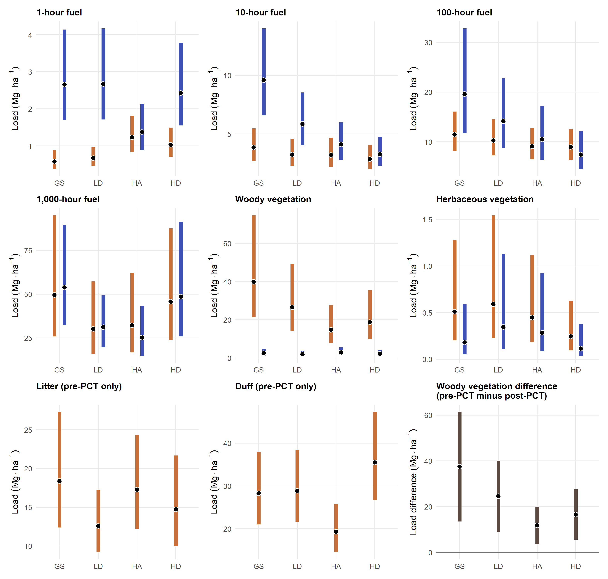



<span id="rd04-record"></span>

This page owns fuel prediction and inference decisions, the figure and companion
table, their source/output review, and the history of replaced display code.
See the [fuel pipeline map](pipeline-fuel.qmd) for the complete sequence.

The figure has been generated from the current
AIC-leading fitted publication models. Its position in the register is an
organizational sequence, not a required execution order relative to RD02 or
RD03.

The [prediction and interpretation review](#rd04-inference-review) below now
compares the thesis and RD04 estimands, demonstrates both prediction
implementations, and records the Methods wording. The figure now uses
random-effect-integrated mean loads throughout and the joint woody phase model
for the displayed pre-minus-post mean change. The completed display and its
model assumptions are recorded below.

## Objective

Produce a compact, reviewable full-inventory figure (and caption) from the
current AIC-leading fitted publication models. Use nine panels: paired pre-/
post-PCT estimates for 1-, 10-, 100-, and 1,000-hour fuels plus woody and
herbaceous vegetation; pre-PCT-only panels for litter and duff; and a separate
matched woody-vegetation-difference panel (pre-PCT minus post-PCT). The figure
must retain uncertainty, retained-overstory treatment context, and the
qualified interpretation of the vegetation-difference estimand.

## Constraints and starting material

The upstream [F01 record](task-f01.qmd#f01-record) supplies component definitions,
saved fitted-model candidates, diagnostics, and provisional leaders. RD04
consumes these artifacts; changes to their derivation or fitting belong in F01.

- Use the saved fitted models identified as AIC leaders in the F01
  model-selection register. Their diagnostic/scientific review remains visible
  through the figure-review decision rather than blocking draft generation.
- Integrate over all fitted random effects for a consistent mean-load
  interpretation, with equal study-site weights. Derive woody mean change
  from the same joint phase model as the woody load panels, retaining its
  pre/post covariance.
- Retain the thesis visual grammar—model estimate point with a colored 95% CI
  range—for the six paired panels. Label pre-PCT-only litter and duff panels
  explicitly; do not imply a post-PCT zero or estimate.
- Plot the matched woody vegetation difference separately with a zero reference
  line. It is an inferred potential surface-fuel contribution, not direct slash
  load, so it must not be styled as another phase estimate.
- Use panel-specific y-scales and a 3 × 3 layout to keep the broad load range
  legible. Keep full model registries, diagnostics, and pairwise comparisons in
  linked artifacts rather than adding them to the figure.

## Suggested deliverables

1. A nine-panel model-estimate figure: six paired phase panels, litter, duff,
   and the matched woody vegetation-difference panel.
2. A publication caption and a short Results paragraph, both marked
   **Pending review** when draft-ready.
3. A linked table or CSV of complete phase-by-treatment model estimates and a
   link to the model-selection register used for the draft.

## Completed output

### Publication execution {#publication-execution}

RD04 inference, audits and display generation use the sole publication
environment: R 4.6.2 with `publication/renv.lock`. The canonical figure, estimates,
saved models and producing provenance are under `publication/outputs/fuel/`.
The scripts retain their prediction, gradient, integration and covariance
verification checks. Model assumptions and final display decisions remain
under their existing scientific review states.

Historical thesis reference calculations belong to the separate thesis export
operation. Publication consumes those exported reference values; it has no
previous-environment replay or retained migration acceptance/difference artifacts.

```{r}
#| label: fig-rd04-fuel-inventory
#| echo: false
#| out-width: "100%"
#| fig-cap: >
#|   RD04 full fuel inventory by retention treatment. Points are
#|   site-standardized mean loads from AIC-leading models, integrated over
#|   all fitted random effects and including modeled zeros; ranges are 95%
#|   confidence intervals for the means. Study sites receive equal weights.
#|   Orange denotes pre-PCT and blue denotes post-PCT for the six components
#|   measured in both phases. Litter and duff are pre-PCT only. The woody
#|   vegetation-difference panel is the pre-PCT minus post-PCT mean contrast
#|   from the joint matched woody phase model, with its pre/post covariance.
#|   It is an inferred potential surface-fuel contribution, not direct slash
#|   load. Panel-specific y-scales are used.


```

Generated artifacts for this review are
`publication/outputs/fuel/figures/rd04-fuel-phase-pct-inventory.png`,
`publication/outputs/fuel/tables/rd04-fuel-model-estimates.csv`, and
`publication/outputs/fuel/manifests/rd04-figure-provenance.yml`.
The figure uses the AIC-leading models documented in the
[F01 model-review register](task-f01.qmd#f01-record). It is also available
[in the working manuscript for review in context](draft-results.qmd#rd04-fuel-inventory-draft).

## Companion estimates table — pending review {#fuel-companion-table}

The table below reformats all 60 displayed estimates and their existing 95%
confidence intervals into 15 component–phase rows, with treatments in the
same order as the figure. It reads the figure's canonical model-estimate CSV
directly; no models or intervals are recalculated. The same table is included in the manuscript supplement. It is a candidate
appendix table; final placement remains a review decision.





The former figure-and-table plan has been merged into this task; this is the
authoritative action record for fuel-display development.

## Implications, handoff, and review state

[RT03](task-rt03.qmd#implemented-source-and-review-decisions) consumes
`rd04-fuel-model-estimates.csv` for narrative values and records its claim-level
wording decisions. [M03](task-m03.qmd) will adapt the Methods wording in the
inference review when its queued work begins. Both should link back here for
the estimand and interval rationale. A change to prediction or uncertainty
requires updating this record and regenerating the figure/CSV before reviewing
dependent narrative claims.

Acceptance requires a consistent mean-load interpretation across panels,
traceability from all 60 estimates to the saved models, preservation of woody
pre/post covariance, and captions that distinguish potential contribution from
measured slash and causal PCT effects. The figure is complete; scientific model
assumptions and final table placement remain under review. The archived stage 06
implementation documents the superseded display, not the current inference target.




