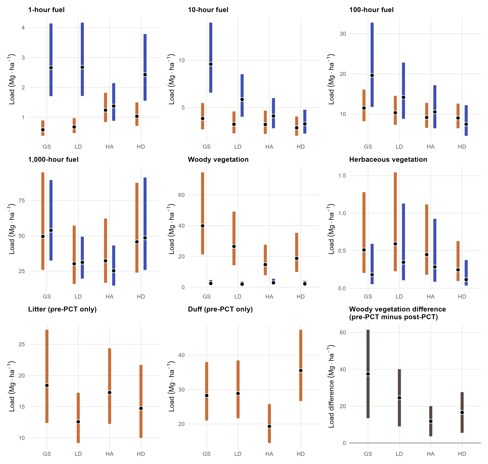

This page is the working index for publication development. Each task is
tracked like a small issue: it begins with an objective and guardrails, records
the decisions and artifacts produced while it is open, and ends either in a
reviewable manuscript product or a completed analytical record. The manuscript
is developed backwards from the results displays: **figures and tables →
results → methods → discussion → introduction → abstract → title**. This order
adapts the “write backwards” approach described by
[Montagnes, Montagnes, and Yang (2022)](https://pmc.ncbi.nlm.nih.gov/articles/PMC10077155/).

## How to use this queue

Each task has a short proposal below it before any work is done. Review and
edit that proposal, then move the task through this sequence:

**Direction for review → Approved to execute → In progress → Pending review →
Accepted (or Revision requested) → Complete.**

“Queued” means the task is deliberately decomposed and ready to be proposed;
it is not yet authorized for execution. “Completed — analytical record” means
the reproducible work is preserved, while a decision explicitly marked
provisional still awaits scientific review. Page targets are working allocations
for the main manuscript, not a journal requirement.

## Task register

This register is both the review checklist and the table of contents for the
task cards. Results displays and their captions come first; each corresponding
Results narrative follows only after its display is accepted. Methods then
document the accepted results, followed by Discussion, Introduction, Abstract,
and Title.

| Order | Task | Status | Proposed target |
|---:|---|---|---|
| 0 | [F-01 — fuel-component separation and model exploration](#f-01) | **Completed — analytical record** | Reproducible component/model record |
| 1 | [R-D04 — fuel phase and PCT display](#r-d04) | **Complete** | Nine-panel figure and model-estimate CSV |
| 2 | [R-D02 — regeneration basal-area/density display](#r-d02) | **Queued** | 1 lead figure; optional compact values table |
| 3 | [R-D03 — sprout-height display](#r-d03) | **Queued** | 1 figure, combined only if readable |
| 4 | [R-T01 — regeneration Results narrative](#r-t01) | **Queued — after R-D02** | 1–2 manuscript pages |
| 5 | [R-T02 — sprout-height Results narrative](#r-t02) | **Queued — after R-D03** | 1–1.5 manuscript pages |
| 6 | [R-T03 — fuel Results narrative](#r-t03) | **Queued — after R-D04** | 1.5–2 manuscript pages |
| 7 | [M-D01 — study design display](#m-d01) | **Queued — Methods stage** | 1 compact figure or table |
| 8 | [M-01 — study area and experimental design](#m-01) | **Queued — after M-D01** | 1–1.5 manuscript pages |
| 9 | [M-02 — regeneration and sprout methods](#m-02) | **Queued — after R-T01/R-T02** | 1–1.5 manuscript pages |
| 10 | [M-03 — fuel methods and estimand](#m-03) | **Queued — after R-T03** | 1–1.5 manuscript pages |
| 11 | [D-01 — regeneration cohort discussion](#d-01) | **Queued — after regeneration Results/Methods** | 1.5–2 manuscript pages |
| 12 | [D-02 — sprout development discussion](#d-02) | **Queued — after sprout Results/Methods** | 1–1.5 manuscript pages |
| 13 | [D-03 — fuels and PCT-management discussion](#d-03) | **Queued — after fuel Results/Methods** | 1.5–2 manuscript pages |
| 14 | [D-04 — limits, integration, and future work](#d-04) | **Queued** | 0.5–1 manuscript page |
| 15 | [I-01 — management problem and study purpose](#i-01) | **Queued — after Discussion** | 1–1.5 manuscript pages |
| 16 | [I-02 — regeneration and retention context](#i-02) | **Queued — after Discussion** | 1–1.5 manuscript pages |
| 17 | [I-03 — fuels context and questions](#i-03) | **Queued — after Discussion** | 1–1.5 manuscript pages |
| 18 | [S-01 — supplement and machine-readable outputs](#s-01) | **Queued — after main displays** | Inventory and links |
| 19 | [C-01 — conclusions](#c-01) | **Queued — after Discussion** | ≤0.5 manuscript page |
| 20 | [A-01 — abstract and title](#a-01) | **Queued — last** | Abstract and final title |

## Fuel-analysis preparation

### F-01 — fuel-component separation and model exploration {#f-01}

**Status: Completed — analytical record.**

#### Original objective and guardrails

Create publication-only fuel components that preserve the thesis analyses while
making the pre- and post-PCT data usable as distinct reference phases. Retain
the fixed experimental-design random-intercept structure; record every model
candidate and diagnostic; do not treat an AIC leader as a selected model.

- Thesis notebooks, raw data, and thesis-era `.rda` objects remain unchanged.
- Pre-PCT litter and duff are separated using the Finney–Martin model-3
  forest-floor partition; post-PCT litter and duff are deliberately omitted
  because their boundary is not currently defensible.
- Woody and herbaceous vegetation are separate in both phases.
- The primary PCT contrast is matched-transect pre-PCT minus post-PCT woody
  standing vegetation—an inferred potential surface-fuel contribution, not a
  direct slash-load measurement.

#### Decisions made

| Decision area | Recorded decision | Why it matters for the publication display |
|---|---|---|
| Reporting phases | Show pre- and post-PCT values as distinct phases. | Avoids treating the contrast as automatically causal. |
| Forest floor | Report modeled litter and duff only before PCT. | Prevents a misleading post-PCT forest-floor estimate. |
| Vegetation | Keep woody and herbaceous components separate. | Allows the PCT-related standing-woody change to remain visible. |
| PCT estimand | Use matched pre minus post woody standing vegetation. | Clearly labels the management contrast and its limitation. |
| Model selection | Preserve all candidates; leaders are provisional pending scientific review. | Keeps model choice auditable instead of hiding it in a final table. |

#### Rendered component dictionary

The generated dictionary below is rendered from the publication artifact, so
the displayed definitions and the downloadable record remain aligned.

```{r}
#| label: tbl-fuel-component-dictionary
#| echo: false
#| warning: false
#| message: false
#| tbl-cap: "Publication fuel-component dictionary generated by F-01."

dictionary <- read.csv(
  "../analysis/outputs/publication/fuel/data/fuel-component-data-dictionary.csv",
  check.names = FALSE
)
knitr::kable(dictionary, format = "html", escape = TRUE)
```

#### Rendered provisional model-review register

These are the generated **provisional AIC leaders**, not chosen final models.
The final column intentionally preserves the review state. See the complete
[model-comparison register](https://github.com/fisher-j/multi-age/blob/5f80aaf/analysis/outputs/publication/fuel/manifests/model-comparison.csv)
and the [candidate-specific diagnostic plots](https://github.com/fisher-j/multi-age/tree/5f80aaf/analysis/outputs/publication/fuel/diagnostics)
when deciding whether to accept, revise, or replace a leader.

```{r}
#| label: tbl-fuel-provisional-models
#| echo: false
#| warning: false
#| message: false
#| tbl-cap: "Provisional AIC-leading fuel models generated by F-01; all remain eligible for scientific review, not final selections."

leaders <- read.csv(
  "../analysis/outputs/publication/fuel/manifests/model-selection-log.csv",
  check.names = FALSE
)
leaders <- leaders[, c("response", "analysis", "provisional_aic_leader",
                       "pd_hessian", "dharma_uniformity_p",
                       "dharma_dispersion_p", "selection_status")]
names(leaders) <- c("Response", "Analysis", "Provisional leader",
                    "PD Hessian", "DHARMa uniformity p",
                    "DHARMa dispersion p", "Status")
knitr::kable(leaders, format = "html", digits = 3, escape = TRUE)
```

#### Generated artifacts and implementation history

| Artifact | Role in review | Location or history |
|---|---|---|
| Component dictionary | Definitions, units, and reporting-phase boundary. | [CSV at the completion commit](https://github.com/fisher-j/multi-age/blob/5f80aaf/analysis/outputs/publication/fuel/data/fuel-component-data-dictionary.csv) |
| Exploration summaries | Raw phase-by-treatment summaries and matched woody PCT contrast. | [Fuel data artifacts](https://github.com/fisher-j/multi-age/tree/5f80aaf/analysis/outputs/publication/fuel/data) |
| Model-selection log | The rendered provisional register above. | [CSV at the completion commit](https://github.com/fisher-j/multi-age/blob/5f80aaf/analysis/outputs/publication/fuel/manifests/model-selection-log.csv) |
| Candidate registry and diagnostics | Full auditable model search. | [Manifests](https://github.com/fisher-j/multi-age/tree/5f80aaf/analysis/outputs/publication/fuel/manifests) · [diagnostics](https://github.com/fisher-j/multi-age/tree/5f80aaf/analysis/outputs/publication/fuel/diagnostics) |
| Reproducible pipeline | Publication-only derivation, exploration, fitting, and evaluation stages. | [Fuel pipeline](https://github.com/fisher-j/multi-age/tree/5f80aaf/analysis/scripts/publication/fuel) |
| Initial derivation | Establishes component derivation and the pairing audit. | [Commit `bde965b`](https://github.com/fisher-j/multi-age/commit/bde965b) |
| Completed exploration and model record | Carries dead-woody classes forward and records all candidates/diagnostics. | [Commit `5f80aaf`](https://github.com/fisher-j/multi-age/commit/5f80aaf) |

## Results displays

### R-D04 — fuel phase and PCT display {#r-d04}

**Status: Complete.** The figure has been generated from the current
AIC-leading fitted publication models. Its position in the register is an
organizational sequence, not a required execution order relative to R-D02 or
R-D03.

The [prediction and interpretation review](#rd04-inference-review) below now
compares the thesis and R-D04 estimands, demonstrates both prediction
implementations, and records the Methods wording. The figure now uses
random-effect-integrated mean loads throughout and the joint woody phase model
for the displayed pre-minus-post mean change. The completed display and its
model assumptions are recorded below.

#### Objective

Produce a compact, reviewable full-inventory figure (and caption) from the
current AIC-leading fitted publication models. Use nine panels: paired pre-/
post-PCT estimates for 1-, 10-, 100-, and 1,000-hour fuels plus woody and
herbaceous vegetation; pre-PCT-only panels for litter and duff; and a separate
matched woody-vegetation-difference panel (pre-PCT minus post-PCT). The figure
must retain uncertainty, retained-overstory treatment context, and the
qualified interpretation of the vegetation-difference estimand.

#### Constraints and starting material

- Use the saved fitted models identified as AIC leaders in the F-01
  model-selection register. Their diagnostic/scientific review remains visible
  through the figure-review decision rather than blocking draft generation.
- Integrate over all fitted random effects for a consistent mean-load
  interpretation, with equal study-site weights. Derive woody mean change
  from the same joint phase model as the woody load panels, retaining its
  pre/post covariance.
- Retain the thesis visual grammar—model estimate point with a colored 95% CI
  range—for the six paired panels. Label pre-PCT-only litter and duff panels
  explicitly; do not imply a post-PCT zero or estimate.
- Plot the matched woody vegetation difference separately with a zero reference
  line. It is an inferred potential surface-fuel contribution, not direct slash
  load, so it must not be styled as another phase estimate.
- Use panel-specific y-scales and a 3 × 3 layout to keep the broad load range
  legible. Keep full model registries, diagnostics, and pairwise comparisons in
  linked artifacts rather than adding them to the figure.

#### Suggested deliverables

1. A nine-panel model-estimate figure: six paired phase panels, litter, duff,
   and the matched woody vegetation-difference panel.
2. A publication caption and a short Results paragraph, both marked
   **Pending review** when draft-ready.
3. A linked table or CSV of complete phase-by-treatment model estimates and a
   link to the model-selection register used for the draft.

#### Completed output

```{r}
#| label: fig-rd04-fuel-inventory
#| echo: false
#| out-width: "100%"
#| fig-cap: >
#|   R-D04 full fuel inventory by retention treatment. Points are
#|   site-standardized mean loads from AIC-leading models, integrated over
#|   all fitted random effects and including modeled zeros; ranges are 95%
#|   confidence intervals for the means. Study sites receive equal weights.
#|   Orange denotes pre-PCT and blue denotes post-PCT for the six components
#|   measured in both phases. Litter and duff are pre-PCT only. The woody
#|   vegetation-difference panel is the pre-PCT minus post-PCT mean contrast
#|   from the joint matched woody phase model, with its pre/post covariance.
#|   It is an inferred potential surface-fuel contribution, not direct slash
#|   load. Panel-specific y-scales are used.


```

Generated artifacts for this review are
`analysis/outputs/publication/fuel/figures/rd04-fuel-phase-pct-inventory.png`,
`analysis/outputs/publication/fuel/tables/rd04-fuel-model-estimates.csv`, and
`analysis/outputs/publication/fuel/manifests/rd04-figure-provenance.yml`.
The figure uses the AIC-leading models documented in the rendered F-01
model-review register above. It is also available
[in the working manuscript for review in context](manuscript.qmd#rd04-fuel-inventory-draft).

<details>
<summary>Show the R-D04 figure-generation code</summary>

```r

```

</details>



The former figure-and-table plan has been merged into this task; this is the
authoritative action record for fuel-display development.

### R-D02 — regeneration basal-area/density display {#r-d02}

**Status: Queued.** **Proposal for review:** simplify the existing
`fig-regen-ba-rw-to` into the lead results display, keeping redwood and tanoak
basal area/density responses to retention. Keep Douglas-fir only as descriptive
context if it changes interpretation; otherwise move it to the supplement.

**Inputs:** thesis Results and `fig-regen-ba-rw-to`. **Review product:** one
main figure, caption, and a decision on whether a compact estimates table adds
information beyond annotations. **Acceptance test:** the display supports the
main retention-response claim without a separate model-output table.

### R-D03 — sprout-height display {#r-d03}

**Status: Queued.** **Proposal for review:** review treatment and temporal/
10-year sprout-height displays together, then retain the smallest set that
preserves the management-relevant message for redwood and tanoak. Combine
panels only when both messages remain legible.

**Inputs:** `fig-sprout-ht-inc-treat`, `fig-sprout-ht-inc-year`, and
`fig-sprout-ht-yr-10` in the thesis Results. **Review product:** selected or
redesigned figure(s), caption(s), and a supplement disposition for the rest.
**Acceptance test:** the retained display distinguishes treatment from time
without repeating the basal-area/density display.

## Results narratives

### R-T01 — regeneration Results narrative {#r-t01}

**Status: Queued — after R-D02 acceptance.** **Proposal for review:** write
the basal-area/density result around the accepted regeneration display: state
the primary redwood response to canopy openness, give concise tanoak context,
and reserve other species for descriptive or supplemental treatment. Do not
introduce interpretation that belongs in the Discussion.

**Review product:** 1–2-page Results subsection linked from the working
[manuscript](manuscript.qmd). **Acceptance test:** every quantitative claim is
visible in an accepted display or linked table.

### R-T02 — sprout-height Results narrative {#r-t02}

**Status: Queued — after R-D03 acceptance.** **Proposal for review:** report
the accepted redwood and tanoak height/time findings in a distinct subsection;
combine it with R-T01 only if one shared display and one take-home message make
the combined result easier to read.

**Review product:** 1–1.5-page Results subsection. **Acceptance test:** it
adds the sprout-development evidence without restating the regeneration
basal-area/density result.

### R-T03 — fuel Results narrative {#r-t03}

**Status: Queued — after R-D04 acceptance.** **Proposal for review:** report
phase-specific fuel conditions as reference values, then describe the qualified
matched woody-standing-vegetation contrast. Retain treatment comparisons only
where the accepted display makes their management role clear.

**Review product:** 1.5–2-page Results subsection, accepted fuel display, and
linked detailed values. **Acceptance test:** it does not imply a direct
slash-load measure or causal PCT effect beyond the reviewed design.

## Methods

### M-D01 — study design display {#m-d01}

**Status: Queued — Methods stage.** **Proposal for review:** retain one
legible study-design display that combines the study area/treatment layout and
sampling logic, if that combination remains readable. Move the second map or
layout to the supplement. It should orient the reader without duplicating the
design table.

**Inputs:** thesis Methods Figures 2.1–2.2 and the current sampling-layout
materials. **Review product:** candidate display, caption, accessibility text,
and supplement disposition. **Acceptance test:** a reader can identify the four
treatments, replication, and measurement phases without consulting the text.

### M-01 — study area and experimental design {#m-01}

**Status: Queued — after M-D01 acceptance.** **Proposal for review:** retain
the study setting, four treatments, replication, measurement timing, and PCT
context needed to understand the accepted results. Use M-D01 and a compact
design table to avoid reproducing procedural detail.

**Review product:** 1–1.5-page Methods subsection plus any compact table.
**Acceptance test:** all variables and phases in accepted displays are
traceable to the design.

### M-02 — regeneration and sprout methods {#m-02}

**Status: Queued — after R-T01/R-T02.** **Proposal for review:** describe only
the regeneration measurements and thesis-derived model/summaries retained in
the accepted displays. Move expanded model specifications, comparisons, and
secondary species detail to the supplement.

**Review product:** 1–1.5-page Methods subsection and supplement links.
**Acceptance test:** a reader can reproduce the reported estimands without
being asked to navigate unused thesis-era analyses.

### M-03 — fuel methods and estimand {#m-03}

**Status: Queued — after R-T03.** **Proposal for review:** document the
publication component definitions, phase boundary, matched woody contrast,
uncertainty/model decision, and limits on causal language. Keep diagnostic
detail in the linked F-01 artifacts and supplement.

**Review product:** 1–1.5-page Methods subsection. **Acceptance test:** the
method wording exactly matches the accepted fuel caption and Results claims.

## Discussion

### D-01 — regeneration cohort discussion {#d-01}

**Status: Queued.** **Proposal for review:** interpret redwood and tanoak
regeneration under retained overstory as evidence about developing a new cohort
in multiaged redwood stands. Tighten the thesis discussion around the accepted
basal-area/density evidence and its uncertainty.

**Review product:** 1.5–2-page Discussion subsection. **Acceptance test:**
each inference follows an accepted Results claim and cited context.

### D-02 — sprout development discussion {#d-02}

**Status: Queued.** **Proposal for review:** connect accepted sprout-height
patterns to light, retention, and cohort development without duplicating D-01.
Combine with D-01 only if the accepted results show one inseparable management
message.

**Review product:** 1–1.5-page subsection. **Acceptance test:** it explains
why the height result matters beyond the basal-area/density result.

### D-03 — fuels and PCT-management discussion {#d-03}

**Status: Queued.** **Proposal for review:** interpret phase-specific fuel
conditions and the matched woody contrast as linked silvicultural, fuels, and
fire-management information. Keep the distinction between inferred potential
surface-fuel contribution and direct slash measurement explicit.

**Review product:** 1.5–2-page subsection. **Acceptance test:** it does not
presume one downstream fire-modeling use or extend beyond the reviewed design.

### D-04 — limits, integration, and future work {#d-04}

**Status: Queued.** **Proposal for review:** close the Discussion with the
limitations that constrain the regeneration and fuel interpretations, then
identify targeted future work without reopening detailed model results.

**Review product:** 0.5–1-page subsection. **Acceptance test:** it resolves
rather than repeats caveats from prior discussion subsections.

## Introduction, supplement, and closing matter

### I-01 — management problem and study purpose {#i-01}

**Status: Queued — after Discussion.** **Proposal for review:** condense the
multiaged-silviculture framing to establish the management problem, then state
the study purpose and scope as supported by the accepted Results/Discussion.

### I-02 — regeneration and retention context {#i-02}

**Status: Queued — after Discussion.** **Proposal for review:** retain only
the sprouting, light, and retention context needed to motivate D-01/D-02;
move broad background not needed for the study question out of the main text.

### I-03 — fuels context and questions {#i-03}

**Status: Queued — after Discussion.** **Proposal for review:** merge and
focus fuel context on phase-specific reference conditions and the PCT question;
avoid broad fire-management claims unsupported by the study.

**Review product for I-01–I-03:** a 4–5-page Introduction with a final,
aligned study-purpose paragraph. **Acceptance test:** its questions are each
answered by an accepted Results subsection.

### S-01 — supplement and machine-readable outputs {#s-01}

**Status: Queued — after main displays.** **Proposal for review:** inventory
every item excluded from the main text: detailed model registry, diagnostics,
pairwise comparisons, optional Douglas-fir detail, expanded fuel components,
and machine-readable phase-specific values. Link each item from its accepted
main-text counterpart.

### C-01 — conclusions {#c-01}

**Status: Queued — after Discussion.** **Proposal for review:** write a short
conclusion limited to the management implications directly supported by the
accepted regeneration, sprout, and fuel results.

### A-01 — abstract and title {#a-01}

**Status: Queued — last.** **Proposal for review:** draft the abstract from
the accepted results, methods, discussion, and conclusion; set the final title
only after the abstract has stabilized. This preserves the backwards-writing
sequence above.

## Reference and archive boundaries

The [working manuscript](manuscript.qmd) is the only draft assembly point.
This page supersedes the former fuel-analysis specification, editorial log,
content plan, compression map, and figure/table plan for current task status,
review links, and the next action. Their source files remain in repository
history, while the relevant decisions and boundaries are retained above.
